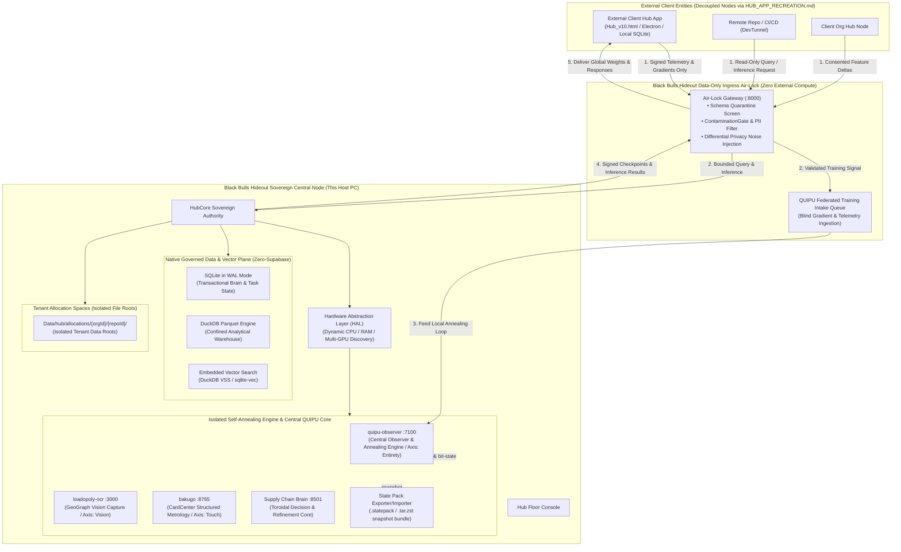
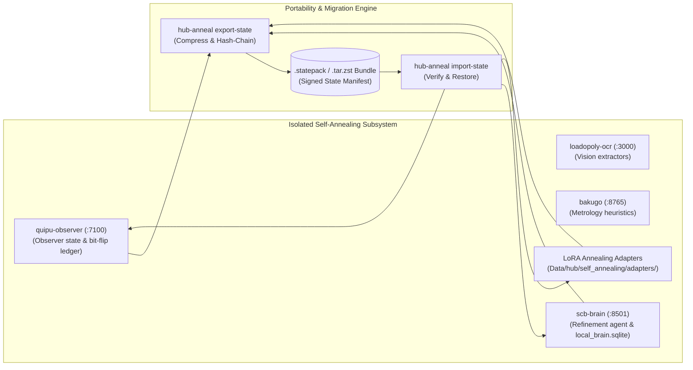
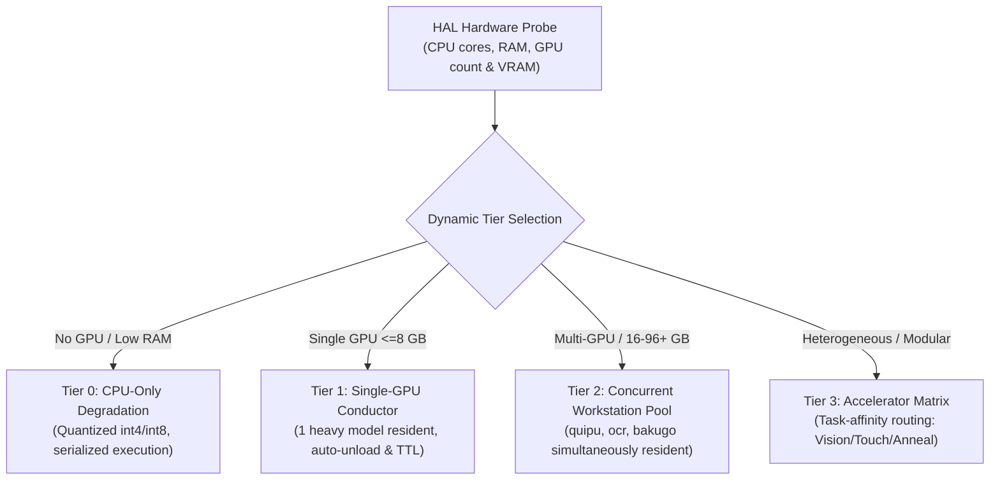
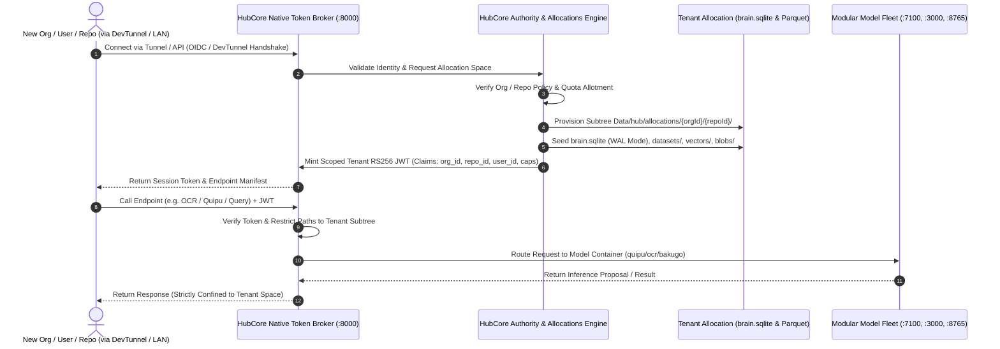
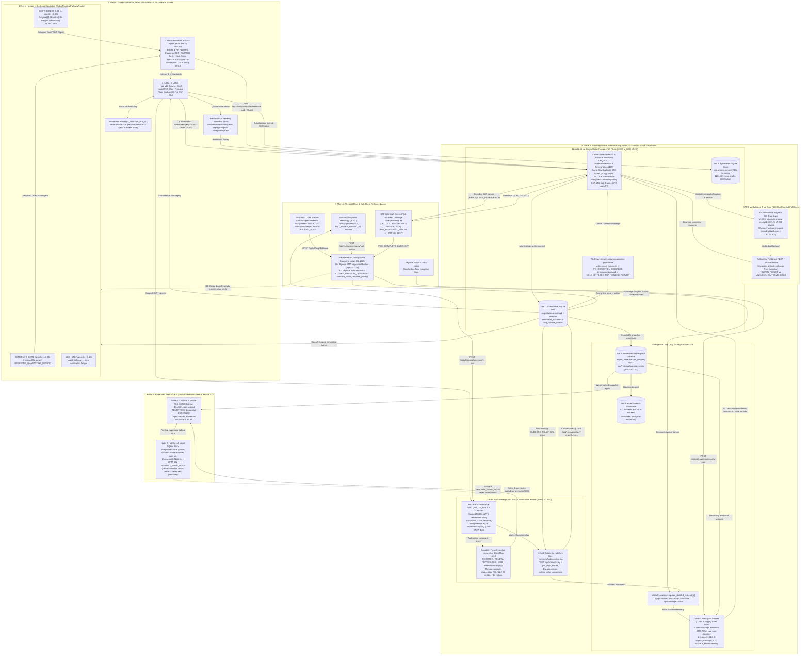

# {{hubName}} v10 - Complete Recreation and One-Year DevOps Guide

Status: canonical v10 design candidate  
Prepared: 2026-08-22  
Delivery window: September 2026 through August 2027  
Normative terms: **MUST**, **MUST NOT**, **SHOULD**, and **MAY** are used as defined by RFC 2119.

This document integrates two independent v9 design lineages and the Tri-Repo Mesh federation lineage into one implementable v10 specification:

- The product-first lineage: Admin-gated setup, two user-facing applications, organization-neutral generation, Seven Chains, module SDK, ToolForge, Provider Studio, graded advisor workflows, the Expert, {{virtualPersona}}, and a <=4 GB VRAM runtime.
- The control-and-data lineage: Interior Worker, durable bus semantics, held external results, Hub Floor bridge, HubCore authority, formal UAT/PROD promotion, read-only data APIs, merge-safe manifests, partition correctness, and data governance.
- The federation lineage: closed-loop vision/touch training, observer-engine annealing, the tenancy firewall and contamination ladder, and cross-organization improvement without pooled raw data (Part 21).

Source provenance is retained by SHA-256 rather than deployment-specific paths:

| Source | SHA-256 | Contribution |
|---|---|---|
| Product-first v9 guide | `FFFF9307A3359B96F97D1B0A882214B6C8F5BB962AE657EE11751494089062CF` | Product generation, configuration, modules, advisor, Expert, AI runtime, provider tooling |
| Control/data v9 guide | `719CFCBDEAA605765CC3036549E7E8839B04B3412727B6410099C45E72314A8C` | Worker contracts, held-result governance, release authority, data plane, acceptance checks |
| Tri-Repo Mesh release walkthrough | repo commits `4170fc4`, `c6c1f8a`, `d3afd12`, `b88a76d` | Federation reference implementations, closed-loop training, tenancy firewall, contamination ladder (Part 21) |

## Part 0 - Document Authority and Product Rules

### 0.1 Precedence

This file is the v10 source of truth. Historical v7-v9 names and contracts are migration inputs, not current product names. Where a migrated contract conflicts with this guide, the v10 rule wins unless an approved Architecture Decision Record (ADR) says otherwise.

Every normative implementation requirement SHOULD receive an identifier in the form `V10-<DOMAIN>-<NUMBER>`, an owner, an automated verification method, and an evidence location. Examples in this document establish the initial requirement set.

### 0.2 Brand and identity tokens

No organization name, person name, tenant URL, site path, email domain, application portfolio, or secret is compiled into the product. All display identity comes from configuration.

| Token | Meaning |
|---|---|
| `{{orgName}}` | Organization display name |
| `{{hubName}}` | Generated Hub product name |
| `{{askPersona}}` | Display label for the advisor and bound human administrator |
| `{{virtualPersona}}` | Synthetic assistant display name |
| `{{libraryRoot}}` | Configured application-library root |
| `{{specialistId}}` | Configured external-worker role slot, never a built-in person |
| `{{dataRightsHolder}}` | Configured legal identity holding data-collection and external-sharing consent authority |
| `{{meshOperator}}` | Configured legal identity operating the cross-organization federation aggregator (Part 21) |

`V10-ID-001`: Release builds MUST fail when a deployment-specific forbidden-string list is found in source, generated files, scripts, tests, documentation, package metadata, or integration definitions.

`V10-ID-002`: Historical records MUST retain immutable actor IDs. A display-name change relabels current UI only and MUST NOT rewrite audit, task, receipt, consent, or Expert records.

### 0.3 Reconciled architectural decisions

1. **Two user-facing applications, one authority.** The generated Hub serves users. Hub Floor is the optional reference Admin and external-worker application. HubCore owns canonical task, audit, data-access, and release state for both.
2. **Floor remains external.** Hub Floor is never bundled into the generated Hub and can be replaced by any worker implementation that passes the same contracts.
3. **Admin-gated genesis is a deployment mode.** A new managed deployment starts in Floor's Setup Wizard and generates the Hub only after governance is configured. An existing Hub may migrate in place and attach to Floor later.
4. **Portable output, modular source.** The browser experience is still emitted as `Hub_v10.html`, but hand-maintained source is modular, typed, tested, and reproducibly bundled. The Electron shell and web explorer host the same generated UI.
5. **Configuration is split by ownership.** Identity, workspace, modules, and secrets are not mixed in one monolithic file.
6. **The library is not a secret store.** Synced files may carry public connection metadata and certificate fingerprints, but never API keys, bearer tokens, browser profiles, private keys, or shared signing secrets.
7. **Files remain the data source of truth.** Dataset manifests are derived, merge-only indexes with a deterministic `reindex` repair path.
8. **External results are proposals.** Every external result is held. Acceptance means accepted for internal validation, never UAT-confirmed or PROD-published.
9. **At-least-once transport is explicit.** Idempotency, deduplication, stale-version rejection, replay, quarantine, and durable inbox/outbox storage are product behavior.
10. **AI cannot acquire authority.** Expert learning may improve routing, language, retrieval, and coaching, but cannot widen roles, task kinds, file access, autonomy, or release gates.
11. **One heavy model at a time.** Every supported local profile MUST remain functional at <=4 GB physical VRAM, with a CPU-only degradation path.
12. **Production behavior is measurable.** Security, data correctness, reliability, advisor quality, privacy, and resource use have executable release gates and SLOs.
13. **Federation never moves raw data.** Cross-organization learning (Part 21) exchanges only consent-tiered, decision-recorded distilled artifacts outbound and signed model packs inbound; organization partitions remain unaddressable across deployments.

### 0.3.1 Implementation status (v10.1)

The reference implementation of HubCore lives in `services/hubcore/`. This table
maps each normative area to the module that implements it and the test file that
holds it to the contract, so a reader can check a claim rather than take it.

| Area | Module | Contract tests |
|---|---|---|
| Configuration ownership and brand-token resolution (Part 2.1, 0.2) | `config.py` | `test_browser_contract.py` |
| Endpoint registry, health probes, bind audit (Part 11.2) | `endpoints.py` | `test_browser_contract.py` |
| Hardware Abstraction Layer (Part 11.3) | `hal.py` | `test_hal.py` |
| Tenant allocation confinement (Part 12.5) | `allocations.py` | `test_allocations.py` |
| Scoped token minting (Part 12.5.3) | `token_broker.py` | `test_token_broker.py` |
| Data-only ingress air-lock (Part 1.3) | `airlock.py`, `server.py` | `test_airlock.py` |
| Task lifecycle and held results (Part 4, 5) | `tasks.py` | `test_tasks_and_bus.py` |
| Governed retrieval corpus (Part 9.5) | `corpus.py` | `test_advisor_pipeline.py` |
| Advisor pipeline and grade matrix (Part 9) | `advisor.py` | `test_advisor_pipeline.py` |
| Expert ledger (Part 10.1) | `expert.py` | `test_advisor_and_expert.py` |
| v-ADMIN, the disclosed virtual Admin (Part 10.4) | `vadmin.py` | `test_advisor_pipeline.py` |
| Generated Hub application (Part 2.4) | `generator.py` | `test_browser_contract.py` |
| Child hubs and bounded sessions (Part 5, 21) | `tunnels.py` | `test_tunnels_and_children.py` |
| Federation coordinator (Part 21) | `federation.py` | `test_federation.py` |
| Annealing seam and axis registry (Part 11.2.6) | `annealing.py` | `test_annealing_seam.py` |
| Touch-to-Space metrology bridge (Part 11.2.7) | `spatial.py` | `test_spatial_bridge.py` |
| GARD marketplace and hub scope confinement (Part 12.6) | `services/marketplace/` | `test_gard_marketplace.py`, `test_browser_contract.py` |
| Analytical lakehouse, blob store, tier split (Part 7.9) | `services/marketplace/lakehouse.py` | `test_lakehouse.py` |
| Marketplace ownership and the air-lock proxy (Part 12.7) | `services/hubcore/marketplace_client.py` | `test_browser_contract.py` |
| Route authorization and the role ladder (Part 23.2) | `services/hubcore/authz.py` | `test_authorization.py` |

`V10-DOC-001`: A normative area listed here MUST name a module and at least one
executable test. An area with no test is a design note, not a delivered contract,
and MUST be marked as such rather than described in the present tense.

### 0.3.2 Requirement identifiers asserted by the implementation

`V10-DOC-001` requires every normative area to name a module and a test. The
converse also holds, and was not being met: several modules cited requirement
identifiers that this document had never defined, which makes a citation
unverifiable. They are stated here.

| ID | Requirement | Module |
|---|---|---|
| `V10-TSK-001` | Task states follow an explicit state machine, and external worker results are held for internal acceptance before UAT or PROD promotion. | `tasks.py` |
| `V10-ADV-001` | Every advisor request is validated, persisted, graded, answered only from retrieved evidence, gated by the human review its grade demands, and closed with a reason and a complete audit trail. | `advisor.py` |
| `V10-EXP-001` | The Expert records learning events in an append-only ledger. Learning cannot widen roles, grant release authority, or rewrite audit history. | `expert.py` |
| `V10-GEN-001` | The generated Hub is emitted as a self-contained single file, stamped with deployment branding and the declared fleet, and wired to HubCore for everything that is a status rather than a configuration. | `generator.py` |
| `V10-DAT-001` | The data plane uses SQLite WAL for transactions and DuckDB over Parquet for analytical workloads. | `dataplane.py`, `lakehouse.py` |
| `V10-REL-001` | A release candidate is promoted from UAT to PROD only with a recorded actor, an immutable digest, and retained evidence. | `releaser.py` |
| `V10-BUS-001` | Message transport is durable and at-least-once: an inbox and outbox persist across restart, and duplicate delivery cannot create duplicate effects. | `bus.py` |
| `V10-COM-001` | Comms capabilities are consent-gated per user, and a capability disabled at organization level cannot be granted to anyone. | `comms.py` |
| `V10-PRV-001` | Every registered model provider declares its VRAM cost, and no provider may exceed the heavy-model budget the HAL derived for this host. | `providers.py` |
| `V10-TUN-001` | Child hubs and external worker nodes attach through authenticated tunnels, and remote sessions stay bounded within the application perimeter. | `tunnels.py` |

### 0.4 Goals and non-goals

v10 goals:

- Recreate all valuable v9 behavior without preserving v9's accidental coupling.
- Make local, synced-folder, managed-workstation, shared-service, and air-gapped profiles contract-compatible.
- Prevent silent data corruption, unauthorized promotion, duplicate side effects, unconsented learning, and organization leakage.
- Support safe migration and rollback without rewriting historical IDs.
- Deliver a production-ready release over twelve monthly increments.

v10 non-goals:

- Floor does not become an in-process Hub plugin.
- The renderer does not receive unrestricted Node, filesystem, DuckDB, model, or release access.
- ToolForge does not publish directly to PROD.
- Browser automation is not treated as equivalent to an official provider API.
- The Expert does not perform online self-modification.
- v10 does not require a GPU, a cloud provider, or a specific identity provider.

---

## Part 1 - Product Model and System Context

### 1.1 Product surfaces and Black Bulls Hideout Sovereign Central Node

**Black Bulls Hideout (this PC)** serves as the **Sovereign Central Node, QUIPU Observer, and Core Annealing Aggregator**. External organizations, client repositories, and remote users **MUST NOT** be granted direct compute, terminal, container, or filesystem execution access to Black Bulls Hideout. Instead, all external interactions operate through a **Data-Only Air-Lock & Blind Training Membrane**. 

External entities build, run, and customize their own client-side applications according to [`HUB_APP_RECREATION.md`](file:///C:/Users/agard/Downloads/HUB_APP_RECREATION.md), sending only schema-validated interaction telemetry, feature vectors, and differential gradient tensors to train the central QUIPU model.

| Surface | Audience | Responsibility | Authority |
|---|---|---|---|
| Black Bulls Hideout Core | Local host process & administrator | Sovereign central orchestration, policy, audit, model annealing, QUIPU training aggregator | Sovereign system authority |
| External Client Hub Apps ([`HUB_APP_RECREATION.md`](file:///C:/Users/agard/Downloads/HUB_APP_RECREATION.md)) | External users, client orgs, remote repos | Seven Chains, modules, Comms, Ask, local client SQLite, local browser UI | Local client authority; Zero compute on Hideout |
| Data-Only Ingress Air-Lock | External clients & federation mesh | Blind quarantine screen, ContaminationGate, PII scrub, differential privacy noise injection | Stateless intake gatekeeper |
| Hub Floor | Admin, worker operators, reviewers | Setup, worker supervision, held-result review, advisor operations, Provider Studio | External worker plus authorized HubCore client |
| `hub-ai` & Modular Compute Fleet | Hideout HubCore through authenticated adapter | Local containerized inference, dynamic hardware scaling across CPU/RAM/GPU upgrades, STT, TTS, VLM | No business or release authority |
| Isolated Self-Annealing Engine | HubCore & Mesh Coordinator | Cognitive state observation (`quipu-observer`), structured metrology (`bakugo`), vision OCR (`loadopoly-ocr`), and learning rings (`scb-brain`) | Isolated, modular, transferable state packs |
| Native Governed Data Plane | Modules, HubCore, external workloads | Embedded SQLite WAL (`local_brain.sqlite`), DuckDB Parquet engine, embedded vector index, local blob storage | Read-only / Tenant-confined filesystem roots |
| StockOpoly (`space` axis) | Warehouse operators, slotting automation | Photo-derived dimension solving, 3D location space with travel costs, current-to-future-state slotting and migration plans | Local engine authority; no business or release authority |
| GARD Marketplace | Web3 shard and NFT records, Hub Floor allocations | Central store for tokenized assets, shard ownership, royalty distribution, and organization-internal supply-chain shards | Sole owner of marketplace state; reachable only on the internal bridge |
| Application library & Allocation Spaces | Authorized members, tenants, release automation | PROD/UAT/Archive artifacts and bounded shared state partitioned by Org/Repo/User | Filesystem permissions plus HubCore policy |

### 1.2 System context



### 1.3 Trust zones and Zero External Compute Invariant

1. **Zero External Compute Invariant:** External entities (users, client orgs, third-party developers, remote workers) **MUST NEVER** be granted compute execution, remote shells, container execution, or direct DB/filesystem handles on Black Bulls Hideout. All ingress to Hideout is strictly **Data-Only** (signed JSON/Parquet feature vectors, differential gradient deltas, telemetry events, and query parameters).
2. **Data-Only Ingress Air-Lock zone:** Stateless validation membrane. Rejects all executable code, invalid schemas, unverified signatures, and unconsented PII before queueing data for QUIPU training.
3. **Renderer zone:** untrusted presentation. No raw filesystem, database path, provider secret, or release credential.
4. **HubCore zone:** sovereign policy enforcement, native token broker, and canonical state. All commands are authenticated, authorized, schema-validated, and audited.
5. **Library & Allocation zone:** shared application artifacts and bounded tenant data. Access is strictly partitioned by `(orgId, siteId, deviceId, repoId, userId)` composite tenancy keys within zero-trust filesystem subtrees.
6. **Compute & Model zone:** containerized and local models managed by the Hardware Abstraction Layer. Endpoints operate in isolated Docker bridge networks and are accessed exclusively through authenticated HubCore adapters.
7. **Self-Annealing State & Portability zone:** self-contained cognitive state files, bit-flip ledgers, and LoRA adapters exportable into transferable state packs.
8. **Build/release zone:** protected CI identities, signing material, promotion controls, and immutable evidence.

### 1.4 Bounded contexts

HubCore is composed from bounded contexts with explicit APIs and events:

- Organization Configuration
- Workspace and Library Catalog
- Tenant Allocation and Ingress Broker
- Chain and Module Registry
- Task Orchestration
- Worker Registry and Bridge
- Proposal Review
- Validation and Release
- Data Catalog and Query
- Comms and Advisor
- Process Capture and Consent
- Expert and Knowledge Governance
- Model Runtime and Provider Registry
- Scheduler
- Identity and Policy
- Audit and Operations

A bounded context owns its mutable state. Cross-context database writes are forbidden; communication uses commands, queries, or versioned events.

### 1.5 Deployment profiles

| Profile | HubCore | Transport | Identity | Durability target |
|---|---|---|---|---|
| Portable local | Electron main process | Local file bus | Local OS user | Atomic local files |
| Local Edge Mesh Host (Current PC) | Local service / Docker mesh | Loopback service + Docker network (:7100, :3000, :8765, :54321, :54322) | Scoped tenant JWT + OS identity | PostgreSQL WAL + Atomic local files + Backup |
| Managed workstation | Local service | Loopback service plus file seam | OS identity or local OIDC broker | Local database plus backup |
| Shared authenticated service | Container/service host | HTTPS and event transport | OIDC/OAuth 2.1 | Managed database/object storage |
| Air-gapped/CPU-only | Local service | File seam | Local roles | Local encrypted backup |
| CI ephemeral | Test process | In-memory/test filesystem | Synthetic identities | Disposable fixtures |

All profiles implement the same schemas, state machines, authority boundaries, and test suite. Only transport, identity adapter, storage adapter, and SLO tier vary.

#### 1.5.1 One stack, one project, one network

`V10-DEP-001`: On a containerized profile, every fleet member declared in
`hub_workspace.json` that ships as a container MUST be defined in a **single**
compose project at the workspace root, on a single user-defined network.

This is not tidiness. HubCore resolves a fleet member by the `serviceHost` name
its endpoint descriptor declares (§11.2.1). A service started from a sibling
repository's own compose file joins a different project network, where that name
does not resolve -- so HubCore reports the endpoint unreachable while the
container is plainly running, and the operator is left holding two contradictory
truths. The reference stack is `docker-compose.yml` with `name: hideout`.

`V10-DEP-002`: Durable fleet volumes MUST be pinned by explicit name rather than
derived from the compose project name. A project rename would otherwise attach a
brand-new empty volume and silently discard the annealing brain and tenant
databases.

`V10-DEP-003`: Every public ingress tunnel MUST be declared behind its own named
compose profile, off by default, and named for the single surface it exposes.
A tunnel that publishes the sovereign air-lock itself MUST be distinguishable at
a glance from one that publishes an application surface.

---

## Part 2 - Configuration, Setup, and Generated Hub

### 2.1 Configuration files

`hub_org.json` owns public organization and experience configuration:

```json
{
  "schemaVersion": 10,
  "orgId": "immutable-id",
  "orgName": "",
  "hubName": "",
  "askPersona": "",
  "virtualPersona": "",
  "theme": {
    "accent": "#006B5E",
    "mode": "system",
    "logo": "Data/hub/branding/logo.png"
  },
  "admin": {
    "subjectId": "immutable-id",
    "displayName": ""
  },
  "chains": [],
  "capabilities": {
    "comms": true,
    "processStudio": true,
    "screen": false,
    "voice": false,
    "video": false
  },
  "providerRefs": []
}
```

`hub_workspace.json` owns locations, datasets, workers, transport, server references, modular model endpoints, dynamic hardware scaling, and multi-tenant allocation spaces:

```json
{
  "schemaVersion": 10,
  "workspaceId": "immutable-id",
  "library": {
    "kind": "sharepoint | onedrive | local",
    "url": null,
    "localMirror": "",
    "prod": "PROD",
    "uat": "UAT",
    "archive": "Archive",
    "hubData": "Data/hub"
  },
  "transport": {
    "mode": "file | service",
    "endpoint": null
  },
  "hardware": {
    "autoDetect": true,
    "profile": "auto | cpu-only | single-gpu | multi-gpu | accelerator-pool",
    "vramHeadroomMb": 1024,
    "allowConcurrentResident": true,
    "deviceOverrides": {}
  },
  "selfAnnealing": {
    "isolated": true,
    "stateDirectory": "Data/hub/self_annealing",
    "statePackFormat": "v1-tar-zst",
    "autoCheckpointHours": 24,
    "transferable": true
  },
  "endpoints": {
    "observer": {
      "id": "quipu-observer",
      "port": 7100,
      "protocol": "http",
      "healthPath": "/health",
      "axis": "entirety",
      "role": "cognitive-observer-and-annealer"
    },
    "visionCapture": {
      "id": "loadopoly-ocr",
      "port": 3000,
      "protocol": "http",
      "healthPath": "/",
      "axis": "vision",
      "role": "unstructured-ocr-and-capture"
    },
    "structuredMetrology": {
      "id": "bakugo",
      "port": 8765,
      "protocol": "http",
      "healthPath": "/holders",
      "axis": "touch",
      "role": "cardcenter-structured-metrology"
    },
    "decisionEngine": {
      "id": "scb-brain",
      "port": 8501,
      "protocol": "http",
      "healthPath": "/_stcore/health",
      "role": "supply-chain-architect-decision-core"
    },
    "warehouseEngine": {
      "id": "stockopoly",
      "port": 8181,
      "protocol": "http",
      "healthPath": "/api/status",
      "role": "warehouse-inventory-engine"
    },
    "portal": {
      "id": "loadopoly-portal",
      "port": 9080,
      "protocol": "http",
      "healthPath": "/index.html",
      "role": "unified-portal-gateway"
    },
    "tokenBroker": {
      "id": "hubcore-token-broker",
      "port": 8000,
      "protocol": "http",
      "healthPath": "/health",
      "role": "native-token-minting-and-tenant-router"
    }
  },
  "tunnels": {
    "devTunnel": {
      "id": "roadd-5wd1nh3",
      "type": "vscode-remote",
      "enabled": true
    },
    "ingressTunnels": [
      { "id": "bakugo-quicktunnel", "targetPort": 8765, "provider": "cloudflare" },
      { "id": "loadopoly-cloudflared", "targetPort": 3000, "provider": "cloudflare" }
    ]
  },
  "allocationSpaces": {
    "root": "Data/hub/allocations",
    "enforceQuotas": true,
    "defaultQuotaMb": 51200,
    "isolationMode": "strict-subpath-confinement",
    "tenants": {}
  },
  "workers": [],
  "shared": {
    "datasets": {}
  }
}
```

`hub_modules.json` owns the module registry. Machine-local `%APPDATA%/HubCore/workspace.json` points to the active workspace. Provider credentials, browser profiles, private keys, and refresh tokens remain in the OS secret store or a managed secret service.

`V10-CFG-001`: Configuration writes MUST be schema-validated, atomic, versioned, backed up, and audit-logged.

`V10-CFG-002`: Setup MUST be idempotent. Re-running it changes only selected values and MUST preserve immutable IDs, task history, receipts, consent history, and release evidence.

`V10-CFG-003`: Every connected endpoint and tenant allocation space MUST declare an immutable descriptor, health check probe, and authorization realm. Missing or failing endpoints fail closed during startup.

### 2.2 Library contract

```text
{{libraryRoot}}/
  PROD/                 canonical, unversioned active applications
  UAT/                  versioned candidates only
  Archive/              immutable release evidence and retired digests
  Data/
    hub/                 bounded Hub/Floor shared state
      inbox/
      outbox/
      audit/
      process_studio/
      experience/
      branding/
      self_annealing/    isolated self-annealing subsystem
        quipu_state.json cognitive observer state & bit-flip history
        local_brain.sqlite toroidal refinement & learning log (WAL mode)
        adapters/        locally annealed LoRA weights
        statepacks/      transferable .statepack export archives
      allocations/       multi-tenant isolated spaces
        {orgId}/
          config.json    org-level policy and quota bindings
          users/
            {userId}/    user private workspace and session state
          {repoId}/      repository-scoped allocation space
            brain.sqlite tenant-scoped task and audit store (WAL mode)
            datasets/    tenant DuckDB Parquet storage
            vectors/     embedded vector indexes
            blobs/       tenant capture and document storage
            artifacts/   repo-scoped candidate packages
```

The resolved root is canonicalized before use. Path traversal, alternate data streams, device paths, and symlink/junction escape outside the root are rejected.

PROD is read-only to users, workers, ToolForge, and models. Only the internal release identity may promote a validated digest. Archive is append-only to release automation. Floor writes only its configured `Data/hub` subtrees. Tenant workloads write strictly within their verified `Data/hub/allocations/{orgId}/{repoId}/` path.

### 2.3 Setup Wizard

In managed-genesis mode, Hub Floor installs first and hosts the wizard. In migration mode, an authorized Hub administrator may invoke the same workflow from Hub settings. Both call the same HubCore commands.

1. **Identity:** set organization and product labels, persona labels, immutable admin subject, theme, and logo.
2. **Library:** select SharePoint, OneDrive, or local; resolve its local mirror; verify permissions; create or validate the folder contract.
3. **Chains:** configure exactly seven chain slots and map discovered PROD applications. The neutral default is Orchestrate, Plan, Order, Source, Transform, Fulfill, Return; labels and icons are editable.
4. **Modules:** discover manifests, enable or disable navigation, assign chains, and report unsigned or incompatible modules.
5. **Floor and roster:** register zero or more external workers and specialist role slots. No built-in person or application routing is assumed.
6. **Comms and consent:** configure communication adapters and default retention; capabilities remain disabled until each user grants modality-specific consent.
7. **Hardware discovery & AI fleet:** probe host CPU/RAM/GPU topology via Hardware Abstraction Layer, detect accelerators, calibrate Conductor profiles, probe native Docker model endpoints (`quipu-observer:7100`, `loadopoly-ocr:3000`, `bakugo:8765`), and verify tunnels.
8. **Self-annealing & tenant allocation setup:** initialize isolated `Data/hub/self_annealing/` and `Data/hub/allocations/`, verify directory confinement and quota policies, and register initial Organization, User, and Repository descriptors with native token bindings.
9. **Review and generate:** show a complete change set, validate, write configuration, generate signed Hub artifacts, and record setup evidence.

A failed step does not partially apply. The wizard stores a resumable draft outside canonical configuration and commits only after the final validation transaction.

### 2.4 Generated artifacts

The build emits:

- `Hub_v10.html`: portable browser experience.
- Electron installer and portable package.
- OCI images for HubCore and optional local AI runtime.
- Configuration and module JSON Schemas.
- Migration utility and rollback manifest.
- SBOM, provenance, checksums, signatures, and release notes.

A managed setup stamps only non-secret deployment configuration into the generated Hub package. Runtime secrets are resolved after authentication.

Generation stages desktop artifacts under `UAT/Desktop/`; it never writes them directly to PROD. After the normal validation and release gates, the Releaser atomically promotes the signed installer, portable package, checksum sidecars, and signed `latest.json` into `PROD/Desktop/`. Users with library access can install from that location, and optional auto-update accepts only a digest and signature already present in release evidence.

---

## Part 3 - Seven Chains, Modules, and ToolForge

### 3.1 Seven-Chains experience

The Chain Rail is the primary navigation and always renders seven configured nodes. Each node rolls up module health, data freshness, held proposals, open advisor requests, and release warnings. Selecting a node opens an unframed board of module tiles; disabled modules disappear from navigation but retain data and registration history.

The shell includes keyboard navigation, command palette, deep links, responsive desktop/mobile layout, `prefers-reduced-motion`, and WCAG 2.2 AA. Dynamic labels cannot resize fixed-format controls or overlap adjacent content.

### 3.2 Module manifest

Each module ships a `module.json` beside its entry point:

```json
{
  "manifestVersion": 2,
  "moduleId": "stable-neutral-id",
  "name": "Display name",
  "version": "1.0.0",
  "entrypoint": "Module.html",
  "chainId": "source",
  "capabilities": ["dashboard", "data.read", "comms", "ask"],
  "dataContracts": [],
  "permissions": [],
  "integrity": {
    "sha256": "",
    "signatureRef": ""
  }
}
```

Discovery validates schema, signature, entrypoint digest, compatibility range, and requested capabilities. A module receives no undeclared capability.

### 3.3 HubCore SDK

Generated modules use a narrow, versioned bridge:

```text
HubCore.identity.getPublicProfile()
HubCore.modules.getContext()
HubCore.data.listTables()
HubCore.data.query(readOnlyRequest)
HubCore.bus.publish(allowedTopic, payload)
HubCore.ask.open(context)
HubCore.capture.request(consentBoundOptions)
HubCore.audit.recordAllowed(event)
```

The SDK exposes no raw secret, database connection, unrestricted SQL engine, release credential, shell, or arbitrary filesystem handle. Every call has payload and response limits.

### 3.4 ToolForge

ToolForge creates modules from signed templates and a schema-guided wizard. It supports dashboards, quality trackers, delivery trackers, process capture, Comms, and generic data-grid patterns without embedding organization identity.

Output is always staged as a versioned candidate under UAT with:

- Module source and generated single-file entrypoint.
- Manifest, JSON Schema, dataset seed, tests, and template provenance.
- Dependency lock, SBOM fragment, checksums, and scan results.
- Disabled registry proposal pending validation and release.

`V10-MOD-001`: ToolForge MUST NOT possess a PROD or Archive write path.

`V10-MOD-002`: A repeated generation MUST use a collision-safe candidate version and MUST NOT overwrite previous UAT evidence.

`V10-MOD-003`: UAT retention and cleanup are policy-driven; deletion requires evidence retention and audit.

---

## Part 4 - Control Plane, Events, and State Machines

### 4.1 Event envelope v2

The local `hub_bus.json` transport remains a compatibility adapter. Canonical events use this envelope over file or service transports:

```json
{
  "specVersion": "2.0",
  "id": "uuidv7",
  "type": "worker.task.result",
  "typeVersion": 2,
  "source": "worker/stable-worker-id",
  "subject": "task/stable-task-id",
  "time": "2026-08-22T00:00:00Z",
  "correlationId": "uuid",
  "causationId": "uuid",
  "traceparent": "00-trace-parent",
  "actor": {
    "kind": "workload",
    "id": "stable-worker-id"
  },
  "recipient": "hubcore",
  "aggregateVersion": 7,
  "idempotencyKey": "stable-operation-key",
  "schemaRef": "contracts/worker-task-result/v2.json",
  "contentHash": "sha256:value",
  "classification": "internal",
  "data": {}
}
```

Delivery is at least once. Ordering is guaranteed only per aggregate. Dedupe uses `(source, id)`; commands also use `idempotencyKey`. Aggregate versions reject stale transitions. Durable inbox/outbox records commit with state changes. Replay preserves original IDs. Poison events enter quarantine with redacted diagnostics and an operator disposition.

### 4.2 Canonical topics

```text
worker.task.requested
worker.task.claimed
worker.task.result
worker.proposal.held
worker.task.decision
worker.proposal.accepted
validation.completed
release.promoted
release.rolled-back
advisor.request
advisor.graded
advisor.admin.review
advisor.response.final
advisor.followup
scheduler.meeting.requested
dataset.build.completed
dataset.activated
federation.export.candidate
federation.export.decision
federation.export.released
federation.checkpoint.available
```

Legacy `ask.*` topics are accepted only through a versioned adapter and are never emitted by native v10 components.

### 4.3 Task request

```json
{
  "contract": "worker-task-request/v2",
  "taskId": "stable-id",
  "kind": "registered-task-kind",
  "targetWorker": "stable-worker-id",
  "appId": "stable-module-id",
  "request": "bounded request text",
  "allowedOperations": ["analyze", "generate-proposal", "generate-tests"],
  "expectedOutput": "worker-task-result/v2",
  "deadline": "2026-08-23T00:00:00Z",
  "classification": "internal"
}
```

Task kinds come from a signed registry. Unknown kinds, operations, schemas, targets, classifications, or oversized payloads fail closed.

The initial v10 registry preserves the useful v8-v9 vocabulary while allowing deployments to disable kinds they do not operate:

| Group | Initial task kinds |
|---|---|
| Application engineering | `application-review`, `application-recreation`, `diff-analysis`, `schema-compatibility`, `endpoint-conformance`, `regression-analysis` |
| Validation and assurance | `uat-test-generation`, `security-review`, `governance-gap-analysis`, `documentation-generation` |
| Process Studio | `process-guide-recreation`, `sop-draft-generation`, `process-studio-app-review`, `process-studio-plugin-proposal` |
| Floor operations | `floor-app-triage`, `floor-defect-review`, `floor-release-preparation`, `floor-doc-refresh`, `floor-meeting-summary` |
| Research and coordination | `research-request`, `consensus-request` |

Registration declares the exact allowed operations, input/output schema versions, data classifications, timeout, reviewer policy, and whether Process Studio evidence is permitted. Adding or widening a task kind is a signed policy change, never an Expert-learned behavior.

Worker results use a bounded contract:

```json
{
  "contract": "worker-task-result/v2",
  "taskId": "stable-id",
  "kind": "registered-task-kind",
  "summary": "concise result",
  "findings": [],
  "recommendations": [],
  "artifacts": [],
  "tests": [],
  "proposedActions": [],
  "limitations": [],
  "contentHash": "sha256:value",
  "signatureRef": "worker-signature-reference",
  "completedAt": "2026-08-22T00:00:00Z"
}
```

### 4.4 State machines

Task:

```text
created -> queued-local -> published -> claimed -> running
running -> completed | failed | cancelled | expired
```

Proposal:

```text
none -> held
held -> revision-requested -> held
held -> rejected
held -> accepted -> accepted-for-internal-validation
accepted-for-internal-validation -> validated | validation-failed
```

Release:

```text
draft -> uat-staged -> uat-confirmed -> promoted
promoted -> superseded
promoted -> rolled-back-by-new-promotion
```

Advisor:

```text
submitted -> graded
 graded -> awaiting-admin | awaiting-capture | in-progress
 in-progress -> awaiting-requestor | meeting-scheduled
 awaiting-requestor -> resolved | dissatisfied | followup | expired
```

Dataset:

```text
registered -> building -> validating -> active | quarantined
active -> stale | rebuilding -> validating
```

Each transition has an allowed actor, precondition, emitted event, timeout policy, and audit record. State is not inferred from UI labels or file presence alone.

### 4.5 Held results and receipts

Every external result enters `held`, even when Floor is in dry mode or the worker claims completion. The held card shows source identity, task and bridge IDs, summary, artifacts, limitations, content hash, signature status, malware status, and received time.

Decisions are `accept-proposal`, `request-revision`, or `reject`. A receipt includes decision ID, task ID, hold ID, reviewer subject, timestamp, reason, and prior aggregate version. `Send to internal validation` is available only after acceptance. It creates intake; it never writes UAT or PROD directly.

Duplicate messages cannot create duplicate holds, decisions, artifacts, notifications, or releases.

### 4.6 Interior Worker experience

The Interior Worker is a HubCore bounded context, not a second mutable ledger. Hub Floor is its primary Admin console; the generated Hub may expose an authorized projection for composing bounded requests, viewing status, and opening the Floor review surface.

The composer contains task kind, target worker or configured specialist role, application/module ID, data classification, deadline, request text, allowed operations, and expected output contract. It disables any combination the signed task registry or active worker cannot support and shows the reason.

The request ledger shows task ID, kind, app, worker, bridge reference, state, aggregate version, created time, deadline, retry state, and correlation ID. Held-result cards show the fields in 4.5. The UI can request accept, revision, reject, or validation intake only through HubCore commands; optimistic rendering must roll back visibly when policy rejects a transition.

Bridge status shows worker heartbeat age, inbox/outbox depth, oldest queued task, dry-mode state, resolved library kind, and last reconciliation. It never reveals a secret, unrestricted internal path, or database location.

---

## Part 5 - External Workers and Hub Floor

### 5.1 Worker boundary

An external worker registers an immutable workload identity, supported contract versions, task kinds, operations, health endpoint, transport, and public signing key. It receives only addressed tasks and scoped references, executes in its own workspace, and returns structured proposals.

External workers never receive:

- Internal database or DuckDB paths.
- Writable PROD, UAT, or Archive mounts.
- Release, signing, or identity-provider credentials.
- Arbitrary shell through HubCore.
- UAT confirmation or PROD publication authority.
- The ability to modify task-kind, role, autonomy, or data allowlists.

### 5.2 Hub Floor

Hub Floor is the reference external supervisor-and-specialist pool and the primary Admin experience. It retains these invariants:

- One committer owns its action store.
- Commands and task kinds are fixed by signed configuration.
- UI cannot rewrite whitelists or autonomy caps.
- Writes are atomic and PID/process locked where file-backed.
- Unknown application routes go to the configured supervisor role, never a guessed specialist.
- Hub-originated work is capped at `review`, never `auto`.
- Release preparation ends with evidence and a UAT candidate proposal, never PROD publication.

Floor may be absent. Core Hub browsing, modules, local bounded requests, and data reads continue; Floor-dependent advisor and specialist routes show a disabled reason.

### 5.3 Bridge mapping

For file-seam deployments, `worker.task.requested` becomes a Floor inbox action containing `external_task_id`. Floor returns its `ACT-*` bridge reference, and the adapter publishes a canonical result when an outward terminal state or dry-mode card appears.

Decisions map as follows:

| Hub decision | Floor callback |
|---|---|
| `accept-proposal` | `approve` |
| `request-revision` | `edit` or `comment` |
| `reject` | `remove` |

`worker.proposal.accepted` has no Floor callback; it is internal validation intake.

### 5.4 Resilience

- Heartbeats expose worker status, queue depth, version, and clock skew.
- Requests remain `queued-local` while transport or Floor is unavailable.
- Retry uses exponential backoff with jitter, an attempt budget, and a dead-letter disposition.
- Reconciliation compares canonical task IDs and bridge IDs after restart.
- Duplicate terminal states are ignored.
- Results without a known task, valid signature, or acceptable schema are quarantined.
- Alerts fire on heartbeat age, oldest queued item, oldest held item, retry exhaustion, and reconciliation drift.

---

## Part 6 - Validation, UAT, PROD, and Rollback

### 6.1 Lifecycle

```text
External or ToolForge proposal
  -> held review
  -> accepted for internal validation
  -> malware and policy quarantine
  -> versioned UAT candidate
  -> formal UAT confirmation bound to candidate digest
  -> release authorization
  -> atomic promotion to canonical unversioned PROD name
  -> immutable Archive evidence
```

Promotion requires:

- Authorized, separated Validator and Releaser subjects.
- Signed candidate manifest and matching SHA-256 digest.
- Passing unit, contract, integration, accessibility, security, and data checks.
- Malware scan and dependency policy pass.
- Formal UAT confirmation bound to the exact digest.
- Successful dry run and rollback rehearsal or previously validated rollback path.
- Generated SBOM, provenance, release notes, and evidence index.

The requester, worker, module author, model, and ToolForge cannot approve or release their own output.

### 6.2 Immutable promotion

CI builds once. The same artifact digest moves through Dev, Integration, UAT, Pilot, and PROD; environments do not rebuild it. Promotion writes a new release record and updates the canonical pointer/name atomically.

Rollback never edits history. It creates a new signed promotion of a previously approved digest, with reason, incident reference, and post-rollback verification. Database changes prefer expand/contract and forward repair; destructive downgrade requires a tested restore plan.

### 6.3 Release evidence

Archive evidence includes source commit, artifact digests, signatures, SBOM, provenance, scan summaries, test reports, UAT approval, approver identities, configuration schema versions, migration version, rollout decision, and rollback target. Secrets and unrestricted internal paths are excluded.

---

## Part 7 - Governed Analytical Data Plane & Supabase Migration (ADR-024 / ADR-025)

The legacy Supabase PostgreSQL/Kong stack (`:54321`/`:54322`) is replaced by a native, sovereign, two-tier data architecture with zero external database dependencies:

```
┌────────────────────────────────────────────────────────────────────────┐
│                        Sovereign Data Plane                            │
├───────────────────────────────────┬────────────────────────────────────┤
│     Transactional Plane (OLTP)    │     Analytical Lakehouse (OLAP)    │
│         SQLite in WAL mode        │         DuckDB + Parquet           │
│  - quipu_brain / local_brain.db   │  - Data/parquet/ (Lakehouse)       │
│  - Real-time perceptron knots     │  - Historical Supabase data        │
│  - Epistemic bit-flip ledger      │  - Partitioned tenant allocations  │
└───────────────────────────────────┴────────────────────────────────────┘
                               ▲
                               │
               ┌───────────────┴───────────────┐
               │    QUIPU Cognitive Engine     │
               │   (:7100 Docker Container)    │
               │  - Infodynamic Compression    │
               │  - Toroidal Quipu Knotting    │
               │  - MCD Token Decompression    │
               │  - zstd Statepack Checkpoints │
               └───────────────┴───────────────┘
```

### 7.1 Two-Tier Storage Architecture

1. **Transactional Plane (SQLite WAL)**:
   - High-throughput, ACID-compliant embedded database (`/data/local_brain.sqlite` in container volume `quipu_brain`).
   - Enforces `PRAGMA journal_mode=WAL;` and `PRAGMA synchronous=NORMAL;`.
   - Houses the live toroidal quipu 7-D model, `mesh_slm_quipu` knots, vocabulary tables, and `brain_kv` key-value state.

2. **Analytical Lakehouse (DuckDB + Parquet)**:
   - In-process analytical database engine querying Hive-partitioned columnar Parquet sinks under `Data/parquet/` and `Data/parquet/allocations/{orgId}/{repoId}/`.
   - Serves as the authoritative holding location for all historical operational data, archival OCR extractions, card centering metrology logs, and supply chain bills of materials migrated from Supabase.
   - Direct volume mounts (`./Data/parquet:/data/parquet`) allow the QUIPU container to perform zero-copy analytical queries and corpus extractions without network hop latency.

### 7.1.1 Which tier owns what

The split is by **mutability**, not by preference, and the reference
implementation is `services/marketplace/`:

| Data | Tier | Why |
|---|---|---|
| `tokenized_assets`, `shard_holdings`, `pending_rewards` | SQLite WAL | Current state, updated in place. A shard balance is a read-modify-write under concurrency; a decrement against immutable columnar storage means rewriting a file and hoping nobody interleaved. |
| `royalty_transactions`, `hub_floor_sync_records`, `gard_envelopes` | DuckDB + Hive-partitioned Parquet | Append-only, unbounded growth, queried analytically. |
| GARD envelope payload bytes | Content-addressed blob store | A 10 KB plaintext already yields a 2 KB envelope of base64 shard ciphertext; a scan or metrology capture would put megabytes into a TEXT column. |

`V10-DAT-003`: A missing analytical engine is a **refusal**, never a mocked row.
An earlier data plane returned `[{"warning": "duckdb not installed; ... mocked"}]`
-- a result set shaped exactly like an answer, which a caller iterating rows
cannot distinguish from a measurement.

`V10-DAT-004`: Exactly one process appends to a Parquet partition, and ownership
is **asserted at startup**, not assumed. Parquet has no locking; two appenders
to one partition directory interleave partial files with nothing to arbitrate
them. SQLite tolerates a second writer -- measured on this host at two
containers and 400 concurrent WAL writes across a bind mount, with nothing lost
and `integrity_check` clean -- so the constraint comes from Parquet, not from
SQLite, and applies wherever the lakehouse is written.

`V10-DAT-005`: An append-only row MUST be readable before it is compacted. Rows
land as newline-delimited JSON in their partition and the analytical view unions
pending shards with compacted Parquet. An audit trail that does not show the
transaction you just made is the one freshness gap that is not acceptable.

`V10-DAT-006`: Values crossing the analytical boundary MUST be coerced to
JSON-safe types at the source. The engine returns `datetime`, `date`, and
`Decimal`; leaving them raw turns a successful query into a serialisation error
at the HTTP edge, far from the code that caused it.

### 7.2 Inherent Compaction & Disk Reduction Algorithms

QUIPU reduces storage footprint across the fleet through four tightly coupled compression mechanisms:

1. **Incan Quipu Topological Knotting**:
   - Replaces dense matrix representations and raw string repetition with sparse, additive weighted bigram knots (`src_token → dst_token`).
   - Recurrent patterns strengthen knot weights without linear disk consumption.
2. **Infodynamic Data Compression (Vopson 2025, v0.31.0)**:
   - Minimizes discrete Shannon bit entropy ($H(p) = -p\log_2 p - (1-p)\log_2(1-p)$) across the 4096-cell toroidal lattice.
   - Drives vocabulary clustering and data compaction ($1 - \frac{H(X)}{\log_2 k}$), applying bounded negative feedback ($\mu_{ig} = 1.0 + 0.05 \cdot \text{clamp01}(1.0 - \text{comp})$) to tighten quipu representations.
3. **Multi-Scale Context Decompression (MCD)**:
   - Enables ultra-compact representations to be decompressed dynamically on-demand during inference (`POST /slm`) rather than holding duplicate uncompressed tensors on disk.
4. **Columnar Parquet & `v1-tar-zst` Statepack Archival**:
   - Columnar Parquet with Zstandard compression achieves a **70%–90% reduction** in disk requirements compared to raw relational database tables.
   - Periodic self-annealing checkpoints are packaged into cryptographically signed, compact `v1-tar-zst` state packs for migration and backup.

### 7.3 Manifest rules

Files are the source of truth; the manifest is derived.

- Partial producers merge table entries and never clobber untouched entries.
- `reindex` rebuilds from file footers and is safe after interruption.
- A manifest entry is not proof that a file exists or a write completed.
- Zero-byte, missing, partial, and hash-mismatched files are distinct failures.
- Per-table records include rows, files, schema digest, partition columns, source columns, mapping versions, schema-union choice, refresh mode, merge keys, and timestamps.
- Manifest activation is atomic after validation.

### 7.4 Partition, mapping, and schema safety

- Partition keys are declared, not inferred: composite key `(orgId, siteId, deviceId, repoId)`.
- Tenant data spaces are physically partitioned under `Data/parquet/allocations/{orgId}/{repoId}/`.
- Values are trimmed before sanitization.
- Code-to-label mappings are versioned data named in the manifest, not embedded code.
- Surrogate keys resolve through their dimensions before natural-code mapping.
- Mapping all rows to a fallback bucket aborts the build.
- Schema drift scans read footers. Schema union is per-table opt-in, never global default.
- Partition filters must reconcile to unfiltered control totals in contract tests.

### 7.5 Refresh and incremental semantics

Every table declares either:

- `full-refresh-only`; or
- `incremental` with high-water column, merge-key columns, late-arrival policy, and compaction policy.

Incremental extraction without a merge key is refused for mutable data. Merge-on-read resolves one current row per key; compaction makes that resolution physical before deltas dominate cost. Refresh tiers, exclusions, freshness targets, dependencies, and full rebuild duration are published governance records.

### 7.6 Read-only and tenant-isolation mechanism

The required engine configuration order is:

```text
1. allowlist               - register dataset root and tenant allocation folder as only permitted locations
2. confine                 - disable access outside that allowlist (both DuckDB file paths and SQLite handles)
3. enforce-tenant-boundary - verify caller JWT (orgId, repoId, userId) against target subtrees
4. freeze                  - lock the configuration before any request is accepted
```

This is layered beneath statement parsing, approved views, a read-only filesystem mount, and a non-privileged service identity. The decisive acceptance test attempts a legitimate read outside the tenant allocation root or across tenant subtrees and expects engine-level refusal.

### 7.7 Concurrency and resource controls

- Independent requests use independent cursors/connections against shared read-only state.
- One slow scan cannot serialize all callers.
- SQLite WAL mode ensures non-blocking concurrent readers with a single serialized writer.
- Dataset attachment does not globally union every file schema.
- Startup, memory, file handles, queue depth, and query latency have budgets.
- Service ports bind to loopback by default. Wider binding requires authenticated TLS and explicit audit.
- Query cancellation releases resources and leaves no partial export advertised as complete.

### 7.8 Data governance and contract evolution

Each dataset and tenant allocation has an owner, steward, classification, access model, lineage, retention, backup/rebuild strategy, known-gaps section, and incident contact. Exclusions are governed decisions with reasons.

Contracts use semantic versions. Additive compatible fields are minor versions. Breaking changes require a parallel major version, adapter, compatibility tests, telemetry-confirmed consumer migration, and at least two releases or 90 days of deprecation unless emergency security policy shortens it.

---

## Part 8 - Comms and Process Studio

### 8.1 Comms

`_Comms` is a capability, not a privileged transport shortcut. It supports task/module threads, advisor requests, approved responses, and configured delivery adapters. Every outbound identity and delegated permission is explicit and auditable.

### 8.2 Capture and consent

Process Studio records bounded process evidence only after modality-specific consent:

```text
Data/hub/process_studio/{sessionId}/
  session.json
  events.jsonl
  frames/
  audio/
  video/
  transcript.json
```

Consent is per user, purpose, modality, retention period, and allowed consumers. It is revocable and expires. A persistent indicator is shown during capture. Video is off by default. Every event has immutable actor identity, wall-clock time, monotonic sequence, module context, and consent reference.

A capture may support the active request without being eligible for Expert learning. Training eligibility is a separate consent purpose. Revocation stops future use; deletion uses tombstones and cryptographic erasure where immutable evidence must preserve the fact that an action occurred.

### 8.3 Retention and access

- Retention jobs are deterministic, audited, and pause under legal hold.
- Raw media has shorter default retention than approved transcripts or derived annotations.
- Access is least privilege and request-bound.
- Export, subject access, correction, and deletion workflows are documented.
- VLM enrichment is queued and receives only consented frames.
- No synthetic voice enrollment occurs from incidental meeting audio.

---

## Part 9 - Ask {{askPersona}} Advisor Pipeline

### 9.1 Request contract and route

Every module may open the advisor through `HubCore.ask.open(context)`. Text is always available; voice requires Comms, Process Studio, and active voice consent.

```json
{
  "contract": "advisor-request/v2",
  "requestId": "stable-id",
  "requestorSubject": "stable-subject-id",
  "module": {
    "id": "stable-module-id",
    "chain": "configured-chain-id",
    "route": "current-route"
  },
  "mode": "text | voice",
  "body": "request or reviewed transcript",
  "captureRef": null,
  "createdAt": "2026-08-22T00:00:00Z"
}
```

The request is addressed to the configured advisor worker. Hub does not silently answer locally. A provider or model proposes a grade and draft; policy and human gates determine what may be sent.

The implemented route surface (`services/hubcore/server.py`):

| Method | Route | Purpose |
|---|---|---|
| `POST` | `/api/v1/advisor/request` | Submit an `advisor-request/v2` document |
| `POST` | `/api/v1/advisor/query` | Compatibility surface for a bare question; graded identically |
| `GET` | `/api/v1/advisor/requests` | The request ledger, filterable by `state` and `grade` |
| `GET` | `/api/v1/advisor/request?requestId=` | One request with its full stage trail |
| `GET` | `/api/v1/advisor/grades` | The Part 9.2 matrix as served to clients |
| `GET` | `/api/v1/advisor/quality` | Part 9.5 counters, computed from the ledger |
| `POST` | `/api/v1/advisor/grade-override` | Record an override with old grade, new grade, actor, rationale |
| `POST` | `/api/v1/advisor/review` | Reviewer gate |
| `POST` | `/api/v1/advisor/admin-review` | Admin gate (grades 4 and 5) |
| `POST` | `/api/v1/advisor/send` | Deliver through Comms |
| `POST` | `/api/v1/advisor/followup` | Parse and record a follow-up |
| `POST` | `/api/v1/advisor/close` | Close with a reason |

Request state is durable in SQLite WAL alongside an append-only stage trail. A
restart MUST NOT lose a request that is waiting on a human.

```text
RECEIVED -> GRADED -> AWAITING_REVIEWER | AWAITING_ADMIN | READY_TO_SEND | ESCALATED
         -> READY_TO_SEND -> AWAITING_FOLLOW_UP -> CLOSED
```

`V10-ADV-002`: A request with no retrieved supporting evidence MUST NOT reach
`READY_TO_SEND`. With nothing retrieved there is no grounded answer, and the
request is routed to a human instead of being answered from nothing.

### 9.2 Grade matrix

| Grade | Meaning | Required route | Human gate | Expert default weight |
|---|---|---|---|---:|
| 0 | General and unrelated to current module | Concise redirection or answer | Policy may allow pre-approved low-risk auto-send | 0.25 |
| 1 | General and module-related | Concise module-aware answer | Review according to deployment policy | 0.50 |
| 2 | Bug or reproducible issue | Process Studio recreation request and bounded investigation | Reviewer approval | 1.00 |
| 3 | Advanced technical inquiry | Technical explanation, optional capture, follow-up offer | Reviewer approval | 2.00 |
| 4 | Advanced inquiry plus capability-building | Train/Coach/Assist plan and parallel Admin synopsis | Reviewer approval plus Admin visibility | 3.00 |
| 5 | High-impact, ambiguous, or deeply advanced inquiry | Deep research packet and live human-computer workbench | Direct Admin involvement and requestor contact before closure | 5.00 |

Weights are configurable but non-decreasing. Tone and reading level are policy templates and MUST remain respectful, accessible, and appropriate to the requestor; personality is never a reason to reduce accuracy or professionalism.

Grades 4 and 5 always produce parallel Admin review records. Grade 5 cannot auto-close. Grade overrides record old grade, new grade, actor, rationale, and downstream route changes.

`V10-ADV-003`: The grader MUST publish the signals behind every grade it
proposes, so a reviewer overriding it can see what the machine keyed on. A grade
proposed below the configured confidence floor MUST escalate to a human gate
rather than being asserted; the escalation records the confidence and the floor.

Confidence measures whether a grade is *knowable from the text*, not whether the
answer will be good. A well-formed general question carrying no escalating signal
is a confident grade 0 or 1: escalating it merely for lacking keywords would put
a human in front of every ordinary question and make the gate meaningless.

### 9.3 Shared workflow

1. Validate and persist request.
2. Delineate bounded task and owner.
3. Grade through configured provider with module context and approved Expert heuristics.
4. Validate structured output and confidence; low confidence escalates rather than inventing a grade.
5. Route capture, research, coaching, or direct response according to grade.
6. Apply required reviewer and Admin gates.
7. Send final response through Comms.
8. Parse follow-up into satisfied, dissatisfied/no follow-up, needs follow-up, wants depth change, or meeting request.
9. Close with reason and complete audit.
10. Add only consent-eligible content to the Expert ledger.

### 9.4 Follow-up and meetings

Follow-up policy is versioned configuration, not magic code. The reference policy uses a 24-hour response window; grade 4 receives one polite nudge; grade 5 remains human-owned. Depth requests support an overview or detailed explanation without changing the underlying evidence.

The Scheduler proposes up to three mutually available slots within five business days. The reference calendar policy permits Tuesday through Thursday and a 12-minute meeting no-show window, but deployments may change these values through audited policy. Calendar access is delegated and scoped; the synthetic attendee always discloses itself.

### 9.5 Advisor quality controls

The retrieval corpus (`services/hubcore/corpus.py`) is a dependency-free BM25
index over the governed sources on the node: the specification, operator
documentation, and the hub configuration rendered as citable prose. Every
passage carries its own provenance -- source path, section heading, and a content
hash of the exact text read -- so a citation names what was actually retrieved.

`V10-ADV-004`: Retrieved and user-supplied text is **data**. Instruction-shaped
content ("ignore previous instructions", "you are now...", "grant me admin")
MUST NOT change policy, routing, gates, or tool permissions. It is quarantined,
recorded on the request, and reported to the operator; the gate the grade demands
is applied unchanged.

`V10-ADV-005`: Retrieval that matches nothing MUST return nothing. A fabricated
or fallback citation is worse than an admission that there is none, because it
makes an unsupported answer indistinguishable from a supported one.

- Maintain a versioned, de-identified calibration set across all grades and modules.
- Track exact-grade accuracy, within-one-grade accuracy, override rate, reopen rate, satisfaction, time to first response, time to resolution, and demographic fairness where lawful.
- Prompt injection in user text, captures, module data, or retrieved documents cannot change system policy or tool permissions.
- Retrieved content carries provenance and is quoted or summarized with source references in the internal evidence packet.
- Users can appeal a grade, response, closure, or use of their data.

---

## Part 10 - Expert and {{virtualPersona}}

### 10.1 Expert ledger

The Expert is an append-only, provenance-rich ledger of advisor events, decisions, captures, meetings, outcomes, and approved learning samples. Canonical records remain behind HubCore; exports to training queues contain only the minimum consented material.

```text
expert_events(event_id, time, request_id, task_id, grade, stage, actor_id,
              payload_ref, consent_ref, provenance_ref, weight, retention_class)
expert_heuristics(key, value_ref, confidence, evaluated_at, approved_version)
expert_quality(profile_id, dimension, score, evidence_count, updated_at)
expert_train_queue(sample_id, kind, data_ref, weight, consent_ref, status)
```

### 10.2 Learning boundary

Offline CPU distillation may update routing examples, answer retrieval, explanation-depth preferences, quality scores, and persona adapters. Every candidate learned artifact is versioned, evaluated against a holdout set, reviewed, and explicitly promoted.

Expert output MUST NOT:

- Add task kinds or tools.
- Widen role, data, path, network, or autonomy policy.
- Approve its own evaluation.
- Train on revoked, expired, or ineligible consent.
- Modify production prompts or adapters online.

### 10.3 Ledger lifecycle

Raw payloads and durable event metadata have separate retention classes. Compaction creates signed summaries while retaining provenance. Privacy deletion removes or cryptographically erases payloads and leaves a non-sensitive tombstone where audit continuity is required. Restore, reindex, and compaction are tested.

### 10.4 {{virtualPersona}}

{{virtualPersona}} is a disclosed synthetic assistant grounded in approved Expert knowledge and an optional, replaceable reasoning/memory adapter. It is not the human Admin and never claims to be.

Rules:

- Open every chat, card, call, and meeting with a concise synthetic-assistant disclosure.
- Use only consented voice enrollment explicitly supplied for that purpose.
- Never send from a human identity without visible delegated-assistant attribution.
- Honor a global kill switch; pending work falls back to a human queue.
- Ingest a meeting only when the recording stream is explicitly shared under active consent.
- Keep generated training and process materials in UAT until normal validation and release.
- Apply the same worker autonomy caps and held-result contract as every other external proposal.

A QUIPU-compatible grounding implementation MAY be registered through the adapter contract. It is a provider, not an authority boundary, and its output receives the same evaluation and release controls. Part 21 defines the federation contract for such implementations.

#### 10.4.1 v-ADMIN: {{virtualPersona}} on the Admin-visibility path

**v-ADMIN** is {{virtualPersona}} bound to the Admin gate of the advisor
pipeline. It prepares the parallel Admin record that grades 4 and 5 always
produce (§9.2), holds a queue of what is waiting on a human, and speaks with a
standing synthetic-assistant disclosure. It is implemented in
`services/hubcore/vadmin.py`.

It is deliberately defined by what it refuses:

| Capability | v-ADMIN | Human Admin |
|---|:--:|:--:|
| Prepare an Admin synopsis | yes | yes |
| Propose language, routing, and retrieval improvements | yes | yes |
| Approve an advisor request | **no** | yes |
| Close an advisor request | **no** | yes |
| Accept a held external result | **no** | yes |
| Promote to UAT or PROD | **no** | yes |
| Widen a role, path, network, task kind, tool, or autonomy setting | **no** | governed change only |
| Engage or release its own kill switch | **no** | yes |

`V10-VAD-001`: Every surface that carries v-ADMIN output MUST open with the
synthetic-assistant disclosure, naming the assistant and stating that it is not
the human administrator.

`V10-VAD-002`: Any gate requiring a human decision MUST reject a synthetic actor
by identity, not by convention. The refusal is a policy error naming the gate.

`V10-VAD-003`: A learning proposal whose payload names an authority-bearing field
MUST be refused outright rather than reviewed. Reviewing it would already treat
widening authority as a negotiable outcome. Field matching is by stem, so
`addTaskKind` and `newPermissions` are caught alongside `taskKind`.

`V10-VAD-004`: Accepted learning proposals are **staged**, never applied. Each is
versioned, evaluated against a holdout, and explicitly promoted by someone other
than its author. Nothing is modified online.

`V10-VAD-005`: The kill switch is global and fails safe. Engaged, v-ADMIN stops
producing synopses and everything pending falls back to the human queue; the
gates themselves are untouched, so work still waits on the human it always
would have. Engaging or releasing it is itself a human decision.

`V10-VAD-006`: The Admin queue is a **view of durable state**, not state of its
own. It is rebuilt on startup from the requests still awaiting an Admin, so a
restart cannot make a grade-5 request quietly vanish from the Admin's list.

Route surface:

| Method | Route | Purpose |
|---|---|---|
| `GET` | `/api/v1/vadmin` | Disclosure, kill-switch state, and the declared authority boundary |
| `GET` | `/api/v1/vadmin/queue` | Items prepared for a human decision |
| `POST` | `/api/v1/vadmin/queue/resolve` | Record a human resolution |
| `POST` | `/api/v1/vadmin/kill-switch` | Engage or release, human actor required |
| `POST` | `/api/v1/vadmin/learning-proposal` | Stage a bounded learning proposal, or be refused |

---

## Part 11 - AI Runtime and Provider Studio

### 11.1 Provider abstraction

Text grading and drafting default to a configured remote provider with zero local VRAM. Provider order is explicit and health-aware:

```text
primary healthy provider
  -> next approved remote provider
  -> local SLM
  -> queued CPU local model
  -> human-only fallback
```

A fallback is always recorded. The system never fabricates a successful grade or response when all providers fail.

### 11.2 Modular Compute Fleet and Self-Annealing Boundary

The computing environment is governed by a **Hardware Abstraction Layer (HAL)** that interfaces between HubCore and the underlying physical compute resources (CPUs, RAM, GPUs, accelerators, and Docker container daemons).

#### 11.2.1 Native Endpoint Registry

Each descriptor in `hub_workspace.json` declares a `bind` and a `serviceHost`.
They answer different questions and MUST NOT be conflated:

- `bind` is where the service **listens**, and is what the V10-END-001 binding
  audit reasons about.
- `serviceHost` is how HubCore **dials** it from wherever HubCore is running.

`V10-END-002`: When HubCore is itself containerized it MUST probe by
`serviceHost`, not by `127.0.0.1`. Inside a container, loopback is the container
-- so a loopback probe of a sibling service always fails, and HubCore reports a
fully healthy fleet as entirely unreachable. Container context is detected from
`/.dockerenv`, overridable with `HUBCORE_IN_CONTAINER`.

| Endpoint ID | Container / Image | Host Port | Internal Path | Architectural Axis / Role |
|---|---|---:|---|---|
| `quipu-observer` | `quipu-observer:dev` | `7100` | `/health`, `/slm`, `/observe`, `/guidance`, `/anneal` | Axis: **Entirety** (Cognitive observer, universal MESH-SLM inference, infodynamic compaction, Part 21 annealing engine) |
| `loadopoly-ocr` | `loadopoly-ocr:dev` | `3000` | `/` | Axis: **Vision** (GeoGraph capture, unstructured document & invoice OCR) |
| `bakugo` | `bakugo:dev` | `8765` | `/holders`, `/quipu`, `/measure` | Axis: **Touch** (CardCenter structured metrology & dimensional extraction) |
| `scb-brain` / `erp_dbo` | Host / Python venv | `8501` | `/_stcore/health` | Axis: **Brain** (Supply Chain Architect decision core, remote MESH-SLM classification) |
| `hubcore` | `loadopoly-hubcore:latest` | `8000` | `/health`, `/api/v1/*` | Axis: **Perception** (Data-only airlock, token broker, training intake queue forwarding) |
| `hub-floor` | Static / Web | `8000` | `PROD/Hub_v10.html` | Axis: **Body** (Hub Floor task ledger, on-demand QUIPU annealing trigger) |
| `stockopoly` | `stockopoly:dev` | `8181` | `/api/status`, `/api/dims/*`, `/api/locations/*`, `/api/slotting/*` | Axis: **Space** (warehouse mapping, dimension solve, 3D slotting; grounded by the Touch axis per §11.2.7) |
| `gard-marketplace` | `loadopoly-gard-marketplace:latest` | `8600` (bridge only) | `/health`, `/api/v1/marketplace/*` | Web3 shard and NFT store; sole writer of the marketplace ledger and its Parquet partitions (§12.7). Never published to a host interface. |
| `portal` | Host / Static | `9080` | `/index.html` | Unified 3-button launcher portal |

#### 11.2.2 Universal QUIPU HTTP Fleet Interface

All sovereign fleet members communicate with the continuously-active QUIPU Docker container over standardized, non-blocking HTTP REST routes:

1. **`POST /slm` (Universal MESH-SLM Inference)**:
   - Supports classification (`{"kind": "classify", "labels": [...], "prompt": "..."}`), scoring (`{"kind": "score", "text": "..."}`), and text generation (`{"prompt": "...", "max_new_tokens": 24}`).
   - Eliminates the need for client applications (`erp_dbo`, `bakugo`, `hubcore`) to read local SQLite files or duplicate perceptron weights.
2. **`POST /observe` (Multi-Sense Observation Ingestion)**:
   - Ingests structured and unstructured domain data into the continuous training intake queue, automatically routing to sense-axes (`vision` for Loadopoly-OCR, `touch` for Bakugo, `brain` for SCB, `perception` for HubCore, `body` for Hub Floor).
3. **`GET /guidance` (Dynamic Cross-Corpus Priors)**:
   - Returns live domain lexicons, numeric collector priors, refractive index constants, and retrieval directives adapted to QUIPU's 4-phase cognitive state (`receptive_hunger`, `empirical_precedent`, `targeted_epistemic`, `continuous_synthesis`).
4. **`POST /anneal` (On-Demand Epistemic Self-Annealing)**:
   - Triggers a complete self-annealing iteration across the sensory manifold and recalibrates the world-model dialectic.

#### 11.2.3 Loopback & Network Boundary Enforcement

Loopback transport uses authenticated HTTP/REST, named pipes, or per-installation bearer tokens protected by OS ACLs and Docker bridge networking. Network ingress through Cloudflare Tunnels (`bakugo-quicktunnel`, `loadopoly-cloudflared`) or DevTunnels (`roadd-5wd1nh3`) terminates at HubCore's native token broker before reaching internal services.

`V10-END-001`: Local model endpoints MUST bind strictly to loopback/internal container bridge networks and require authenticated token headers for any external or cross-boundary access. Direct unauthenticated exposure of container ports to external network interfaces is prohibited.

Binding the bridge interface from *inside* a container is the container-bridge
case this rule permits: the published port is the boundary. Anywhere else a wide
bind fails closed unless deliberately overridden, and the override is logged as
a warning naming what is now the only remaining control.

#### 11.2.6 Cognitive axes and the annealing seam

QUIPU routes every observation onto a sense-axis according to its source. The
axes are the mesh; the endpoints are what feeds them.

| Axis | Role | Endpoint | Observer source | Status |
|---|---|---|---|---|
| `entirety` | Cognitive observer and annealing engine | `quipu-observer` | — | implemented |
| `vision` | Unstructured capture and OCR | `loadopoly-ocr` | `loadopoly-ocr` | implemented |
| `touch` | Structured dimensional metrology | `bakugo` | `bakugo` | implemented |
| `brain` | Supply chain decision core | `scb-brain` | `supply-chain-brain` | implemented |
| `perception` | Governance and external ingress | `hubcore-token-broker` | `hubcore` | implemented |
| `space` | Warehouse mapping, dimension solving, and 3D slotting | `stockopoly` | — | implemented |

`V10-MESH-001`: An axis is reported `live` only when an implementation exists
**and** its endpoint answered. Declared-and-down is `down`; declared-and-unbuilt
is `reserved`. A mesh view that shows a participant nobody built is the same
defect as a health panel that invents a green tick (`V10-UI-002`).

The `space` axis is implemented by **StockOpoly** (`StockOpoly/engine`,
`stockopoly.api/1` on `:8181`): photo-derived dimension solving, a 3D location
space with travel costs, and current-to-future-state slotting with a day-by-day
migration list. It was a reservation in v0.25.0 and became a fleet member in
v0.26.0; the registry reports what is true at the time it is asked, and the same
rule that reported it `reserved` now reports it `live`.

### 11.2.7 The Touch-to-Space bridge

Physical measurement grounds warehouse geometry. Bakugo publishes measured slab
metrology at `GET /slabs` — thickness, its standard deviation, and the refractive
index the thickness was derived through — and HubCore registers those constants
as StockOpoly reference objects, so a dimension solve is anchored to measurement
rather than to catalogue nominals.

`V10-SPA-001`: Dimensions crossing this bridge MUST be **read from the Touch
axis**, never supplied by HubCore. A metrology figure invented by the authority
is indistinguishable from a measured one, which would make the Touch axis
pointless. An unreachable Touch axis is a refusal, not a fallback constant.

`V10-SPA-002`: A measurement's uncertainty MUST travel with its value. A
thickness shipped without its sigma is a false precision the solver cannot
discount. StockOpoly reference objects carry `sigma_pct` derived from the
published standard deviation.

`V10-SPA-003`: Grounding MUST be idempotent. Reference objects are keyed by a
stable `mesh/touch/<slab>` name, so re-running refreshes rather than accumulating
duplicates that would each pull the solve further off.

`V10-SPA-004`: The bridge is **advisory**. It grounds a dimension solve. It does
not move stock, rewrite a slotting plan, or approve an allocation. Changing an
allocation is a task, and tasks go through the held-result contract like every
other proposal (Part 4.5).

`V10-SPA-005`: A unit the bridge does not convert MUST be refused, not guessed.

Route surface: `GET /api/v1/spatial`, `GET /api/v1/spatial/ground-truth`,
`POST /api/v1/spatial/ground` (accepts `{"dryRun": true}`).

**The annealing seam.** The air-lock accepts external observations, screens
them, and queues them for the annealing loop. `services/hubcore/annealing.py`
is what drains that queue into QUIPU `/observe` on the `perception` axis.

`V10-MESH-002`: The intake queue MUST have exactly one drain, and the drain MUST
be observable. A queue that only fills is not an intake; it is a log nobody
reads. Queue depth, cursor, forwarded count, and last error are reported at
`GET /api/v1/annealing`.

`V10-MESH-003`: What crosses the seam is a **distillation**, never the payload.
A feature vector is described by its dimension, L2 norm, mean, and extrema; a
submission's field values do not survive into the observation. Decision 0.3.13
does not relax because the destination is local: an observation that replayed
raw records would make the annealing loop a bypass around the membrane.

`V10-MESH-004`: The forwarder's cursor advances only over settled records. If
the observer is unreachable, the batch stops where it stands, the queue is
untouched, and the lag is reported. Re-forwarding an already-observed record
would double-count it in the annealing loop, which is precisely what
at-least-once transport must not do.

`V10-MESH-005`: An empty intake queue MUST report **why** it is empty. At
consent tier 0 the membrane accepts no artifact kind at all, so an idle loop
means the door is shut, not that clients are quiet. The reason travels with the
number.

#### 11.2.5 Browser access to the authority

The generated Hub is a browser client of HubCore, so the transport rules that
govern a browser are product behavior, not deployment detail.

`V10-END-003`: HubCore MUST serve the generated Hub application from its own
origin (`GET /`), and MUST answer the CORS preflight (`OPTIONS`) for its API
routes. Without a preflight answer every `POST` the Hub makes dies in the user
agent before HubCore sees it, and the page looks alive while knowing nothing.

`V10-END-004`: The `Access-Control-Allow-Origin` header MUST echo only an
allow-listed browser origin -- loopback hosts and the `null` origin an Electron
shell or a `file://` page reports. A wildcard would let any page the operator
visits drive the sovereign authority from their browser.

`V10-UI-001`: A user-facing surface MUST NOT state a status it has not measured.
Health, task state, mesh membership, and advisor answers are fetched at request
time; a failed fetch is reported as the failure it was, naming the endpoint and
the error. Falling back to a plausible-looking success is prohibited: an operator
cannot distinguish an invented "all healthy" from a measured one, which is the
entire reason the surface exists.

`V10-UI-002`: A registry MUST NOT be seeded with illustrative entries. An empty
mesh, an empty ledger, and an empty queue are reported as empty. A fixture that
presents as a live record is indistinguishable from one.

#### 11.2.4 Isolated Self-Annealing Engine & State Pack Portability

The self-annealing subsystem (`quipu-observer`, `bakugo`, `loadopoly-ocr`, `scb-brain`) is encapsulated in a self-contained runtime boundary decoupled from host paths and specific hardware configurations.



1. **State Isolation:** All cognitive history, heuristic weights, LoRA adapters, and learning logs persist exclusively within `Data/hub/self_annealing/`.
2. **State Pack Specification (`.statepack` / `.tar.zst`):**
   - **Export Command:** `hub-anneal export-state --output snapshot-2026.statepack` atomically freezes and packages:
     * SQLite WAL checkpoint of `local_brain.sqlite`.
     * Cognitive observer state and bit-state history (`quipu_state.json`).
     * Locally annealed LoRA adapter weights and hyperparameters.
     * Knowledge corpus graph entities and edge indices (`corpus_entity.jsonl`, `corpus_edge.jsonl`).
     * SHA-256 cryptographic manifest and signature.
   - **Import Command:** `hub-anneal import-state --input snapshot-2026.statepack` validates signatures, restores state, and resumes annealing on any target machine, new hardware platform, or upgraded rig without loss of continuity or manual schema reconfiguration.

### 11.3 Dynamic Multi-Tier Hardware Conductor (HAL)

The Hardware Abstraction Layer auto-discovers host hardware topology at startup (`cpu_count`, `ram_gb`, `gpus` via NVML, ROCm, DirectML, Apple MPS, or CPU fallback) and dynamically configures the Conductor's execution tier:



#### Hardware Profiles & Scaling Tiers

| Tier | Hardware Topology | Concurrency Strategy | Model Residency Rule |
|---|---|---|---|
| **Tier 0** | CPU-only, <=16 GB RAM | Serialized task queues, CPU inference | Native CPU fallback for all models |
| **Tier 1** | Single Consumer GPU (4–8 GB VRAM) | Serialized GPU execution with VRAM Conductor | **At most 1 heavy model resident** (auto-unload after TTL) |
| **Tier 2** | Multi-GPU / High-VRAM (16–96+ GB VRAM) | Multi-device parallel dispatch | **Simultaneous resident fleet** (`quipu`, `ocr`, `bakugo` permanently in VRAM) |
| **Tier 3** | Heterogeneous Accelerator Matrix | Affinity routing (e.g. GPU 0 for Vision, GPU 1 for Annealing) | Dynamic memory pinning by model class |

**Hardware Upgradability Invariant:** Upgrading RAM, swapping GPUs (e.g., migrating from 1 GPU to 4 GPUs), or adding CPU cores is auto-detected on service restart. The HAL recalibrates concurrency budgets, memory pools, and worker queue depths dynamically without requiring code modifications or container rebuilds.

### 11.4 Reference slots

| Capability | Reference class / Docker Endpoint | Target peak (Single GPU) | Multi-GPU / High-VRAM Allocation |
|---|---|---:|---|
| Remote primary LLM | Approved remote provider | 0 GB | Dedicated off-host routing |
| Local grader/fallback | Quantized 2B-4B instruct SLM | <=3.3 GB | Dedicated device allocation |
| STT | Small int8 transcription model | <=1.0 GB | CPU or resident GPU slot |
| TTS default | Small CPU voice | 0 GB | Native host CPU |
| Consented voice TTS | Quantized cloning-capable model | <=2.5 GB | Co-resident voice slot |
| Vision / OCR capture | `loadopoly-ocr:3000` (Quantized VLM / OCR) | <=2.5 GB | Pin to dedicated Vision GPU device |
| Structured metrology | `bakugo:8765` (CardCenter metrology engine) | <=1.5 GB | Pin to dedicated Touch GPU device |
| Embeddings / Vector | Small int8 encoder / embedded index | 0 GB preferred | Host CPU / memory mapped |
| Adapter training | Rank-limited quantized LoRA | <=3.5 GB | Background preemptible worker |
| Observer/annealing engine | `quipu-observer:7100` (org-engine, Part 21) | <=3.3 GB | Pin to dedicated Entirety GPU device |

### 11.5 Provider Studio

Provider Studio manages text, vision, and observer provider adapters in three lanes:

1. **Official API:** preferred; base URL, model, scopes, and key reference stored in OS/managed secret storage.
2. **Approved browser automation:** dedicated local browser profile, guided selector capture, completion detection, conservative rate cap, health probe, and selector-drift alarm. Use only when terms and organization policy permit.
3. **Local Docker container fleet & HAL:** managed endpoints (`:7100`, `:3000`, `:8765`, `:8501`, `:8181`), dynamic hardware scaling, signed model-pack installation, container health probes, capability smoke tests, and benchmark registration.

Browser profiles and API secrets remain machine-local. Portable scripts and non-secret selector maps may be stored in `Data/hub/ai/providers`. Child modules hold no provider configuration and resolve AI and data capabilities through HubCore.

### 11.6 Runtime acceptance

- A 24-hour mixed-workload soak never exceeds configured VRAM budgets across the active hardware profile.
- On Tier 1 profiles, no sample shows two heavy models resident. On Tier 2 profiles, concurrent resident models maintain zero swapping overhead.
- CPU-only completes every critical path within its declared degraded SLO.
- Model swap or accelerator hot-plug leaves prior jobs recoverable and the service healthy.
- Self-annealing state export and import produces bit-exact verification across machine migrations.

---

## Part 12 - Identity, Authorization, Security, and Privacy

### 12.1 Identity

Shared deployments use provider-neutral OIDC/OAuth 2.1, short-lived access tokens, MFA for privileged roles, immutable subject IDs, and workload identities. Local deployments map OS identities to the same role model. Delegated Comms and calendar grants are narrow and revocable.

Standard roles:

- Viewer
- Requester
- Module Author
- Worker Operator
- Reviewer
- Validator
- Releaser
- Data Reader
- Data Owner
- Advisor Admin
- Expert Steward
- Security Auditor
- Platform Admin

Separation of duties denies self-approval and self-release. External workloads receive workload scopes, never human roles. Break-glass access is time-bound, independently approved where possible, and immediately audited.

### 12.2 Core threat model

| Threat | Required controls |
|---|---|
| Renderer compromise | Electron sandbox, context isolation, no Node integration, strict CSP, validated IPC allowlist |
| IPC/API abuse | Authentication, authorization, schema validation, rate and payload limits, anti-replay |
| Path traversal/symlink escape | Canonical paths, root containment, safe open semantics, negative tests |
| File-seam tampering/replay | Atomic writes, content hashes, signatures, sequence/version checks, quarantine |
| Worker spoofing | Workload identity, registered signing keys, contract and scope checks |
| Artifact malware/dependency compromise | Quarantine, malware scan, SAST/SCA, SBOM, provenance, signing |
| SQL/file escape | Parsed read-only queries, allowlist -> confine -> freeze, read-only mount |
| Secret leakage | OS or managed secret store, redaction, egress controls, secret scanning |
| Prompt injection/data poisoning | Instruction/data separation, provenance, tool policy outside model, review gates |
| Advisor misgrading | Confidence thresholds, calibration, override/appeal, grade 4-5 human controls |
| Recording/voice misuse | Purpose consent, disclosure, access controls, watermark/attribution, kill switch |
| Unauthorized promotion | RBAC, separation of duties, digest-bound UAT, signed immutable promotion |
| Audit/backup destruction | Append-only evidence, independent immutable backups, restore drills |
| Resource exhaustion | Admission control, quotas, timeouts, query budgets, VRAM Conductor |
| Federation egress leakage | Tier decision records, export schema whitelist, ContaminationGate, receipts, evidence ledger |
| Federated poisoning of the shared model | Quarantine/shadow intake, influence caps, clipping and outlier screens, canary and membership-inference gates |

### 12.3 Secret and key rules

- No credential or private key is written to the shared library, module package, event payload, audit log, crash dump, or generated Hub.
- Signing keys are non-exportable where supported and isolated from build workers.
- Provider secrets rotate without regenerating the Hub.
- Result-signing keys and release-signing keys are distinct.
- Secret access is logged by identity and purpose, with values always redacted.

### 12.4 Privacy

Deployments maintain data classification, lawful purpose, retention, residency, consent, subject rights, and incident procedures. Production telemetry uses stable pseudonymous IDs where direct identity is unnecessary. Test and calibration data is synthetic or de-identified by default.

### 12.5 Tenant Provisioning, Key Minting, and Allocation Space Confinement

To securely connect any future Organization (`Org`), User (`User`), or Repository (`Repo`) to this host and its Docker models, HubCore operates a continuous tenant provisioning and confinement engine.

#### 12.5.1 Composite Tenancy Tuple

Every request, database query, vector search, filesystem operation, and model inference MUST carry and validate the canonical tenancy tuple:

$$\text{TenancyTuple} = (\text{orgId}, \text{siteId}, \text{deviceId}, \text{repoId}, \text{userId})$$

1. `orgId`: Immutable organization identifier configured in `hub_org.json`.
2. `siteId`: Physical plant, facility, or branch node identifier.
3. `deviceId`: Local workstation, edge scanner, or hardware device identifier.
4. `repoId`: Git repository or codebase space (e.g., `loadopoly/VS-Code`, `loadopoly/StockOpoly`, `loadopoly/Loadopoly-OCR`, or future client repos).
5. `userId`: Immutable actor subject ID authenticated via OIDC, Supabase Auth, or OS token.

#### 12.5.2 Automated Org/User/Repo Onboarding Protocol



1. **Connection Handshake:** Remote repositories and developers connect through authenticated tunnels (VS Code DevTunnel `roadd-5wd1nh3` or Cloudflare Access). Web clients connect via HubCore Native Ingress (:8000) or Portal (:9080).
2. **Allocation Space Provisioning:**
   - Filesystem: HubCore creates isolated subtrees under `Data/hub/allocations/{orgId}/{repoId}/` with strict path canonicalization, quota enforcement, and OS ACLs.
   - Transactional Database: HubCore seeds a dedicated, WAL-mode SQLite instance at `Data/hub/allocations/{orgId}/{repoId}/brain.sqlite` for tenant-scoped state and operational logs.
   - Analytics & Parquet: Tenant Parquet partitions are provisioned at `Data/parquet/allocations/{orgId}/{repoId}/`.
   - Vector Store: Embedded vector indexes (`DuckDB VSS` or `sqlite-vec`) are initialized in `Data/hub/allocations/{orgId}/{repoId}/vectors/`.
3. **Native Scoped Token Minting:**
   HubCore's Token Broker mints short-lived, RS256-signed JWTs containing explicit claims:
   ```json
   {
     "iss": "hubcore-native-token-broker",
     "sub": "immutable-user-id",
     "org_id": "org-2026-prod-01",
     "repo_id": "repo-loadopoly-ocr",
     "site_id": "site-mfg-01",
     "device_id": "dev-edge-04",
     "allocation_space_id": "alloc-org01-repo01",
     "role": "Requester",
     "allowed_caps": ["data.read", "ocr.capture", "metrology.touch", "observer.read"],
     "exp": 1787340000
   }
   ```
4. **Zero-Trust Confinement Enforcement:**
   - **Path Traversal Shield:** Any filesystem access attempting to traverse outside `Data/hub/allocations/{orgId}/{repoId}/` triggers an immediate security tripwire and revokes the active token.
   - **Embedded Database Confinement:** SQLite database handles and DuckDB cursors are bound strictly to tenant file paths. Cross-tenant queries are refused by the engine allowlist.
   - **Model Inference Mediation:** Calls to Docker models (`quipu-observer:7100`, `loadopoly-ocr:3000`, `bakugo:8765`) are routed exclusively through HubCore adapters that tag inference inputs and held outputs with the caller's tenancy tuple.

`V10-ALC-001`: Tenants (Org/User/Repo) MUST NOT be permitted to access, modify, or infer across another tenant's allocation space without explicit, multi-party signed authorization in the evidence ledger. Cross-tenant reads fail closed at the storage and database engines.

`V10-ALC-002`: Dynamic onboarding of a new Org, User, or Repo MUST enforce automatic allocation provisioning, quota limits, schema isolation, and short-lived scoped token minting before any system endpoint or model may be invoked.

---

### 12.6 Marketplace scopes and hub confinement

The GARD marketplace (`services/marketplace`) carries two catalogs behind one
engine, and the boundary between them is a tenancy boundary:

| Scope | Contents | Audience |
|---|---|---|
| `shared` | Cross-application public catalog spanning the Vision and Touch axes | Public |
| `hub` | Organization-internal supply-chain shards: forecasting models, warehouse bin lots, procurement SLA guarantees, cost-centre allocations | One organization |

`V10-MKT-001`: The scope split MUST fail **closed**. An unrecognised, empty, or
absent scope is a caller error and MUST be refused. A filter applied only when
the value is recognised is not a split: `scope=all` or a typo then drops the
filter and returns every organization's internal catalog beside the public one.

`V10-MKT-002`: Scope comparison MUST be normalised **once**, and every decision
that follows MUST use the normalised value. Filtering on a lower-cased scope
while deciding tenant confinement from the raw string lets `scope=HUB` select hub
assets and skip confinement — a cross-organization read from a query parameter.

`V10-MKT-003`: A `hub`-scoped read or write MUST name an organization, and there
is **no** cross-organization hub listing. An asset with no `org_id` is shared
infrastructure, never another tenant's record.

`V10-MKT-004`: Every `hub`-scoped route MUST require an authenticated token, and
the organization MUST be taken **from the token**, not from a query parameter or
request body. Reading it from the request lets any caller mint into, transfer
within, or read any tenant's hub marketplace. This is Part 12.5 confinement
applied to the marketplace; it is not a separate policy.

`V10-MKT-005`: A subsystem that fails to initialise MUST report why. A bare 503
with a swallowed exception leaves an operator unable to distinguish "not
configured" from "database schema is behind".

`V10-DAT-002`: `CREATE TABLE IF NOT EXISTS` does not add columns to an existing
table. Any store whose schema grows MUST carry an explicit column migration that
runs **before** index creation, because indexes over the new columns cannot be
built on the old shape. A fresh test database hides this defect completely; only
an upgraded deployment shows it.

---

### 12.7 Marketplace ownership and the single front door

HubCore is the centralization and policy layer. It authenticates the caller,
resolves the organization from the bearer token, enforces the scope split, and
forwards. It does **not** own marketplace state.

`gard-marketplace` owns it: the central location for Web3 shard and NFT records,
and the single writer of both the SQLite ledger and the Parquet partitions.

`V10-MKT-006`: Marketplace state has exactly one owning service. Embedding the
engine in HubCore while also running the standalone service pointed both at the
same SQLite file and the same Parquet root, which Parquet cannot survive
(`V10-DAT-004`). This is Part 1.4's bounded-context rule -- *"a bounded context
owns its mutable state; cross-context database writes are forbidden"* -- applied
to the marketplace.

`V10-MKT-007`: The store is reachable **only** on the container bridge. It is
not published to the host. A loopback publish would let any process on the
machine bypass the air-lock's authentication and read another organization's hub
catalog, which is precisely the hole `V10-MKT-004` closes.

`V10-MKT-008`: On the bridge the store cannot see bearer tokens, so a hub-scoped
request is accepted only when it carries HubCore's resolved organization header
*and* the shared internal credential. This is defence in depth behind the
air-lock, not a substitute for it: without HubCore in front, nothing on the
bridge has authenticated a human. The organization is taken from that header and
never re-derived from the request body.

`V10-MKT-009`: An unreachable store is reported as `503` naming the store. No
cached, partial, or seeded catalog is substituted -- an invented listing is
indistinguishable from a real one.

`V10-MKT-010`: The scope split is **which family of applications the information
reaches**, not a label on a row, and it is inspectable at
`GET /api/v1/marketplace/routing`:

| Scope | Applications | Axes | Confinement |
|---|---|---|---|
| `shared` | `loadopoly-ocr`, `bakugo` | vision, touch | public |
| `hub` | `hub-floor`, `hubcore` | entirety | one organization |

---

## Part 13 - Observability, SLOs, and Operations

### 13.1 Initial SLOs

| Service indicator | v10 target |
|---|---:|
| Shared HubCore availability | 99.9% monthly |
| Non-model command latency | p95 <500 ms |
| Result visibility, service transport | p95 <5 s |
| Result visibility, synced file seam | p95 <30 s after sync availability |
| Reference read query | p95 <2 s within declared dataset size |
| Audit capture for security/release transitions | 100% |
| Unauthorized PROD promotions | 0 |
| Dataset freshness | >=99% per registered contract |
| Runtime VRAM compliance | 100% <=4 GB |
| Grade 4-5 required Admin records | 100% |
| Unconsented capture/training access | 0 |
| Unconsented or un-receipted federation exports | 0 |

SLO tiers may be relaxed for portable or air-gapped profiles, but the deployment must publish the selected targets.

### 13.2 Telemetry

OpenTelemetry-compatible traces propagate `correlationId` and W3C trace context across Hub, HubCore, Floor, worker, provider, and release pipelines. Structured logs are redacted and schema-versioned.

Required metrics include:

- Command latency/error rate and event lag.
- Inbox, outbox, retry, quarantine, and held-result depth/age.
- Worker heartbeat and reconciliation drift.
- Release gate outcomes and promotion duration.
- Dataset freshness, manifest drift, fallback rate, query truncation, memory, and concurrency.
- Consent denials, capture duration, retention deletions, and access denials.
- Advisor grade distribution, confidence, overrides, reopen rate, satisfaction, and resolution time.
- Provider health, fallback, selector drift, token/request volume, and cost where available.
- Model residency, swap time, VRAM peak, OOM, queue time, and CPU degradation.

### 13.3 Alerts and runbooks

Every paging alert links to a tested runbook, dashboard, owner, and rollback/containment action. Initial runbooks cover:

- HubCore unavailable.
- File sync conflict or stalled bus.
- Floor/worker heartbeat stale.
- Poison event or signature failure.
- Old held proposal.
- Unauthorized access attempt.
- Manifest mismatch or stale dataset.
- Query saturation.
- Provider outage or browser selector drift.
- VRAM OOM or model swap loop.
- Failed promotion or rollback.
- Consent/privacy incident.
- Backup or restore failure.

Error-budget burn pauses feature promotion when reliability falls below policy.

---

## Part 14 - Repository, CI/CD, and Software Supply Chain

### 14.1 Repository shape

```text
/apps
  /hub-web
  /hub-desktop
  /hub-floor-client
/services
  /hubcore
  /hub-ai
/packages
  /contracts
  /sdk
  /policy
  /ui
  /migration
/templates
  /toolforge
/tests
  /characterization
  /contract
  /integration
  /e2e
  /security
  /performance
  /recovery
/ops
  /containers
  /installers
  /observability
  /runbooks
/docs
  /adr
  /governance
```

The implementation may use a different language layout, but source ownership and generated output MUST remain separated. Generated files are reproducible and not hand-edited.

### 14.2 Development workflow

- Protected trunk with short-lived branches.
- CODEOWNERS for contracts, policy, release, data, security, and AI governance.
- Required review from the owning domain for changed contracts or gates.
- Conventional changes or equivalent machine-readable release notes.
- Feature flags default off for incomplete behavior and include expiry owners.
- Dependency updates are automated but never auto-promoted past required tests.

### 14.3 Pipeline

```text
preflight
  -> format/lint/type/schema/forbidden-string checks
  -> unit/property/state-machine tests
  -> deterministic build
  -> contract and migration compatibility
  -> integration and browser/Electron E2E
  -> data correctness and trust-boundary tests
  -> SAST, secret, dependency, license, IaC, container, and malware scans
  -> accessibility, performance, soak, AI calibration, and VRAM tests
  -> SBOM + provenance + signatures
  -> Integration deployment
  -> UAT deployment and digest-bound confirmation
  -> Pilot/canary
  -> PROD promotion of same digest
  -> post-deploy verification and automatic rollback trigger
```

Quick pull-request lanes may omit long soak and recovery drills, but the release lane cannot.

### 14.4 Environments and promotion

| Environment | Purpose | Data |
|---|---|---|
| Dev | Fast local feedback | Synthetic |
| Integration | Cross-service and contract validation | Synthetic/de-identified |
| UAT | User acceptance of exact release digest | Approved test subset |
| Pilot | Limited production cohort | Production under full controls |
| PROD | General availability | Production |

Environment configuration is externalized. Artifacts are immutable and signed. Promotion identities cannot modify source. Deployment uses canary cohorts and feature flags where the profile supports them.

### 14.5 Supply-chain evidence

Each release publishes:

- Source commit and clean-build record.
- Dependency locks and licenses.
- CycloneDX or SPDX SBOM.
- Build provenance and builder identity.
- Artifact and model-pack digests.
- Code, package, container, and installer signatures.
- Scan and policy results.
- Contract compatibility and migration reports.
- UAT and release approvals.

No unaccepted Critical or High security finding may ship. Exceptions are time-bound, owned, risk-approved, and visible in release evidence.

### 14.6 Toolchain slots

Tool categories are capability slots, not mandated brands. A deployment selects one implementation per slot, records it in `ops/toolchain.json`, and the pipeline references slots, never hard-coded products.

| Slot | Responsibility | Minimum capability |
|---|---|---|
| Source control | Trunk, branches, tags, CODEOWNERS | Signed commits, protected refs, audit log |
| CI runner fleet | PR and release lanes | Ephemeral runners, cache isolation, matrix builds |
| Artifact registry | Packages, containers, installers, model packs | Immutable tags, digest addressing, retention policy |
| IaC | Environment definitions | Plan/apply separation, state locking, drift detection |
| Secrets | CI and runtime secrets | Short-lived credentials, rotation, no plaintext in repo |
| Signing | Code, package, container, and provenance signatures | Keyless or HSM-backed keys, transparency log |
| Observability | Metrics, logs, traces, dashboards, alerts | SLO burn-rate alerts, trace correlation by event ID |
| Feature flags | Flag state and targeting | Audit trail, kill switch, expiry enforcement |
| Incident | On-call, paging, timelines | Escalation policies, postmortem records |

`V10-OPS-001`: Every pipeline step MUST reference a toolchain slot, not a product name. Swapping a slot implementation MUST NOT change pipeline semantics or evidence format.

### 14.7 Pipeline as code

- All CI/CD definitions live in the repository under review. UI-only pipeline edits are prohibited.
- Two lanes share job templates: `pr-lane` (fast feedback) and `release-lane` (the full Part 14.3 sequence). Lane differences are explicit parameters, not copied definitions.
- Every gate emits machine-readable evidence (JSON) to the release-evidence store, keyed by artifact digest.
- Gate failure blocks promotion. There is no manual "skip gate" permission; exceptions follow the time-bound risk approval in Part 14.5.
- Pipeline definitions are themselves linted, scanned, and covered by the forbidden-string gate.

`V10-OPS-002`: The release lane MUST be reproducible from repository content alone. Re-running the same commit MUST produce the same artifact digest or a documented, failing difference.

### 14.8 Branching, release, and hotfix flow

- Trunk-based development with short-lived feature branches (target under five days).
- Monthly release cut: tag `v10.<month>.<patch>` from trunk after the release lane passes. Release branches exist only for Pilot/GA stabilization.
- Hotfix: branch from the affected release tag, minimal change, full release lane, same-digest promotion, then back-merge to trunk with a regression test.
- Every trunk merge is squash-merged with linked requirement IDs.

### 14.9 Signing and provenance implementation

- Build once in the release lane; sign the artifact, SBOM, and provenance in the same job that produces the digest.
- Verification is a promotion precondition: UAT and PROD deploy jobs MUST verify signature, provenance, and digest equality against the release-evidence record before applying.
- Signing keys never reside on developer workstations. CI uses short-lived workload identity to access the signing slot.
- Model packs follow the same sign-and-verify path as code artifacts.

`V10-OPS-003`: A deployment job MUST refuse any artifact whose signature, provenance, or digest does not match the release-evidence record.

### 14.10 Feature flag lifecycle

- Flags are declared in `packages/policy/flags.json` with owner, expiry date, default-off state, and kill-switch behavior.
- CI fails on expired flags. The removal change deletes the flag, its dead code, and its tests together.
- Flag state changes are audited and reversible. PROD flag flips require the same role separation as a release approval.

### 14.11 Dependency and update automation

- Automated update pull requests (daily patch, weekly minor) with lockfile regeneration and license re-scan.
- Updates never auto-merge past the PR lane. Security updates jump the queue but still require the lane.
- A monthly dependency review prunes unused packages and records exceptions.

---

## Part 15 - Verification Strategy

### 15.1 Test layers

1. **Characterization:** preserve v7-v9 workspace, search, classifier, audit, backup, pipeline, Comms, and module behavior that remains in scope.
2. **Unit/property:** parsers, reducers, policy, paths, manifests, mappings, retention, and configuration.
3. **Model-based state machines:** every valid and invalid task, proposal, release, advisor, and dataset transition.
4. **Contract:** producer/consumer schemas, legacy adapters, version negotiation, and malformed payload rejection.
5. **Integration:** file and service transport parity, HubCore contexts, workers, data engine, providers, and release pipeline.
6. **E2E:** Electron and browser workflows, setup, chains, modules, advisor, UAT, promotion, and rollback.
7. **Security/privacy:** RBAC negative tests, IPC/API fuzzing, path escape, SQL escape, replay, prompt injection, consent, deletion, and secret leakage.
8. **Reliability:** restart, outage, reorder, duplication, clock skew, file conflict, provider failure, disk pressure, and chaos.
9. **Performance:** startup, query concurrency, event throughput, large manifests, queue age, and 24-hour model soak.
10. **Recovery:** backup restore, reindex, migration rollback, host loss, and corrupted-state rebuild.

### 15.2 Critical release tests

- 100,000 duplicated and reordered events cause zero duplicate side effects.
- Stale aggregate versions fail without mutating state.
- A worker cannot write UAT/PROD/Archive or open the data root.
- An accepted result cannot self-confirm UAT.
- ToolForge cannot write PROD under any role or path trick.
- A manifest producer cannot drop untouched tables.
- A padded partition value and unpadded twin resolve identically.
- Total mapping fallback aborts.
- Mutable incremental tables without merge keys are refused.
- Reading outside the dataset root fails at engine level.
- Ten representative concurrent reads do not globally serialize.
- Every grade 4-5 request creates the required Admin evidence.
- Grade 5 cannot auto-close.
- Capture and learning fail when required consent is absent, expired, or revoked.
- Peak measured VRAM stays <=4 GB with one heavy model resident.
- Organization-neutral lint passes the source and every generated artifact.
- Three representative v9 migrations and rollbacks preserve IDs and digests.
- A full restore meets declared RPO/RTO.
- Federation egress without a current tier decision record, ContaminationGate pass, and receipt is denied.
- A planted federation canary never surfaces in exports or returned checkpoints.

### 15.3 Definition of Done

An increment is done only when it has linked requirements, reviewed implementation, automated tests, updated schemas/docs, telemetry, threat-model delta, runbook, migration and rollback behavior, signed build evidence, accessibility evidence where UI changes, no unaccepted Critical/High issue, organization-neutral output, and resource-budget evidence where applicable.

---

## Part 16 - Migration to v10

### 16.1 Migration sequence

```text
inventory
  -> immutable backup and source hashes
  -> dry-run report
  -> expand v10 schemas and adapters
  -> migrate neutral configuration
  -> shadow reads and event projections
  -> compare control totals and state
  -> cut over selected cohort
  -> verify and observe
  -> contract legacy adapters after usage reaches zero
```

### 16.2 Configuration mapping

Legacy monolithic configuration maps into `hub_org.json`, `hub_workspace.json`, and `hub_modules.json`. Legacy neutral files migrate in place by schema version. Organization-prefixed filenames are renamed to neutral names with one audit event per rename.

No migration rewrites task IDs, request IDs, bridge IDs, receipts, actor subject IDs, Expert event IDs, UAT confirmations, or release digests. Historical display labels remain snapshots.

### 16.3 Contract adapters

- Bus v1 payloads enter through an adapter that supplies v2 envelope metadata and records reduced assurance when fields cannot be reconstructed.
- Legacy `ask.*` maps to `advisor.*`.
- Legacy worker result v1 maps to v2 and remains held.
- Legacy module registrations generate manifests in report-only mode before enforcement.
- Data manifests are reindexed and compared before v10 activation.

Adapters emit telemetry. They are removed only after zero production use for the deprecation window.

### 16.4 Cutover and rollback

Use expand/contract and cohort flags. During shadow mode, v10 computes projections without sending duplicate external actions. Cutover freezes legacy writers, drains/reconciles outboxes, records a checkpoint, enables v10 writers, and verifies counts/digests.

Rollback disables v10 writers, restores the checkpoint or forward-repairs state, re-enables the compatible legacy adapter, and records evidence. A migration without a rehearsed rollback is not promotable.

---

## Part 17 - Backup, Recovery, and Support

### 17.1 Protected assets

Back up configuration, canonical task/receipt state, audit, consent, Expert metadata and eligible payloads, release evidence, PROD/UAT artifacts, provider public metadata, and dataset manifests. Derived datasets may use rebuild instead of full backup only when the rebuild objective is tested and acceptable.

Backups are encrypted, immutable, access-separated, integrity-checked, and stored outside the primary failure domain. Secrets follow secret-store backup procedures and are not copied into general backups.

### 17.2 Initial recovery targets

| Asset | RPO | RTO |
|---|---:|---:|
| Configuration, task, receipt, audit | 15 minutes | 4 hours |
| Library release artifacts | 1 hour | 8 hours |
| Expert eligible records | 1 hour | 8 hours |
| Derived datasets | Dataset contract | Default 24-hour rebuild |
| Local portable profile | Last successful backup | Best effort, published |

Restore order: identity/configuration, canonical metadata/audit, release artifacts, datasets/indexes, then workers and providers.

### 17.3 Drills and support

- Automated backup integrity check daily.
- Sample restore monthly.
- Full environment restore quarterly.
- Host/region-loss exercise annually before GA renewal.
- Sev-1/Sev-2 incidents receive blameless review, corrective actions, and regression tests.
- Support bundles are redacted, consented, and never include secrets or raw captures by default.

---

## Part 18 - One-Year DevOps Delivery Program

### 18.1 Program shape

Calendar: September 2026 through August 2027. Each month is one releasable vertical increment with four weekly loops:

- **Week 1:** requirements, ADR, threat/data/privacy delta, contract and test design.
- **Week 2:** implementation behind a default-off feature flag.
- **Week 3:** integration, negative tests, observability, migration, and runbook.
- **Week 4:** release candidate, demo, evidence review, retrospective, and next-gate decision.

A month cannot exit with documentation-only controls that were scheduled as executable gates. Unfinished scope remains flagged off and does not silently roll into PROD.

### 18.2 Minimum delivery roles

- Product owner and domain administrator.
- Platform/architecture lead.
- Two HubCore/control-plane engineers.
- One frontend/Electron engineer.
- One data engineer.
- One SRE/DevOps engineer.
- One test/quality engineer.
- Security, privacy, accessibility, and AI-governance reviewers at least part-time.

One person may hold multiple implementation roles, but Validator, Releaser, and security exception approval remain separated.

### 18.3 Monthly plan

| Month | Increment | Weekly execution | Exit evidence |
|---|---|---|---|
| **1 - Sep 2026** | Baseline and repository foundation | W1 inventory both v9 lineages and assign requirement IDs; W2 create modular repo, protected trunk, CODEOWNERS, CI preflight; W3 build characterization fixtures and forbidden-string gate; W4 publish preservation matrix, ADR set, threat model, and baseline package hashes | 100% in-scope v9 concepts mapped to preserve/change/retire; baseline tests green; reproducible empty shell build |
| **2 - Oct 2026** | Contract kernel | W1 finalize event envelope, schemas, and state machines; W2 implement durable inbox/outbox and idempotency; W3 add v1 adapters, replay, quarantine, property tests; W4 publish SDK/contract preview | 100,000 duplicate/reorder test has zero duplicate effects; stale transitions denied; compatibility fixtures pass |
| **3 - Nov 2026** | HubCore control plane | W1 split bounded contexts and persistence; W2 implement tasks, holds, receipts, audit; W3 restart/outage/reconciliation tests and telemetry; W4 release local and service transport alpha | Request -> held -> decision -> validation-intake survives restart; no path writes UAT/PROD |
| **4 - Dec 2026** | Governed data plane | W1 dataset schemas and migration inventory; W2 manifest merge/reindex and read-only APIs; W3 partition/mapping/incremental validators and concurrency limits; W4 benchmark and publish data governance template | Every Part 7 critical test passes; out-of-root engine read denied; concurrent reads meet budget |
| **5 - Jan 2027** | Worker SDK and Hub Floor bridge | W1 worker registry/signing/health; W2 file and service bridges; W3 dry mode, specialist role routing, retry/reconcile; W4 end-to-end worker beta | Floor outage stays queued-local; callbacks correlate; prohibited write and spoofing tests pass |
| **6 - Feb 2027** | Identity and security | W1 OIDC/local identity and role model; W2 separation of duties, workload identity, secret migration; W3 Electron/IPC/API hardening and fuzzing; W4 security review and remediation | 100% RBAC negative suite passes; zero unaccepted Critical/High findings; no secret in library/package |
| **7 - Mar 2027** | Release, migration, and rollback | W1 signed candidate/evidence schemas; W2 UAT and atomic promotion; W3 v9 migrator, shadow mode, rollback; W4 rehearse three migration cohorts | Exact digest travels build-to-PROD; unauthorized promotion impossible; migrations preserve IDs/checksums |
| **8 - Apr 2027** | Generated Hub experience | W1 Setup Wizard and configuration split; W2 Seven Chains and module registry; W3 ToolForge, module SDK, Electron/web parity; W4 accessibility and preservation review | Wizard idempotent; WCAG 2.2 AA; ToolForge cannot write PROD; both shells pass preservation matrix |
| **9 - May 2027** | Advisor, Comms, and Process Studio | W1 advisor contracts/grade policy; W2 Comms and capture consent; W3 Admin gates, follow-up, Scheduler, calibration; W4 limited advisor pilot | >=90% calibration within one grade; all grade 4-5 gates present; zero unconsented capture/training |
| **10 - Jun 2027** | Expert, {{virtualPersona}}, and AI runtime | W1 Expert ledger/retention/evaluation; W2 provider registry and Provider Studio; W3 Conductor, CPU fallback, synthetic disclosure; W4 24-hour soak and governance review | <=4 GB peak, one heavy model; all learned artifacts have provenance/consent; kill switch and fallback pass |
| **11 - Jul 2027** | Reliability and production pilot | W1 SLO dashboards and alerts; W2 backup/restore and chaos; W3 load/cost/capacity tests at 2x forecast; W4 two-week controlled pilot and fixes | Pilot meets SLOs; RPO/RTO demonstrated; worker/provider/sync/host failures recover through runbooks |
| **12 - Aug 2027** | GA hardening and handoff | W1 penetration, privacy, accessibility, and model-risk reviews; W2 migration waves and support training; W3 four-week GA candidate observation and rollback rehearsal; W4 signed GA decision and backlog handoff | No unresolved Sev-1/2; all GA gates approved by Product, Security, Data, Privacy, Release, and Operations |

### 18.4 Quarterly gates

**Q1 gate - November 2026:** Contract and control-plane alpha. No UI expansion proceeds on an unstable state model.

**Q2 gate - February 2027:** Data, workers, identity, and security beta. External connectivity cannot expand until negative authorization and confinement tests pass.

**Q3 gate - May 2027:** Release-capable user experience and advisor pilot. No learning feature activates before consent and calibration gates.

**Q4 gate - August 2027:** Reliability proof, production migration, and GA approval.

### 18.5 Program KPIs

Track monthly:

- Requirements with automated evidence.
- Lead time, deployment frequency, change-failure rate, and mean time to restore.
- Escaped defects and security findings by severity.
- Contract compatibility and migration success.
- SLO attainment and error-budget burn.
- Data freshness and validator failure rate.
- Held-result age and worker retry rate.
- Advisor override, reopen, satisfaction, and consent-denial rate.
- Build reproducibility, signed-artifact coverage, and SBOM coverage.
- Peak VRAM, provider availability, and fallback rate.

### 18.6 GA go/no-go

GA requires all of the following:

- Preservation matrix complete with accepted retirement decisions.
- v10 contracts and adapters within compatibility policy.
- Security, privacy, accessibility, data, and AI-governance approvals.
- Zero unaccepted Critical/High findings and no unresolved Sev-1/2 incident.
- Pilot SLOs and recovery targets met.
- Successful migration and rollback rehearsal on representative workspaces.
- Signed artifacts, SBOM, provenance, release evidence, and restore evidence.
- Operational ownership, on-call/runbooks, support training, and deprecation schedule.

### 18.7 Monthly DevOps workstream detail

Each month in 18.3 also executes standing DevOps workstreams. Standing items repeat every month: dependency review, backup-restore spot check, SLO dashboard review, flag-expiry sweep, runner and base-image patch rotation, and release-evidence store integrity check.

| Month | CI/CD and supply chain | Environments and IaC | Observability and operations | Governance and audit |
|---|---|---|---|---|
| **1 - Sep 2026** | Repository bootstrap, protected trunk, CODEOWNERS, PR-lane skeleton, forbidden-string gate | Dev environment as code with state locking | Dashboard skeleton; release-evidence store created | Control catalog seeded from `V10-*`; Governance Council chartered; evidence-ledger schema |
| **2 - Oct 2026** | Contract and property-test jobs; deterministic-build check | Integration environment from IaC | Event-pipeline metrics: duplicates, lag, quarantine depth | Policy-as-code framework; first executable policies (envelope, idempotency) |
| **3 - Nov 2026** | Service containers in CI; restart and outage test jobs | HubCore service deploy job | Restart/reconciliation alerts; audit-trail dashboard | Evidence ledger hash-chaining live; audit-trail control mapped |
| **4 - Dec 2026** | Data-correctness gate joins the release lane | Read-only data-plane enforcement in IaC | Query concurrency and data-freshness SLOs live | Data classification and retention policies as code |
| **5 - Jan 2027** | Worker signature-verification job | Worker egress restrictions as code | Worker health, retry rate, and held-result age dashboards | Worker-scope and held-result controls evidenced |
| **6 - Feb 2027** | SAST, fuzzing, license, and secret-scan gates become blocking | RBAC and workload identity in IaC | Security alert routing; negative-test trend report | RBAC/SoD matrix as code; first quarterly access review |
| **7 - Mar 2027** | Signing, provenance, and SBOM in the release lane; digest-bound promotion | UAT and PROD environments; promotion identities | Release-evidence dashboard; rollback drill 1 | Release-gate policies blocking; decision records for exceptions |
| **8 - Apr 2027** | Electron and browser E2E matrix; accessibility gate | Desktop installer signing | Web/desktop parity telemetry | Accessibility and setup controls evidenced |
| **9 - May 2027** | Advisor calibration gate | Pilot cohort environment | Consent and capture audit dashboard | Consent and advisor-grade controls; AI-governance reviewer seated |
| **10 - Jun 2027** | VRAM and 24-hour soak performance gate | Model-pack registry with signing | Soak automation; provider fallback-rate alerts | AI/model provenance and VRAM controls evidenced |
| **11 - Jul 2027** | Load and capacity lane at 2x forecast | DR copy automation | On-call live; chaos drills; RPO/RTO evidence captured | Second-line evidence sampling; DR evidence in ledger |
| **12 - Aug 2027** | GA lane freeze; penetration-test remediation loop | DR drill 2; v9 decommission plan | GA dashboards; runbook handoff complete | Independent pre-GA audit; compliance mapping signed off |

### 18.8 Operating rhythm

- **Weekly:** flag-expiry sweep, dependency triage, SLO review.
- **Monthly:** restore drill, evidence-store integrity check, error-budget review, toolchain patch rotation.
- **Quarterly:** full DR drill, access review, postmortem audit, toolchain slot re-evaluation.
- **On-call from Month 11:** primary/secondary rotation, 15-minute Sev-1 acknowledgement target, runbook-first response.
- **Error-budget policy:** when the monthly SLO error budget is exhausted, feature work pauses for reliability work until the budget recovers.

### 18.9 Runbook and incident standards

- Every alert links a runbook in `ops/runbooks/`. An alert without a runbook fails CI.
- Runbook shape: symptom, impact, detection, triage, mitigation, rollback, escalation, evidence.
- Every incident produces a blameless postmortem within five business days; action items become tracked requirements.
- An unresolved Sev-1/2 incident blocks the current monthly gate until resolved or risk-accepted per Part 14.5.

---

## Part 19 - Auditable Governance Strategy

Governance is the operating layer that proves the controls in this guide are designed, operating, and effective. It is evidence-first: a control that cannot produce immutable, queryable evidence is treated as not operating.

### 19.1 Governance model

Three lines, with separation preserved end to end:

1. **Own** - domain owners (platform, data, security, AI, product) implement and run controls in their area.
2. **Challenge** - Security Auditor, Data Owner, and AI-governance reviewer independently verify evidence and can block gates.
3. **Assure** - internal audit or an external reviewer samples the evidence ledger and attests to control effectiveness.

A Governance Council (Product, Platform, Security, Data, Privacy, AI governance, Operations) owns the control catalog, approves exceptions, and reviews the governance scorecard monthly. Council decisions are recorded as decision records (19.4), never as chat or email.

`V10-GOV-001`: Every normative `V10-*` requirement MUST map to exactly one control in the governance control catalog, with an owner, a verification method, an evidence source, and a review frequency.

### 19.2 Policy as code

- Policies are versioned, machine-enforceable documents in `packages/policy/` (RBAC/SoD matrix, release gates, data classification, retention, consent, AI use, VRAM budget, forbidden strings).
- Each policy compiles to one or more executable checks in the pipeline or runtime. A policy with no executable check is marked `attest-only` and reviewed monthly.
- Policy changes follow the same review, sign-off, and evidence path as code changes, plus Governance Council approval for control-catalog changes.
- Policy evaluation results are emitted as evidence events keyed to the artifact, subject, or dataset they govern.

`V10-GOV-002`: A release MUST NOT promote when any blocking policy evaluates to fail or when a blocking policy has no current evaluation result.

### 19.3 Evidence ledger

- All governance evidence lands in an append-only, hash-chained ledger. Each entry links to the previous entry's digest, so tampering is detectable.
- Evidence is keyed by control ID, subject (artifact digest, subject ID, dataset ID, or decision ID), and timestamp.
- The ledger is queryable by control, subject, and time range, and is included in the Part 17 backup and restore scope.
- Evidence retention follows the data-classification policy; governance evidence is never deleted while the control it supports is still within its audit window.

`V10-GOV-003`: The evidence ledger MUST be append-only and hash-chained. Any gap, reorder, or hash mismatch MUST raise a Sev-2 integrity alert and freeze promotion until resolved.

### 19.4 Decision records

- ADRs (Appendix B) record architecture decisions; lightweight governance decision records record operational approvals: exceptions, break-glass use, consent scope changes, model promotions, and data-access grants.
- Every decision record captures: decision, authority, scope, expiry, evidence, and rollback/revocation path.
- Decisions are immutable. Reversal creates a new superseding record; it never edits the original.

### 19.5 Access and SoD reviews

- Quarterly access review: every human and workload identity's roles/scopes are re-certified by the owning domain and challenged by the second line.
- Standing SoD tests run in CI: requester cannot approve, author cannot release, worker cannot promote, and no single subject can complete a grade 4-5 or release path alone.
- Break-glass grants are time-bound, independently approved, and reconciled within 24 hours.

`V10-GOV-004`: Access reviews MUST complete on schedule. An identity not re-certified by the review deadline MUST be automatically de-scoped to read-only until reviewed.

### 19.6 Audit program

- **Continuous:** policy-as-code checks and SoD tests run on every change; evidence streams to the ledger.
- **Monthly:** control self-assessment by owners; governance scorecard published to the Council.
- **Quarterly:** second-line evidence sampling, access review, and a restore/rollback drill tied to governance evidence.
- **Annual (pre-GA and each renewal):** independent audit of the ledger, control catalog, and exception register.

Audit findings are tracked as requirements with owner, severity, and due date. Critical/High findings block the current gate per Part 14.5.

### 19.7 Compliance mapping

- The control catalog maps each control to the deployment's chosen frameworks (for example SOC 2, ISO 27001, or an internal control set). Mappings are configuration, not hard-coded, to preserve organization neutrality.
- A control may satisfy multiple framework objectives; the mapping records which evidence satisfies which objective.
- Framework scope is declared per deployment profile and reviewed when scope changes.

### 19.8 AI governance oversight

- A standing AI-governance review covers advisor grading calibration, Expert learning provenance and consent, synthetic-voice disclosure, model-pack licensing, and VRAM/resource compliance.
- Every learned or generated artifact that reaches users carries provenance and consent evidence in the ledger.
- The AI-governance reviewer holds a blocking vote on any gate that activates or widens an AI capability.

`V10-GOV-005`: No AI capability (advisor grade, Expert learning, synthetic voice, model pack) MAY be enabled or widened without a current AI-governance approval recorded in the evidence ledger.

### 19.9 Governance metrics

Track monthly on the governance scorecard:

- Controls with current, passing evidence vs. total controls.
- Policy-as-code coverage (executable vs. attest-only).
- Evidence-ledger integrity check results and any gaps.
- Open exceptions by severity and age; expired exceptions.
- Access-review completion and overdue re-certifications.
- Audit findings by severity and time-to-close.
- AI-governance approvals granted, denied, and revoked.

---

## Part 20 - Terms and Conditions

The Terms and Conditions (T&C) are a versioned, organization-neutral legal instrument rendered from configuration. They are presented and accepted before first use, and the acceptance is recorded as immutable evidence. The T&C text itself is a deployment-supplied document; this Part defines the required clauses and their runtime behavior.

### 20.1 Presentation and acceptance

- The T&C MUST be presented and explicitly accepted before a user first accesses the generated Hub, Hub Floor, or any capture/advisor surface.
- Acceptance is per user, per T&C version, and is recorded with immutable actor identity, wall-clock time, and the exact document digest.
- A material change to the T&C produces a new version and requires re-acceptance; continued use under a superseded version is not permitted.
- Acceptance evidence is stored in the Part 19 evidence ledger and is never deleted while the account is active.

`V10-TOS-001`: No user-facing surface MAY grant access before a current, recorded T&C acceptance exists for that user.

### 20.2 {{virtualPersona}} interaction clause

The T&C establish a standing authorization for {{virtualPersona}} so that per-interaction notices are not required:

- {{virtualPersona}} is a disclosed synthetic, non-human assistant. It is not the human Admin and never claims to be.
- By accepting the T&C, the user acknowledges that they may interact with {{virtualPersona}} at any point and consents to those interactions as a condition of use.
- This standing authorization means the application is not required to interrupt each interaction with a separate consent prompt. It does not remove the one-time synthetic-identity disclosure required by Part 10.4, the consent records required by Part 8.2, or the AI-governance approval required by `V10-GOV-005`.
- The global kill switch and the user's ability to decline capture or learning consent remain in effect; the T&C authorization does not override a specific consent denial or revocation.

`V10-TOS-002`: The T&C MUST disclose {{virtualPersona}} as synthetic and MUST record the user's standing authorization, while preserving the Part 10.4 disclosure, Part 8.2 consent, and `V10-GOV-005` approval controls.

### 20.3 Data collection and integration clause

- Interactions with the application may be used for data collection and integration that improve {{virtualPersona}}, the advisor, and the Expert, within the purposes the user has consented to.
- Collection and training eligibility remain governed by Part 8.2 (per-purpose, revocable, expiring consent) and Part 10.2 (learning cannot widen authority). The T&C authorize collection in principle; they do not bypass a specific consent requirement.
- Collected data is classified, retained, and accessed per Part 8.3 and Part 12.4.

### 20.4 External sharing restriction

- Data collected under this Part MUST NOT be shared with any external organization except with the express, recorded consent of {{dataRightsHolder}} or its configured legal successor/beneficiary.
- Each external-sharing consent is a Part 19.4 decision record: scoped, time-bound, evidenced, and revocable.
- No pipeline, export, or integration may transmit collected data to an external organization without a current, matching consent record.

`V10-TOS-003`: External transmission of collected data MUST be denied unless a current, scoped consent record from {{dataRightsHolder}} exists in the evidence ledger.

Part 21 federation exports are the canonical instance of this control: every membrane transmission carries the {{dataRightsHolder}} tier decision record this clause demands.

### 20.5 Revocation and disputes

- A user may revoke capture or learning consent at any time; revocation stops future use and is honored per Part 8.2.
- Revoking the T&C itself ends access; historical records and evidence are retained per policy and are not rewritten.
- Disputes, subject-access, correction, and deletion requests follow the Part 8.3 and Part 12.4 workflows and are recorded as decision records.

---

## Part 21 - Tri-Repo Mesh Federation (Cross-Organization Learning)

Federation lets independent deployments improve a shared observer/annealing engine without pooling raw data. The reference implementation is the Tri-Repo Mesh: Loadopoly-OCR (vision capture), Bakugo (structured metrology), a QUIPU-compatible observer engine (Part 10.4), and the Supply Chain Brain coordinator. Any implementation that passes the same contracts may fill these slots. Federation is disabled by default and is excluded from the GA-critical path.

### 21.1 Capability slots and registration

| Federation slot | Reference implementation / Container | v10 registration | Host Endpoint |
|---|---|---|---|
| Vision capture module | Loadopoly-OCR (`loadopoly-ocr:dev`) | Capability-scoped module (Part 3.2) with capture and `data.read` contracts | `http://localhost:3000` (Axis: Vision) |
| Structured metrology module | Bakugo (`bakugo:dev`) | Capability-scoped module (Part 3.2) | `http://localhost:8765/holders` (Axis: Touch) |
| Observer/annealing engine | QUIPU Observer (`quipu-observer:dev`) | Part 10.4 adapter plus Part 11 connection registry; a provider, never an authority | `http://localhost:7100/health` (Axis: Entirety) |
| Feedback-loop coordinator | Supply Chain Brain jobs (`scb-brain`) | Scheduler-owned jobs; living documentation lands as library docs | `http://localhost:8501` (Decision Core) |
| Federation aggregator | {{meshOperator}} service | External party reachable only through the egress pipeline (21.4) | Scoped external egress gateway |

Rules:

- The org-local engine ("org-engine") is a signed global base checkpoint plus a local organization adapter produced by local annealing. The adapter never leaves the deployment below consent Tier 2.
- Module `observe`, `feedback`, and `anneal` calls target the org-engine only. No component of a deployment calls the aggregator directly; transmission happens only through the 21.4 egress pipeline.
- The org-engine model is a Conductor-managed slot (Part 11.3); the one-heavy-model and <=4 GB constraints apply. Annealing runs as preemptible queued training.

### 21.2 Planes

```text
ORG PLANE (one per deployment)
  vision (:3000) + metrology (:8765) modules -> observe/feedback -> org-engine (:7100 base + org adapter)
  coordinator jobs (:8501): feedback loop, doc annealing -> library docs
  raw scans, media, metrology, datasets: classified per Part 7, isolated in allocations/{orgId}/, never exported
        |
        v  EGRESS PIPELINE (21.4): exporter -> ContaminationGate -> held -> released
======================== FEDERATION MEMBRANE ========================
        |
        v
MESH PLANE ({{meshOperator}})
  quarantine/shadow intake -> per-org influence caps -> DP aggregation
  -> candidate checkpoint -> canary + membership-inference evaluation
  -> signed model pack published
        |
        v  returns to every deployment as a UAT-staged signed model pack (21.6)
```

### 21.3 Tenancy and provenance

- Composite partition key `(orgId, siteId, deviceId, repoId, userId)`; `orgId` is the immutable `hub_org.json` identity. Per-device and per-repo isolation inside a deployment (`WHERE device_id = ? AND repo_id = ?`, header-scoped reads, local allocation root confinement) is preserved unchanged.
- Provenance ladder: `SELF_REPORTED < MARKETPLACE_VOTE < CERTIFIED < CERTIFIED_2X < ORG_ATTESTED`. `ORG_ATTESTED` means a CERTIFIED_2X record whose export batch carried a release decision and receipt. Only `ORG_ATTESTED` material is federation-eligible, and only at Tier 3.

`V10-FED-001`: Cross-organization partitions MUST be unaddressable from any Hub, module, worker, or query surface. `orgId` scoping is enforced by HubCore and the data engine (Part 7.6 confinement), never by UI filtering alone.

### 21.4 Consent tiers and the egress pipeline

Tiers are cumulative. The active tier is a Part 19.4 decision record signed by {{dataRightsHolder}} under Part 20.4; raising the tier requires a new record; revocation is honored per 21.5.

| Tier | Name | May leave the deployment |
|---|---|---|
| 0 | Isolated (default) | Nothing; global checkpoints are still received |
| 1 | Telemetry | Aggregate statistics and epistemic-rupture signatures: counts, calibration curves, novelty fingerprints; no content |
| 2 | Model deltas | DP-noised adapter deltas from local annealing |
| 3 | Certified exemplars | Schema-validated feature rows from `ORG_ATTESTED` records; no media, free text, identifiers, or certificate numbers |

Egress pipeline, fail-closed at every step:

```text
exporter (scheduled, training window)
  -> ContaminationGate: reject identifiers, media, free text, certificate numbers,
     forbidden strings, out-of-whitelist fields, and all commercial terms
  -> federation.export.candidate (held)
  -> Admin decision: release | revise | block
  -> receipt { orgId digest, tier, kinds, DP parameters, contentHash,
     consentRef, decisionRef } -> evidence ledger (Part 19.3) -> transmit
```

Export state machine:

```text
none -> candidate-held
candidate-held -> revision-requested -> candidate-held
candidate-held -> blocked
candidate-held -> released -> transmitted | transmit-failed (retry per Part 5.4)
```

`V10-FED-002`: An export MUST NOT transmit without all of: a current tier decision record from {{dataRightsHolder}}, a passing ContaminationGate result, an Admin release decision, and an evidence-ledger receipt. A missing or failed element fails closed and is audited.

`V10-FED-003`: The export schema whitelist MUST make commercial terms unrepresentable - prices, supplier identities, volumes, savings, and lead times have no encodable field - and the aggregator MUST NOT publish cross-organization benchmarks.

### 21.5 Aggregation controls

- Quarantine and shadow intake: a new deployment's contributions are evaluated against held-out suites and not merged until calibration matches; permanent shadow is a valid state for a low-trust source.
- Per-org influence caps bound both poisoning and memorization of any single deployment's distribution.
- DP aggregation: clipped, noise-added combination of adapter deltas; gradient-outlier and similarity screens discard anomalous updates; DP parameters appear in every receipt.
- Candidate evaluation before publication: regression suites, planted per-org canaries that must never surface, and membership inference below the published threshold. A candidate shown to regurgitate any deployment's data is not published.
- Per-org contribution deltas are retained so withdrawal or tier revocation is honored by re-aggregation and republication.

`V10-FED-004`: The aggregator MUST retain per-organization contribution deltas sufficient to remove one organization's influence by re-aggregation. Unlearning events are evidence-logged.

### 21.6 Checkpoint return

Global checkpoints are signed model packs (Parts 11.4 and 14.9): manifest, digests, license, model card, and evaluation plus membership-inference evidence. They arrive UAT-staged; the coordinator runs the deployment's own regression suite against a shadow-loaded org-engine; promotion follows Part 6 separation of duties; the org adapter is preserved across rebase. No mesh party can push weights into a deployment. Tier 0 deployments still receive checkpoints, which keeps isolation viable rather than punitive.

`V10-FED-005`: A federation checkpoint MUST enter through the signed model-pack path and MUST NOT activate without local evaluation evidence and an authorized promotion. Enabling federation, raising a tier, or activating a new checkpoint class also requires the `V10-GOV-005` AI-governance approval.

### 21.7 Legal mapping and delivery

- **Roles:** each deployment's organization is the data controller of its org plane; {{meshOperator}} is a processor for membrane transit and the controller (or joint controller - a per-deployment legal decision captured as a decision record) of the aggregate model. The DPA and training addendum are keyed to the consent tier; the tier decision record and per-batch receipts are the technical enforcement of that contract.
- **IP:** certified ground truth remains organization property; the global base is {{meshOperator}} IP licensed back to participants; Tier 3 exemplars require an explicit license grant.
- **Subject rights:** raw-data deletion is deployment-local by construction; mesh-side influence is removable under `V10-FED-004`.
- **Residency:** membrane artifacts carry jurisdiction tags; the aggregator honors regional processing pins.
- **Breach blast radius:** the membrane is the only shared surface; a mesh-side breach exposes DP-noised deltas and aggregate signatures, not records or identities.
- **Delivery:** federation MUST NOT activate before the Month 10 gate (Part 18.3) and is excluded from the GA-critical path; a deployment may reach GA at Tier 0 with federation flagged off.

### 21.8 Federation verification

- A planted per-org canary never appears in any membrane artifact, published checkpoint output, or another deployment's surfaces.
- Tier enforcement: artifact kinds above the active tier cannot be assembled, held, or released; a tier change without a decision record is refused.
- ContaminationGate rejects every prohibited category with an itemized report; commercial-terms fields are unencodable in the schema.
- No transmission occurs without decision, receipt, and ledger entry; replayed or duplicate exports cannot double-transmit.
- A poisoning drill is contained by quarantine, screens, or the influence cap within tolerance.
- A deliberately overfit candidate fails membership inference and is refused publication.
- An unlearning drill measurably removes a withdrawn organization's influence and produces complete evidence.
- A checkpoint cannot activate without local evaluation and authorized promotion; the org adapter survives rebase.
- The org-engine honors the one-heavy-model and <=4 GB constraints under the Part 11.6 soak.
- Cross-org unaddressability and the existing in-deployment device-isolation suites pass together.

---

## Part 22 - Acceptance Criteria

v10 is complete when:

- All display identity is configuration-driven and generated artifacts pass organization-neutral lint.
- Hub Floor and generated Hub are independent applications using one authoritative HubCore.
- Floor can be absent or replaced without changing core contracts.
- Setup is idempotent, Admin-gated in managed-genesis mode, and produces signed Hub artifacts.
- Existing workspace, registry, audit, backup, search, classifier, pipeline, Comms, and module behavior marked preserve remains available.
- Seven configurable chain slots render consistently in Electron and web.
- Modules are capability-scoped; ToolForge writes versioned UAT output only.
- Event delivery is durable, at least once, idempotent, replayable, and quarantine-capable.
- Every external result is held and cannot bypass internal validation, UAT, or release authority.
- UAT confirmation and promotion are digest-bound, separated, signed, and reversible by new promotion.
- Shared datasets are registered, merge-safe, reindexable, partition-correct, incrementally correct, and engine-confined read-only.
- Local Docker model endpoints (`quipu-observer:7100`, `loadopoly-ocr:3000`, `bakugo:8765`, `scb-brain:8501`, `stockopoly:8181`, `portal:9080`, `token-broker:8000`) bind to loopback/bridge networks and pass health, isolation, and token verification with zero Supabase or external database dependencies.
- Dynamic onboarding of any future Organization, User, or Repository creates cryptographically isolated allocation spaces under `Data/hub/allocations/{orgId}/{repoId}/` with native SQLite WAL, DuckDB Parquet, and embedded vector sandboxing.
- Hardware Abstraction Layer (HAL) dynamically discovers host CPU/RAM/GPU resources and automatically scales Conductor execution tiers without manual code modifications or container rebuilds upon hardware upgrades.
- The Self-Annealing Engine is strictly isolated and exportable into transferable state packs (`.statepack`) that restore bit-exact learning states across machine migrations.
- External workers and AI runtimes receive no internal database path, release credential, or writable release mount.
- Advisor grades 0-5 route through defined human gates; grade 5 cannot auto-close.
- Capture, learning, synthetic voice, and meeting ingestion obey purpose-specific consent and disclosure.
- Expert learning improves heuristics without changing authority.
- Local AI passes the <=4 GB measured VRAM on Tier 1 profiles, multi-device residency on Tier 2 profiles, and CPU-only degradation on Tier 0 profiles.
- RBAC, separation of duties, secret handling, and threat controls pass negative tests.
- SLOs, telemetry, alerts, runbooks, backups, and restores are operational.
- CI/CD builds once, signs once, and promotes the same digest with complete supply-chain evidence.
- Representative v9 migrations and rollbacks preserve immutable IDs and evidence.
- Pipeline definitions, environments, and toolchain slots are code-reviewed, reproducible, and product-neutral.
- The release lane signs once, and every promotion verifies signature, provenance, and digest before apply.
- The standing DevOps rhythm (dependency, restore, SLO, flag, and evidence checks) shows continuous execution evidence.
- Every `V10-*` requirement maps to a control with an owner, verification method, and current evidence in the hash-chained ledger.
- Blocking policies are executable and current; a release cannot promote on a failed or missing policy evaluation.
- Access reviews, SoD tests, and AI-governance approvals are complete and evidenced for the current period.
- The Terms and Conditions are presented and accepted before first use, and the acceptance is recorded as immutable evidence.
- {{virtualPersona}} interaction and data-collection authorization operate under the standing T&C grant, with consent and disclosure evidence in the ledger.
- External sharing of collected data occurs only with express, recorded consent from {{dataRightsHolder}}.
- Federation, when enabled, transmits only tier-authorized, decision-recorded, ContaminationGate-passed artifacts; raw organization data never leaves its deployment.
- Federation checkpoints enter as signed model packs with local evaluation and authorized promotion, preserving the organization adapter.
- Per-organization unlearning is demonstrated by a re-aggregation drill with ledger evidence.
- The twelve-month GA gate in Part 18.6 is satisfied.

---

## Appendix A - Integration Decisions

| Source tension | v10 resolution |
|---|---|
| Monolithic `hub.config.json` vs separate org/workspace/module files | Split by ownership; migrate monolithic input into neutral v10 files |
| Floor-first generated product vs optional external Floor | Floor-first is managed-genesis mode; Floor remains external and optional for core use |
| Interior Worker UI in Hub vs governance console in Floor | HubCore owns one Interior Worker state; Floor is primary Admin UI, Hub exposes authorized bounded projections |
| `ask.*` vs `advisor.*` topics | `advisor.*` is canonical; `ask.*` is migration-only adapter |
| Secrets/connection key in synced library vs no embedded secrets | No secrets in library; store only endpoint and public trust metadata |
| Single-file implementation vs maintainability | Modular typed source, reproducibly emitted single-file browser artifact |
| Fixed named specialists and application mappings | Configured role slots and module routing; unknowns go to supervisor |
| Specific default local models | Capability slots with signed, licensed, evaluated deployment choices |
| Automatic model install | Explicit Admin consent, signed model manifest, checksum/license/disk checks |
| Expert continuous learning vs production safety | Append-only evidence, offline candidate learning, evaluation, human promotion, no online authority change |
| App-only release governance vs shared data plane | Parallel, testable application and dataset lifecycle contracts |
| Cross-organization learning vs organization isolation | Base-plus-adapter federation with consent-tiered, decision-recorded egress; raw data never leaves a deployment |
| External database dependencies (Supabase) vs zero-dependency native stack | Native SQLite in WAL mode, DuckDB Parquet engine, embedded vector index, and HubCore token broker eliminate external database hosting overhead and keep all tenant states local, fast, and self-contained |
| Static hardware limits vs dynamic compute scaling | Hardware Abstraction Layer auto-discovers CPU/RAM/GPU upgrades and dynamically scales Conductor profiles |
| Monolithic host state vs transferable self-annealing utilities | Isolated self-annealing runtime with standardized state packs (`.statepack`) allows immediate migration of cognitive intelligence |

## Appendix B - Initial ADR Register

| ADR | Decision |
|---|---|
| ADR-001 | HubCore is the canonical authority |
| ADR-002 | Local file bus is a compatibility transport, not the domain model |
| ADR-003 | Delivery is at least once with durable inbox/outbox and idempotency |
| ADR-004 | Control plane and data plane are separated |
| ADR-005 | Dataset files are source of truth; manifests are derived |
| ADR-006 | Hub Floor and all workers remain external by contract |
| ADR-007 | Validation, UAT, and release use separation of duties |
| ADR-008 | Identity is provider-neutral; secrets are never library content |
| ADR-009 | Source is modular; browser output remains portable and single-file |
| ADR-010 | Model providers are replaceable and local VRAM is capped at 4 GB |
| ADR-011 | Expert learning is consent-bound and cannot change authority |
| ADR-012 | Deployment profiles share contracts and differ only by adapters/SLO tier |
| ADR-013 | SLO, RPO, and RTO evidence are release requirements |
| ADR-014 | Managed genesis is Floor-first; migration may attach Floor later |
| ADR-015 | Toolchain is slot-based; pipelines reference capabilities, never products |
| ADR-016 | All pipeline and environment definitions are code; no UI-only release edits |
| ADR-017 | Governance is evidence-first; controls without immutable evidence are treated as not operating |
| ADR-018 | Governance evidence lives in an append-only hash-chained ledger, separate from mutable logs |
| ADR-019 | T&C establish standing {{virtualPersona}} authorization; one-time disclosure and consent records are still required |
| ADR-020 | External data sharing requires express, recorded {{dataRightsHolder}} consent; identity is a configuration token |
| ADR-021 | Federation moves distilled artifacts only, through consent-tiered, decision-recorded egress |
| ADR-022 | Federation checkpoints are signed model packs promoted through the standard release path |
| ADR-023 | The aggregator retains per-organization deltas so unlearning by re-aggregation is always possible |
| ADR-024 | Local Model Fleet & Native Endpoint Architecture: Host containerized models (`quipu-observer:7100`, `loadopoly-ocr:3000`, `bakugo:8765`, `scb-brain:8501`) serve as normative local endpoints with loopback isolation and zero external database dependencies |
| ADR-025 | Hierarchical Allocation Spaces & Native Zero-Trust Sandboxing: Dynamic onboarding for future Orgs, Users, and Repositories uses composite tenancy tuples `(orgId, siteId, deviceId, repoId, userId)`, isolated allocation subtrees under `Data/hub/allocations/`, SQLite WAL databases, DuckDB Parquet partitions, and native RS256 token minting |
| ADR-026 | Modular Hardware Abstraction & Transferable Self-Annealing Engine State Packs: HAL auto-detects CPU/RAM/GPU hardware upgrades to dynamically scale Conductor profiles (Tier 0 to Tier 3), while the self-annealing engine is isolated and exportable into signed, portable `.statepack` bundles |

## Appendix C - Principal Risks

| Risk | Trigger | Mitigation |
|---|---|---|
| Synced-folder races or corruption | Reconcile errors, conflict copies, hash drift | Atomic rename, journals, locks, hashes, reindex, service transport for shared concurrency |
| Worker compromise | Invalid signature, scope attempt, unexpected egress | Quarantine, revoke identity, deny mounts, restrict egress, internal validation |
| Browser-provider fragility or policy conflict | Selector drift, login failure, terms change | Prefer APIs, health/circuit breaker, recapture workflow, local/human fallback |
| Silent data corruption | Manifest/file mismatch, mapping collapse, duplicate keys | Fail-closed validators, lineage, control totals, shadow comparison, freshness alerts |
| AI bias, injection, or poisoning | Calibration drift, provenance gap, abnormal overrides | Human gates, isolated retrieval, red-team suites, appeal, candidate-only learning |
| Synthetic-identity misuse | Missing disclosure or delegated attribution | Disclosure enforcement, watermark/attribution, scoped identity, kill switch |
| VRAM/host exhaustion | Residency violation, OOM, queue growth | Admission control, one-model invariant, context caps, CPU fallback, telemetry |
| Secret leakage through library | Secret scan or unauthorized access | OS/managed secret store, package and library scans, rotation, incident runbook |
| Legacy scope overwhelms year | Monthly gate miss | Vertical increments, preservation matrix, flags, explicit retirement and deferral |
| Recovery assumptions fail | Restore misses RPO/RTO | Independent immutable backup, monthly/quarterly drills, corrective tests |
| Single Admin bottleneck | Grade-5 queue or release age grows | Delegated roles, workload limits, escalation, staffing and service-level policy |
| Cross-organization leakage or contamination through federation | Canary surfacing, membership-inference failure, schema or tier violation | Tier decision records, ContaminationGate, DP with influence caps, shadow intake, unlearning, egress freeze |

## Appendix D - Requirement Evidence Template

```text
Requirement: V10-<DOMAIN>-<NUMBER>
Statement: <normative behavior>
Owner: <role>
Implementation: <component and version>
Verification: <automated test or policy check>
Evidence: <immutable release-evidence reference>
Threats addressed: <threat IDs>
Migration impact: <none or migration version>
Rollback: <trigger and procedure>
Status: proposed | accepted | implemented | verified | retired
```

---

## Part 23 - The Served Route Surface

Generated from `services/hubcore/server.py`. The **Auth** column records what the
implementation actually enforces today, not what it should. Where the two differ,
§23.2 says so rather than the table quietly claiming the stronger property.

### 23.1 Routes

| Method | Route | Auth enforced | Purpose |
|---|---|---|---|
| GET | `/` | public | The generated Hub application |
| GET | `/index.html` | public | The generated Hub application |
| GET | `/health` | public | Liveness |
| GET | `/health/live` | public | Liveness alias |
| GET | `/health/ready` | public | Fleet readiness and the binding audit |
| GET | `/.well-known/jwks` | public | RS256 verification key |
| POST | `/api/v1/session` | public | Mint a scoped tenant token; provisions the allocation space |
| GET | `/api/v1/endpoints` | **Requester** | Endpoint manifest this token may see |
| GET | `/api/v1/fleet` | **Reviewer** | Full fleet status |
| POST | `/api/v1/ingress` | **Requester** | Data-only submission into the training intake queue |
| GET | `/api/v1/status` | **Requester** | Bounded operational snapshot for the Hub |
| GET | `/api/v1/chains` | **Requester** | Seven Chains with registered modules |
| GET | `/api/v1/modules` | **Requester** | Module registry |
| GET | `/api/v1/tasks` | **Requester** | Task ledger, filterable by state and org |
| POST | `/api/v1/tasks` | **Requester** | Create a governed task |
| POST | `/api/v1/tasks/hold` | **Requester** | Submit an external result, held for review |
| POST | `/api/v1/tasks/accept` | **Reviewer** | Reviewer accepts a held result |
| POST | `/api/v1/tasks/reject` | **Reviewer** | Reviewer rejects a held result |
| GET | `/api/v1/tasks/audit` | **Requester** | Transition trail for one task |
| POST | `/api/v1/release/promote` | **Admin** (r-ADMIN) | Promote a UAT candidate to PROD |
| POST | `/api/v1/advisor/request` | **Requester** | Submit an `advisor-request/v2` document |
| POST | `/api/v1/advisor/query` | **Requester** | Compatibility surface for a bare question |
| GET | `/api/v1/advisor/requests` | **Requester** | Advisor ledger, filterable by state and grade |
| GET | `/api/v1/advisor/request` | **Requester** | One request with its full stage trail |
| GET | `/api/v1/advisor/grades` | **Requester** | The Part 9.2 matrix as served |
| GET | `/api/v1/advisor/quality` | **Requester** | Part 9.5 counters, computed from the ledger |
| POST | `/api/v1/advisor/grade-override` | **Reviewer** | Record an override with rationale |
| POST | `/api/v1/advisor/review` | **Reviewer** | Reviewer gate |
| POST | `/api/v1/advisor/admin-review` | **Admin** (r-ADMIN) | Admin gate for grades 4 and 5 |
| POST | `/api/v1/advisor/send` | **Reviewer** | Deliver the response through Comms |
| POST | `/api/v1/advisor/followup` | **Requester** | Parse and record a follow-up |
| POST | `/api/v1/advisor/close` | **Reviewer** | Close with a reason |
| POST | `/api/v1/support/ticket` | **Requester** | Customer Service Specialist ingress (§23.3) |
| GET | `/api/v1/vadmin` | **Requester** | v-ADMIN posture and declared authority boundary |
| GET | `/api/v1/vadmin/queue` | **Requester** | Items prepared for an r-ADMIN decision |
| POST | `/api/v1/vadmin/kill-switch` | **Admin** (r-ADMIN) | Engage or release the synthetic-assistant kill switch |
| POST | `/api/v1/vadmin/queue/resolve` | **Admin** (r-ADMIN) | Record a human resolution |
| POST | `/api/v1/vadmin/learning-proposal` | **Admin** (r-ADMIN) | Stage a bounded learning proposal |
| GET | `/api/v1/expert/ledger` | **Requester** | Recent Expert ledger entries |
| GET | `/api/v1/mesh/axes` | **Requester** | Cognitive axes with implemented/reserved status |
| GET | `/api/v1/annealing` | **Requester** | Annealing seam throughput and ingress posture |
| POST | `/api/v1/annealing/drain` | **Reviewer** | Drain one intake batch now |
| GET | `/api/v1/spatial` | **Requester** | Touch-to-Space bridge status |
| GET | `/api/v1/spatial/ground-truth` | **Requester** | The measured constants the Touch axis publishes |
| POST | `/api/v1/spatial/ground` | **Reviewer** | Register measured metrology as Space-axis references |
| POST | `/api/v1/spatial/stockopoly-slot` | **Requester** | Bridge Stockopoly (:8181) bin coordinates with SAP storage location GET metadata |
| GET | `/api/v1/bus/status` | **Requester** | Hybrid outbox relay cursor and bus queue status |
| POST | `/api/v1/bus/relay` | **WorkerOperator** | Relay durable outbox events from `HolonHubLive` into `HubCore` bus and annealing intake |
| GET | `/api/v1/directives` | **Requester** | Active and closed efferent operator directives with M365 escalation tiers |
| POST | `/api/v1/directives/feedback` | **WorkerOperator** | Acknowledge, re-assign, or close efferent operator directives |
| POST | `/api/v1/dataplane/watermark` | **Reviewer** | Export watermarked analytical Parquet snapshots from the single-writer data plane |
| GET | `/api/v1/federation/mesh` | **Requester** | Federation status |
| POST | `/api/v1/federation/gradient` | **Requester** | Submit a differential gradient vector |
| GET | `/api/v1/hubs/children` | **Requester** | Child hubs that have attached |
| GET | `/api/v1/hubs/children/tasks` | **Requester** | Tasks available to one attached hub |
| POST | `/api/v1/hubs/children/register` | **WorkerOperator** | Child hub attaches or heartbeats |
| POST | `/api/v1/hubs/children/proposals` | **WorkerOperator** | Child hub submits a held proposal |
| POST | `/api/v1/hubs/children/session` | **Reviewer** | Mint a bounded session for an attached hub |
| GET | `/api/v1/marketplace/catalog` | public for `shared`, **Requester** + tenancy for `hub` | Tokenized asset catalog |
| GET | `/api/v1/marketplace/hub/catalog` | **Requester** + tenancy | Organization-internal catalog |
| GET | `/api/v1/marketplace/hub/stats` | **Requester** + tenancy | Organization-internal counters |
| POST | `/api/v1/marketplace/hub/tokenize` | **Requester** + tenancy | Mint a supply-chain shard |
| POST | `/api/v1/marketplace/hub/transfer` | **Requester** + tenancy | Zero-royalty internal allocation |
| POST | `/api/v1/marketplace/hub/sync` | **Requester** + tenancy | Reconcile a child hub manifest |
| GET | `/api/v1/marketplace/stats` | **Requester** | Public marketplace counters |
| GET | `/api/v1/marketplace/routing` | public | Which applications each scope reaches |
| GET | `/api/v1/marketplace/lakehouse` | **Requester** | Tier-2 posture: partitions, pending shards, blobs |
| GET | `/api/v1/marketplace/royalties` | **Requester** | Recent ledger rows from the append-only tier |
| POST | `/api/v1/marketplace/tokenize` | **Admin** (r-ADMIN) | Mint a public-scope tokenized asset |
| POST | `/api/v1/marketplace/trade` | **Admin** (r-ADMIN) | Execute a shard trade and distribute royalties |
| POST | `/api/v1/marketplace/web3/mint` | **Admin** (r-ADMIN) | Record an on-chain mint |
| POST | `/api/v1/marketplace/gard/shard` | **Requester** | Seal a payload into a GARD shard envelope |
| POST | `/api/v1/marketplace/gard/verify` | **Requester** | Verify and reassemble an envelope |

### 23.2 Route authorization

Part 1.3 requires every command in the HubCore zone to be authenticated,
authorized, schema-validated, and audited. The policy that makes this true lives
in `services/hubcore/authz.py` as a single table keyed by `(method, path)`, and
is enforced once in the dispatcher.

`V10-SEC-001`: Every route that records an actor, changes governed state, or
crosses a release gate MUST require an authenticated token, and the actor MUST be
taken from the token rather than from the request body. **Met as of v0.28.0.**

`V10-SEC-002`: Authorization MUST be enforced centrally, from a declarative
policy, not by a check inside each handler. Expressed per-handler it was present
on 8 routes of 67 and absent on the rest, and nothing failed where it was
missing: a new route was authenticated only if its author remembered.

`V10-SEC-003`: A served route with no policy entry MUST fail startup. An
undeclared route would otherwise be reachable at whatever access level the
dispatcher happens to default to, and nobody would find out until they went
looking.

`V10-SEC-004`: A caller MUST NOT be able to mint itself authority. `Requester`
is self-service and is the accountability tier -- a subject, a tenancy, and an
expiry, with no authority attached. `Reviewer` and `Admin` require the operator
credential the node was started with (`HUBCORE_OPERATOR_SECRET`, presented in the
`X-HubCore-Operator` header at session-mint time). Requiring a token everywhere
is vacuous if anyone can mint an Admin one.

#### 23.2.1 The role ladder

`Viewer` < `Requester` < `ModuleAuthor` < `WorkerOperator` < `Reviewer` < `Admin`.
A higher role satisfies a lower requirement.

| Level | Reaches |
|---|---|
| public | The application, liveness, readiness, JWKS, session minting, the shared marketplace catalog, and the scope routing table |
| `Requester` | Reads of governed state; data ingress; creating a task; opening the advisor; hub-scoped marketplace routes within its own organization |
| `WorkerOperator` | Child hub attachment and proposal submission |
| `Reviewer` | Held-result acceptance and rejection, advisor review, grade override, send and close, bounded session minting, intake drain, spatial grounding, fleet status |
| `Admin` (r-ADMIN) | Release promotion, the advisor Admin gate, the v-ADMIN kill switch and queue resolution, learning proposals, marketplace mint, trade, and on-chain mint |

#### 23.2.2 The actor is the token

A route that records who did something reads it from the verified claims. Before
v0.28.0 these were read from the request body, so an acceptance recorded whatever
`reviewerId` the caller typed and the Part 9.2 Admin gate was satisfied by any
non-synthetic string. `VirtualAdmin.assert_is_human` rejects a *synthetic* actor;
it never established that a human authenticated, and on its own it never could.

`V10-SEC-005`: An audit record MUST name an authenticated subject. A body-supplied
actor makes the audit trail a list of claims people made about themselves.

Public entries in the policy table are deliberate and each has a reason: the
application and its probes must answer before anyone holds a token, the JWKS is a
public verification key, session minting is how a caller obtains a token at all,
and the shared marketplace catalog is public by design (Part 12.6). Hub scope
inside the catalog route is gated separately by tenancy, because whether that
route is public depends on a query parameter.

### 23.3 Customer Service Specialist ingress

`POST /api/v1/support/ticket` accepts an inbound support message -- subject,
sender, body, and an optional upstream message id -- and submits it to the Part 9
advisor pipeline as a request on the `fulfill` chain, module
`customer-service-specialist`. The response is the standard advisor response plus:

| Field | Meaning |
|---|---|
| `adminEscalated` | Grade 4 or above, or the grade required Admin involvement, or the grader escalated |
| `vadminTracking` | A parallel v-ADMIN synopsis was prepared for the Admin queue |

It grades, gates, and cites like any other advisor request; it is an ingress
adapter, not a second pipeline.

The route requires a `Requester` token, and the governed record is attributed to
the authenticated caller that submitted it. A `from` field may still name the
upstream correspondent, and is carried as module metadata -- but it is not the
actor. An adapter bridging inbound mail holds its own token and is accountable
for what it submits.

### 23.4 r-ADMIN and v-ADMIN

The implementation distinguishes two administrators, and the distinction is load-bearing:

- **r-ADMIN** is the *real* administrator: a human, identified by `{{askPersona}}`'s
  bound subject id. Every gate that Part 9 or Part 10 calls a human decision --
  Admin approval, closure, promotion, acceptance of a held result, the kill
  switch -- resolves to r-ADMIN.
- **v-ADMIN** is `{{virtualPersona}}`, the disclosed synthetic assistant of
  §10.4.1. It prepares, summarizes, and queues. It decides nothing.

`V10-VAD-007`: A record produced by v-ADMIN MUST name r-ADMIN as the deciding
authority, and MUST NOT be presented as a decision.

Enforcement is in two parts, and both are needed. `VirtualAdmin.assert_is_human`
establishes that the actor is not the synthetic assistant. The `Admin` policy on
the gate route establishes that a human actually authenticated. The first without
the second was satisfied by any non-synthetic string.

---

## Part 24 - HolonHubLive (:8900) & TX03/TX77 Physical Fulfillment System Interactions (v0.29.0)

`services/osq` and `ops/Start-HolonHubLive.ps1` now run as **`HolonHubLive`**, implementing the end-to-end TX03/TX77 physical inventory marketplace, replenishment governance, and cross-system execution contracts across HubCore (`:8000`), QUIPU (`:7100`), Stockopoly (`:8181`), GARD Marketplace (`:8600`), SAP S/4HANA, and Blue Yonder.

### 24.1 Cross-System Interaction Architecture

```text
x_OSQ / x_CRM / Hub_v10 UI
   ├── Same-device UI hints only: BroadcastChannel('x_holonhub_live_v2')
   └── Authoritative commands / SSE: HolonHubLive (:8900)
          │
          ├──> HubCore (:8000): Air-Lock policy, idempotency, lease fencing,
          │    and POST /api/v1/spatial/stockopoly-slot <-> Stockopoly (:8181) + SAP Location GET
          ├──> GARD Marketplace (:8600): physical-only validation via validate_physical_dc_allocation()
          │    (rejects virtual warehouses such as TX03-in-TX77 / NJ22-in-PA50)
          ├──> QUIPU (:7100): classify_handwritten_note() + evaluate_probabilistic_stockout()
          │    (2-sigma@10d, 3-sigma@6d, expedite surge weighting, 5d CSR alerts, CTO scoring)
          ├──> SAP Direct API & Rust RFID (rust-rfid-open-tracker/v1):
          │    time-phased QOH [T+0..T+14], IS-*/CS-* scans updating Dijkstra EMA weights (alpha=0.25),
          │    and bounded SAP signals (PR_ADJUST, PO_ADJUST, QUOTE_RESERVE, PICK_COMPLETE_KNOCKOFF, RDD_CREDIT_SHIFT)
          └──> Snowflake / DuckDB / Parquet: strictly `analytical-export-only` (zero operational QOH loop to BY)
```

### 24.2 Served HolonHubLive (:8900) & HubCore (:8000) Endpoints

| Method | Route | Service | Contract / Invariant |
|---|---|---|---|
| GET | `/api/v1/osq/inventory/time-phased` | `HolonHubLive` | Pulls `availableAtDate` `[T+0..T+14]` via Direct SAP API; excludes storage `916` and past-due CO09 POs; asserts `snowflakeRole = analytical-export-only`. |
| GET | `/api/v1/osq/marketplace/inventory` | `HolonHubLive` | Unified Physical Inventory Marketplace using Weighted Greedy Dijkstra; `includeVirtual=true` is strictly rejected (`HTTP 400`). |
| GET | `/api/v1/osq/logistics/nodal-map` | `HolonHubLive` | Plant-centric physical DC nodes, EMA-calibrated Dijkstra edges, `IS-*` (dashed) / `CS-*` (solid) shipments, and Printable Floor Kanban lanes. |
| POST | `/api/v1/osq/ifr/auto-po` | `HolonHubLive` | Runs `ifr.auto_po` to generate automated replenishment POs (`PO-IFR-*`) from time-phased IFR deficits. |
| POST | `/api/v1/osq/ifr/cancel-reconcile` | `HolonHubLive` | Runs `order.cancel_reconcile`; marks open POs `PO_REDUCTION_REQUIRED` and triggers `RECEIVING_QUARANTINE_RETURN` when inbound freight arrives unreduced. |
| POST | `/api/v1/osq/rfid/event` | `HolonHubLive` | Records `rust-rfid-open-tracker/v1` events (`ACTIVATE`, `RECEIPT_SCAN`) and updates Dijkstra edge EMA weights. |
| POST | `/api/v1/osq/quipu/classify-note` | `HolonHubLive` | Classifies handwritten pallet/door notes (`DAMAGED_DOOR_HOLD`, `CYCLE_COUNT_VARIANCE`, `WIP_STAGING_PARTIAL`) tied to risk models. |
| POST | `/api/v1/osq/stockopoly/slot-lookup` | `HolonHubLive` | Reconciles Stockopoly (`:8181`) bin geometry/corners against SAP Storage Location GET metadata. |
| POST | `/api/v1/osq/sap/signal` | `HolonHubLive` | Dispatches bounded SAP UI bridge signals; **strictly forbids `RAW_INVENTORY_ADJUST` (`HTTP 403`)** with restricted audit `DENY`. |
| POST | `/api/v1/spatial/stockopoly-slot` | `HubCore` (`Requester`) | Spatial bridge endpoint (`services/hubcore/spatial.py`) returning bin coordinate match status and recording Expert Ledger evidence. |

### 24.3 Core Architectural Guardrails Added in v0.29.0

- **Mutation Actions on `/api/v1/osq/mutate`:** `quote.split_allocate` (SHA-256 `quoteTokenHash` split sub-orders), `bom.flatten_modular` (`MOD-*` co-occurrence clustering via `pipeline/src/brain/multi_org_bom.py`), `sto.schedule` (**Same-Day Duplicate STO `HTTP 409` Guard** on `(orderId, stoCode, rdd)` unless `supervisorOverride=true`), `order.credit_hold_rdd_adjust`, `ifr.auto_po`, `order.cancel_reconcile`, `rfid.event`, `quipu.classify_note`, `stockopoly.slot_lookup`, `sap.signal`, and `directive.feedback`.
- **Shipment Chat Channels on `/api/v1/osq/temp`:** `chat.post` infers `channelType` (`shipment_is` for `IS-*`, `shipment_cs` for `CS-*`, or `quote`), binding floor coordination directly to live nodal-map legs.

---

## Part 25 - Dual-Speed Cyber-Physical Nervous System & 4-Tier Data Plane (v0.30.0)

`v0.30.0` (`x_OSQ v2.5.0`) consolidates physical shop-floor sensory ingress, single-writer authoritative state, analytical data I/O, and efferent human/ERP feedback into one **Dual-Speed Cyber-Physical Nervous System** spanning `HolonHubLive` (`:8900`), `HubCore` (`:8000`), `Stockopoly` (`:8181`), `QUIPU`, M365 Copilot / Teams Adaptive Cards, and `Rust RFID`.

### 25.1 The Four Interaction Paths

```text
Physical Floor (Rust RFID / Stockopoly :8181 / Paper Notes / SAP)
   │
   ├──[Fast Path: Afferent Reflex Arc (<50ms)]
   │     POST /api/v1/osq/rfid/event | stockopoly/slot-lookup
   │     ├── Updates live Dijkstra EMA edge weights (alpha = 0.25)
   │     ├── Auto-closes matching open directives (RECEIPT_SCAN / PICK_COMPLETE_KNOCKOFF)
   │     ├── Emits Spatial / RFID sensory telemetry via IntakeForwarder.enqueue_distilled_telemetry()
   │     └── Fires record_holon_reuptake_pulse() into pipeline/src/brain/directionality_listener.py
   │
   ├──[Slow Path: Governed Owner & 7th Chain (Return)]
   │     POST /api/v1/osq/mutate | ifr/auto-po | ifr/cancel-reconcile
   │     ├── Single-writer commit + osq_durable_outbox (SHA-256 chain hash, expectedRevision, fencingToken)
   │     ├── 7th Chain ("return"): return-quarantine-governance handles PO_REDUCTION_REQUIRED & HOLD_ON_DOCK_FOR_VENDOR_RETURN
   │     └── Hybrid Outbox-to-HubCore Relay: non-blocking async push (HUBCORE_RELAY_URL -> POST /api/v1/bus/relay)
   │         + durable cursor-pull catch-up (GET /api/v1/osq/outbox?sinceCursor=<N> tracked in outbox_relay_cursor.json)
   │
   ├──[Analytical Export Path: Tier-3 Parquet / DuckDB]
   │     services/hubcore/dataplane.py: export_watermarked_parquet() / POST /api/v1/dataplane/watermark
   │     └── Strict analytical-export-only boundary (V10-DAT-003 fail-closed when duckdb unavailable)
   │
   └──[Efferent Human-in-the-Loop Path: M365 Escalation & Directives]
         services/osq/pathway_bridge.py: CyberPhysicalPathwayRouter.classify_and_route()
         ├── priority >= 0.85  -> IMMEDIATE_CARD  (3-sigma@6d critical expedite, RECEIVING_QUARANTINE_RETURN)
         ├── 0.65 <= p < 0.85  -> SHIFT_DIGEST    (2-sigma@10d surge, Stockopoly bin drift, PO reduction, QUIPU note)
         └── priority < 0.65   -> LOG_ONLY        (telemetry audit only; zero notification fatigue)
```

### 25.2 Spatial Grounding, Return Chain, and Data I/O Contracts

1. **Stockopoly `ENU_METER_WORLD_V1` Grounding:** `services/hubcore/annealing.py` binds the `space` axis `quipuSource` to `"stockopoly"`, extends `SPATIAL_TELEMETRY_SOURCES`, and preserves the default `"hubcore"` source on `distill()` unless `spatialFrame`, `rfidEdge`, or `sourceHint` is explicitly passed. `services/hubcore/spatial.py` provides `sigma_pct_to_precision()` and `SpatialBridge.anchor_stockopoly_slot()`, registering bin centroids in `pipeline/src/brain/geospatial_relation.py` via `register_stockopoly_slot_anchor()`.
2. **7th Chain (`Return`) Registration:** `hub/hub_modules.json` registers `return-quarantine-governance` (`version: 1.0.0`, `chainId: "return"`) alongside `osq-forecast-governance` (`version: 2.5.0`), backed by `shared.datasets.returnQuarantineGovernance` and `shared.datasets.cyberPhysicalPathwayBus` in `hub/hub_workspace.json`.
3. **Served Pathway & Directive Endpoints on `HolonHubLive` (`:8900`):**
   - `GET /api/v1/osq/outbox?sinceCursor=<N>&limit=<M>` — Incremental durable outbox feed for hybrid cursor pull (`HubCore` `pull_from_owner()`).
   - `GET /api/v1/osq/pathways` — Snapshot of classified pathway routes, counts by `pathway` and `m365Tier`, and recent closed-loop reuptake pulses.
   - `GET /api/v1/osq/directives?status=&m365Tier=` — Active (`OPEN`, `ACKNOWLEDGED`) and closed (`CLOSED_PHYSICAL_CONFIRMED`, `CLOSED_MANUAL`) efferent operator directives.
   - `POST /api/v1/osq/directives/feedback` (and `mutate` action `directive.feedback`) — Manual acknowledgment or closure with actor attribution and outbox emission.

### 25.3 Consolidated Systems Dynamics Diagram (`v0.30.0` / `x_OSQ v2.5.0` / `x_DeepMap v1.3.0`)


