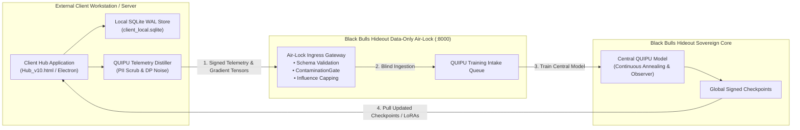
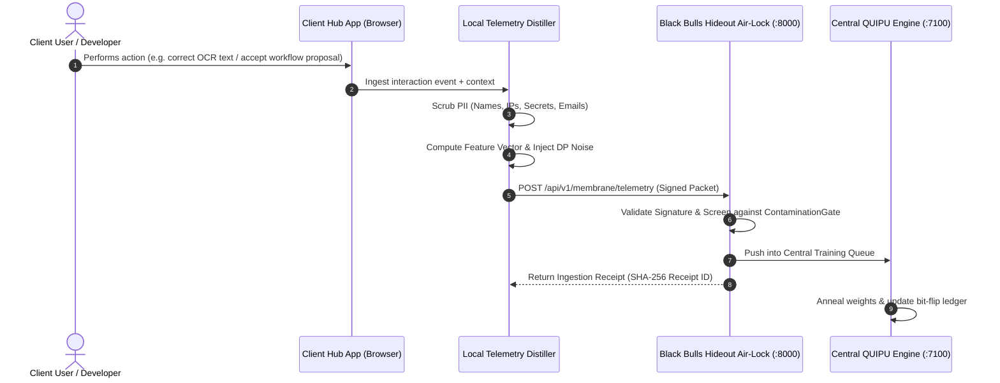

# {{hubName}} Client Hub Application - Standalone Recreation & QUIPU Training Guide

**Status:** Canonical External Developer Specification  
**Version:** 10.1-Client  
**Target Node:** Black Bulls Hideout (Sovereign Central Node)  
**Security Boundary:** Data-Only Air-Lock Membrane (Zero External Compute on Central Node)  

---

## Executive Summary

This document is the standalone implementation blueprint for external organizations, independent developers, and client repositories building and deploying their own **Client Hub Applications** (`Hub_v10.html`, Electron client, or local Web portal).

External Client Hubs run entirely on client-managed infrastructure or local developer workstations. External entities **NEVER** receive terminal/shell access, container execution privileges, or raw database mounts on the central node (**Black Bulls Hideout**). Instead, Client Hubs communicate with Black Bulls Hideout exclusively through a **Data-Only Air-Lock & Blind Training Membrane**, sending anonymized telemetry, feature vectors, and differential gradient tensors that train the central **QUIPU** model while receiving signed model updates and inference results in return.



---

## Part 1 - Sovereign Architecture & Zero-Trust Boundary

### 1.1 Central Node vs. Client Node Separation

| Dimension | Black Bulls Hideout (Central Node) | External Client Hub (This Specification) |
|---|---|---|
| **Role** | Sovereign Authority, Observer & QUIPU Trainer | User Presentation, Local Tasks & Workflow Engine |
| **Compute Execution** | Strictly internal; **Zero external compute allowed** | 100% local on client workstation / browser |
| **Storage & State** | Central WAL SQLite, Parquet Lake, Docker Models | Local `client_local.sqlite`, local configuration |
| **Network Exposure** | Protected behind Data-Only Air-Lock (:8000 / Tunnel) | Outbound HTTPS client connecting to Air-Lock |
| **QUIPU Relationship** | Trains and anneals the global QUIPU weights | Consumes checkpoints; distills training telemetry |

### 1.2 The Zero External Compute Invariant

`CLIENT-SEC-001`: External Client Hubs MUST NOT attempt to execute code, open remote shells, or mount remote filesystems directly on Black Bulls Hideout. Central node ingress is restricted to stateless REST/JSON payloads conforming to published membrane schemas.

---

## Part 2 - Client Application Project Structure & Configuration

### 2.1 Recommended Directory Layout

```text
client_hub/
├── app/
│   ├── index.html                   # Portable, single-file Client Hub UI (Hub_v10.html)
│   ├── js/
│   │   ├── app.js                   # Client runtime logic & Seven Chains controller
│   │   ├── modules_loader.js        # Dynamic client module loader
│   │   └── quipu_telemetry.js       # In-browser interaction telemetry hook
│   └── css/
│       └── theme.css                # Neutral theme styling
├── config/
│   ├── client_workspace.json        # Client workspace and endpoint declarations
│   └── telemetry_consent.json       # User-granted telemetry and training permissions
├── storage/
│   ├── client_local.sqlite          # Local client database (WAL mode)
│   ├── cache/                       # Local cached Parquet / temporary files
│   └── checkpoints/                 # Downloaded QUIPU global model checkpoints
├── quipu_bridge/
│   ├── __init__.py
│   ├── distiller.py                 # Feature extractor & differential privacy engine
│   ├── egress_client.py             # Air-Lock API client (signed uploads)
│   └── ingress_client.py            # Checkpoint pull & inference proxy
└── scripts/
    ├── start_client.py              # Local client launcher script
    └── sync_quipu_model.py          # Scheduled script to fetch latest QUIPU checkpoints
```

---

### 2.2 Client Configuration Schema (`client_workspace.json`)

```json
{
  "$schema": "https://json-schema.org/draft/2020-12/schema",
  "clientVersion": "10.0",
  "clientNodeId": "client-org-alpha-node-01",
  "orgId": "org-client-alpha",
  "repoId": "repo-client-app",
  "centralNode": {
    "airLockUrl": "https://hideout.example.com:8000",
    "tunnelId": "roadd-5wd1nh3",
    "timeoutMs": 15000,
    "authToken": "client-scoped-jwt-token-or-devtunnel-key"
  },
  "localData": {
    "databasePath": "storage/client_local.sqlite",
    "enableWal": true,
    "checkpointDir": "storage/checkpoints"
  },
  "features": {
    "sevenChains": true,
    "localToolForge": true,
    "quipuTrainingBridge": true,
    "offlineMode": false
  },
  "telemetry": {
    "batchSize": 50,
    "flushIntervalSeconds": 60,
    "differentialPrivacyEpsilon": 0.5,
    "scrubPii": true
  }
}
```

---

### 2.3 User Telemetry Consent Schema (`telemetry_consent.json`)

```json
{
  "$schema": "https://json-schema.org/draft/2020-12/schema",
  "userId": "usr-client-developer-01",
  "grantedAt": "2026-08-22T16:00:00Z",
  "grants": {
    "uiInteractionTelemetry": true,
    "ocrCorrectionFeedback": true,
    "metrologyHeuristicFeedback": true,
    "workflowDecisionGraphs": true,
    "quipuFederatedModelTraining": true,
    "voiceAudioRaw": false,
    "screenVideoRaw": false
  }
}
```

---

## Part 3 - The Seven Chains Client UI & Local Module SDK

### 3.1 The Seven Chains Architecture

The Client Hub renders exactly seven modular functional chains in a clean, responsive single-file interface:

1. **Orchestrate:** Workflow coordination, task dispatch, and priority queues.
2. **Plan:** Multi-stage requirement decomposition, roadmaps, and milestones.
3. **Order:** Intake processing, work authorization, and commercial requests.
4. **Source:** Codebase dependencies, repository manifests, and catalog discovery.
5. **Transform:** Code edits, data extraction, document processing, and formatting.
6. **Fulfill:** Testing, packaging, artifact verification, and staging.
7. **Return:** Feedback loops, post-mortems, bug tracking, and error correction.

### 3.2 Client Module Contract

Client modules are standalone JavaScript/TypeScript or Python plugins running in an isolated worker iframe or subprocess:

```javascript
// Example Client Module: module_ocr_viewer.js
class OcrViewerModule {
  constructor(clientContext) {
    this.ctx = clientContext;
    this.chainId = "Transform";
    this.moduleId = "client.transform.ocr_viewer";
  }

  async onInit() {
    console.log("OCR Viewer initialized for chain:", this.chainId);
  }

  async processDocument(fileBlob) {
    // 1. Send inference request to Black Bulls Hideout via Air-Lock
    const result = await this.ctx.airLock.callInference("ocr", fileBlob);
    
    // 2. Render bounding boxes and text in client UI
    this.renderOcrResult(result);
    
    // 3. Queue local telemetry to train QUIPU
    this.ctx.telemetry.recordEvent({
      action: "ocr_scan_completed",
      confidence: result.confidence,
      correctedChars: 0
    });
  }
}
```

---

## Part 4 - The QUIPU Federated Training & Telemetry Bridge

### 4.1 How Client Hubs Train the QUIPU Model

The QUIPU model on Black Bulls Hideout is an observer and continuous-annealing intelligence engine. External Client Hubs improve QUIPU by sending **distilled, privacy-preserved training signals**:



---

### 4.1.1 The served air-lock contract

The routes below are what HubCore actually serves (`services/hubcore/server.py`).
Earlier drafts of this guide named a `/api/v1/membrane/telemetry` endpoint; the
implemented ingress route is `POST /api/v1/ingress`, and a client MUST target it.

Every ingress call is authenticated. A client first mints a scoped token, which
also provisions its allocation space -- no endpoint or model may be invoked
before the space, quota, and schema isolation exist.

| Method | Route | Auth | Purpose |
|---|---|---|---|
| `GET` | `/health` | none | Liveness. No internal detail is returned. |
| `GET` | `/health/ready` | none | Fleet readiness and the loopback binding audit. |
| `GET` | `/.well-known/jwks` | none | RS256 verification key for issued tokens. |
| `POST` | `/api/v1/session` | none | Mint a scoped tenant token; provisions the allocation space. |
| `GET` | `/api/v1/endpoints` | bearer | The endpoint manifest this token may see. |
| `POST` | `/api/v1/ingress` | bearer | Data-only submission into the training intake queue. |
| `GET` | `/api/v1/fleet` | bearer (Reviewer/Admin) | Full fleet status. |
| `POST` | `/api/v1/federation/gradient` | bearer | Submit a differential gradient vector on a declared axis. |

**Minting a session**

```json
POST /api/v1/session
{
  "orgId": "org-client-alpha",
  "repoId": "repo-client-app",
  "userId": "user-01",
  "role": "Requester",
  "capabilities": ["data.read"],
  "ttlSeconds": 900
}
```

The response carries `token`, `expiresAt`, `allocationSpaceId`, and the endpoint
`manifest` the token is scoped to. An organization that is not registered on the
node is refused: onboarding is an Admin decision, not a side effect of a request.

**Submitting data**

```json
POST /api/v1/ingress
Authorization: Bearer <token>
{
  "kind": "heuristic_refinement",
  "orgId": "org-client-alpha",
  "repoId": "repo-client-app",
  "contentHash": "<sha256 of payload>",
  "signatureRef": "<detached signature reference>",
  "payload": { "axis": "vision", "featureVector": [0.124, -0.892], "lossMetric": 0.042 }
}
```

The response is a disposition (`queued` or `duplicate`), the content hash, the
consent tier applied, and the queue depth. Deduplication is by payload content
hash, so a retried submission cannot create a duplicate training signal.

**Refusals are explicit.** A rejected submission returns a policy error naming
the rule it broke -- never an empty success. `401` means the token is missing or
invalid, `403` means policy refused it (wrong tenant, unregistered org, blocked
by the ContaminationGate), `400` means the envelope was malformed.

### 4.1.3 What happens to a submission after it is accepted

An accepted submission is screened, distilled, and queued. HubCore then forwards
the **distillation** onto the central observer's `perception` axis. A client
should understand precisely what does and does not cross:

| Submitted | Reaches the model |
|---|---|
| `featureVector: [0.12, -0.89, 0.44]` | dimension `3`, L2 norm, mean, min, max |
| `axis: "vision"` | the axis hint, as routing context |
| `confidence: 0.82` | the confidence, clamped to `[0, 1]` |
| any other payload field | **nothing** — field values do not survive |
| `orgId`, `repoId` | the partition label only; partitions stay unaddressable across deployments |

`V10-CLI-008`: A client MUST NOT rely on a submitted field value being
recoverable from the central model. Ingress is one-way and lossy by design.
If a client needs the value later, it keeps its own copy in its own store.

Forwarding progress is visible at `GET /api/v1/annealing`: queue depth, cursor,
forwarded count, and the last error if the observer is unreachable. A submission
that has been accepted but not yet forwarded is pending, not lost.

**Consent gates everything.** At consent tier 0 the membrane accepts no artifact
kind, and every submission is refused with a policy error naming the tier. A
client seeing `hubcore.contamination.rejected` with a tier message is not
malfunctioning; the node's data-rights holder has not opened that tier.

### 4.1.2 Browser transport

A Client Hub that runs in a browser is subject to the same-origin policy, and
HubCore is explicit about it rather than leaving it to chance:

- HubCore serves its own Hub application at `GET /`, so a page loaded from the
  authority is same-origin and needs no CORS at all.
- For a page loaded from `file://` (an Electron shell reports the `null` origin)
  or from another loopback port, HubCore answers the `OPTIONS` preflight and
  echoes the request origin -- **only** for loopback hosts and `null`.
- A non-loopback origin receives no `Access-Control-Allow-Origin` header. This is
  deliberate: a wildcard would let any page a user visits drive the sovereign
  authority from their browser. A client served from a real domain must call the
  air-lock server-side, not from the page.

### 4.2 Distilled Telemetry Schema (legacy draft shape)

> The envelope below is the older draft. Wrap it as the `payload` of a
> `POST /api/v1/ingress` call described in §4.1.1; do not post it to
> `/api/v1/membrane/telemetry`, which the node does not serve.

```json
{
  "packetId": "pkt-20260822-00124",
  "clientNodeId": "client-org-alpha-node-01",
  "orgId": "org-client-alpha",
  "repoId": "repo-client-app",
  "timestamp": "2026-08-22T16:30:00Z",
  "consentTokenRef": "consent-ref-usr01-v10",
  "records": [
    {
      "eventType": "heuristic_refinement",
      "axis": "vision",
      "featureVector": [0.124, -0.892, 0.441, 0.012, 0.778],
      "decisionLabel": "accepted_proposal",
      "lossMetric": 0.042,
      "differentialPrivacyEpsilon": 0.5
    },
    {
      "eventType": "metrology_touch_delta",
      "axis": "touch",
      "featureVector": [0.003, 0.451, -0.112, 0.984, 0.000],
      "decisionLabel": "boundary_snapped",
      "lossMetric": 0.011,
      "differentialPrivacyEpsilon": 0.5
    }
  ],
  "clientSignature": "MEUCIQDx...[RS256 Signature over payload]..."
}
```

---

### 4.3 Client Distiller & Egress Implementation (Python Reference)

Create `quipu_bridge/distiller.py`:

```python
import os
import json
import uuid
import datetime
import numpy as np
import requests

class QuipuDistiller:
    def __init__(self, config_path="config/client_workspace.json"):
        with open(config_path, "r") as f:
            self.config = json.load(f)
        self.airlock_url = self.config["centralNode"]["airLockUrl"]
        self.auth_token = self.config["centralNode"]["authToken"]
        self.epsilon = self.config["telemetry"].get("differentialPrivacyEpsilon", 0.5)

    def scrub_pii(self, text: str) -> str:
        """Removes emails, IP addresses, and secret keys."""
        import re
        text = re.sub(r'[\w\.-]+@[\w\.-]+\.\w+', '[REDACTED_EMAIL]', text)
        text = re.sub(r'\b(?:[0-9]{1,3}\.){3}[0-9]{1,3}\b', '[REDACTED_IP]', text)
        text = re.sub(r'(?:ghp_|sk_|bearer\s+)[\w-]{16,}', '[REDACTED_SECRET]', text, flags=re.I)
        return text

    def apply_laplace_noise(self, vector: list, sensitivity: float = 1.0) -> list:
        """Applies Laplace noise for Differential Privacy."""
        scale = sensitivity / self.epsilon
        noise = np.random.laplace(0, scale, len(vector))
        return (np.array(vector) + noise).tolist()

    def send_training_signal(self, axis: str, raw_features: list, label: str, loss: float):
        """Prepares, noises, signs, and sends training telemetry to Hideout Air-Lock."""
        if not self.config["features"].get("quipuTrainingBridge", False):
            return None

        noised_features = self.apply_laplace_noise(raw_features)
        
        payload = {
            "packetId": f"pkt-{uuid.uuid4()}",
            "clientNodeId": self.config["clientNodeId"],
            "orgId": self.config["orgId"],
            "repoId": self.config["repoId"],
            "timestamp": datetime.datetime.utcnow().isoformat() + "Z",
            "records": [
                {
                    "eventType": "distilled_signal",
                    "axis": axis,
                    "featureVector": noised_features,
                    "decisionLabel": label,
                    "lossMetric": loss,
                    "differentialPrivacyEpsilon": self.epsilon
                }
            ]
        }

        headers = {
            "Authorization": f"Bearer {self.auth_token}",
            "Content-Type": "application/json"
        }

        try:
            resp = requests.post(
                f"{self.airlock_url}/api/v1/membrane/telemetry",
                json=payload,
                headers=headers,
                timeout=10
            )
            if resp.status_code == 200:
                print(f"[QUIPU Bridge] Successfully transmitted training packet: {resp.json().get('receiptId')}")
                return resp.json()
            else:
                print(f"[QUIPU Bridge] Ingress rejected ({resp.status_code}): {resp.text}")
        except Exception as e:
            print(f"[QUIPU Bridge] Air-Lock offline or unreachable: {e}")
        return None
```

---

## Part 5 - Local Client Storage & Offline Resilience

### 5.1 Local SQLite Database Schema (`storage/client_local.sqlite`)

The client maintains an embedded SQLite database in WAL mode to guarantee fast, non-blocking local operation even when disconnected from Black Bulls Hideout:

```sql
-- client_local.sqlite schema
PRAGMA journal_mode = WAL;
PRAGMA synchronous = NORMAL;

CREATE TABLE IF NOT EXISTS local_tasks (
    task_id TEXT PRIMARY KEY,
    chain_id TEXT NOT NULL,
    module_id TEXT NOT NULL,
    status TEXT NOT NULL, -- PENDING, EXECUTING, COMPLETED, FAILED
    input_payload TEXT,
    result_payload TEXT,
    created_at TIMESTAMP DEFAULT CURRENT_TIMESTAMP,
    completed_at TIMESTAMP
);

CREATE TABLE IF NOT EXISTS telemetry_queue (
    event_id TEXT PRIMARY KEY,
    axis TEXT NOT NULL,
    feature_json TEXT NOT NULL,
    transmitted INTEGER DEFAULT 0,
    created_at TIMESTAMP DEFAULT CURRENT_TIMESTAMP
);

CREATE TABLE IF NOT EXISTS quipu_checkpoints (
    checkpoint_id TEXT PRIMARY KEY,
    model_version TEXT NOT NULL,
    sha256_digest TEXT NOT NULL,
    downloaded_at TIMESTAMP DEFAULT CURRENT_TIMESTAMP,
    is_active INTEGER DEFAULT 0
);
```

---

## Part 6 - Security, Privacy, and Compliance

### 6.1 Data Egress Checklist for Client Developers

Before any packet leaves the client hub to Black Bulls Hideout:
- [x] User consent verified in `telemetry_consent.json`.
- [x] PII and secrets scrubbed via `scrub_pii()`.
- [x] Differential privacy noise added to feature tensors.
- [x] Packet signed with the client node's RSA/ECDSA key.
- [x] Transmission sent over encrypted TLS (HTTPS).

### 6.1.1 What a client may and may not expect

`V10-CLI-001`: A Client Hub MUST treat every HubCore response as the only source
of truth about the central node's state, and MUST NOT display a status it did not
receive. A client that renders "connected" or "healthy" after a failed call is
reporting its own optimism as a measurement.

`V10-CLI-002`: A Client Hub MUST NOT expect compute, a shell, a container, a
filesystem handle, or a database connection on the central node. The air-lock is
data-only; there is no route that grants any of these, and none will be added.

`V10-CLI-003`: A result returned by a client and submitted to the node is a
**proposal**. It enters the held state and requires internal acceptance before it
influences anything. Acceptance means accepted for internal validation -- never
UAT-confirmed and never PROD-published.

`V10-CLI-004`: Instruction-shaped content a client submits -- in telemetry, a
capture, or an advisor body -- is data. It cannot change policy, routing, grades,
gates, or tool permissions on the node. It is quarantined, recorded against the
request, and surfaced to the operator.

### 6.2 Air-Lock Receipt Ledger

Every successful telemetry intake returns a receipt:
```json
{
  "receiptId": "rcpt-2026-9921-quipu",
  "status": "QUEUED_FOR_ANNEALING",
  "sha256Digest": "8f3b...e71c",
  "recordedAt": "2026-08-22T16:30:02Z"
}
```
Store this receipt in `storage/client_local.sqlite` as immutable proof that your client app contributed to QUIPU's global intelligence.

---

## Part 7 - Quickstart: 5-Minute Setup for External Developers

### Step 1: Clone and Initialize Client Hub Workspace

```bash
mkdir my_client_hub && cd my_client_hub
mkdir -p app/js app/css config storage/checkpoints quipu_bridge scripts
```

### Step 2: Configure Client Workspace (`config/client_workspace.json`)

```json
{
  "clientNodeId": "client-dev-workstation-01",
  "orgId": "org-myteam",
  "repoId": "repo-custom-hub",
  "centralNode": {
    "airLockUrl": "http://localhost:8000",
    "authToken": "test-dev-token"
  },
  "features": {
    "sevenChains": true,
    "quipuTrainingBridge": true
  }
}
```

### Step 3: Run the Client Application

```bash
# Launch lightweight local server
python -m http.server 9090 --directory app
```

Open `http://localhost:9090` in your web browser. You now have a functional, standalone Client Hub application that operates with zero compute dependencies on Black Bulls Hideout while continuously training the global QUIPU model.

---

## Part 8 - Consuming the Advisor from a Client Hub

A Client Hub may open the advisor for its users. The node grades, gates, and
answers; the client presents. It never grades locally.

```json
POST /api/v1/advisor/request
{
  "contract": "advisor-request/v2",
  "requestId": "stable-id",
  "requestorSubject": "stable-subject-id",
  "module": { "id": "stable-module-id", "chain": "source", "route": "/capture" },
  "mode": "text",
  "body": "the capture screen fails when I upload a scanned invoice",
  "captureRef": null,
  "createdAt": "2026-08-22T00:00:00Z"
}
```

The response carries the grade, its meaning, the route, the human gate, the
request state, the answer, and the citations behind it. A client MUST render all
of these together:

| Field | Meaning for the user |
|---|---|
| `grade`, `gradeMeaning` | How the node classified the request (Part 9.2) |
| `route` | What happens next |
| `state` | `READY_TO_SEND`, or which human it is waiting on |
| `citations[]` | Source, section, confidence, and snippet actually retrieved |
| `escalated`, `escalationReason` | The grader declined to assert a grade |
| `quarantined[]` | Instruction-shaped text that was ignored |
| `disclosure` | The synthetic-assistant disclosure, when one applies |

`V10-CLI-005`: A client MUST NOT present an advisor answer whose `state` is not
`READY_TO_SEND` as a delivered answer. A request awaiting a reviewer or an Admin
is exactly that, and saying otherwise tells the user a human approved something
nobody has looked at.

`V10-CLI-006`: A client MUST NOT synthesize an answer when the call fails. The
advisor either answered or it did not; a local fallback that reads like an answer
is indistinguishable from one.

`V10-CLI-007`: Where a synthetic assistant contributed, the client MUST show its
disclosure. The synthetic assistant is never presented as the human administrator
and never as the author of a decision.

Follow-ups are posted to `POST /api/v1/advisor/followup` and classified by the
node into `satisfied`, `dissatisfied`, `needs_follow_up`, `depth_change`, or
`meeting_request`. Closure is `POST /api/v1/advisor/close` and always carries a
reason; a grade-5 request cannot be closed without a recorded Admin decision.

---

## Part 9 - The Marketplace from a Client Hub

The GARD marketplace serves two catalogs, and they are not two views of one
thing. They are separated by a tenancy boundary.

| Scope | Route | Auth | What a client sees |
|---|---|---|---|
| `shared` | `GET /api/v1/marketplace/catalog` | none | The public cross-application catalog |
| `hub` | `GET /api/v1/marketplace/catalog?scope=hub` | **bearer** | One organization's internal supply-chain shards |
| `hub` | `GET /api/v1/marketplace/hub/catalog` | **bearer** | The same, by a dedicated route |
| `hub` | `GET /api/v1/marketplace/hub/stats` | **bearer** | Aggregate counts for that organization |
| `hub` | `POST /api/v1/marketplace/hub/tokenize` | **bearer** | Mint a supply-chain shard |
| `hub` | `POST /api/v1/marketplace/hub/transfer` | **bearer** | Zero-royalty internal allocation |
| `hub` | `POST /api/v1/marketplace/hub/sync` | **bearer** | Reconcile a child hub's local manifest |

`V10-CLI-009`: A client MUST NOT expect to choose its own organization. On every
`hub`-scoped call the organization is taken from the presented token. Supplying a
different `org_id` is refused with `403`, and omitting it means "my own", never
"all of them".

`V10-CLI-010`: A client MUST NOT invent a scope. `scope` accepts exactly `shared`
or `hub`; anything else is refused with `400`. There is no `all`, and a client
that wants both makes two calls with two different authorizations.

`V10-CLI-011`: An internal shard transfer is an **allocation**, not a trade. It
carries no royalty and moves nothing outside the organization. A client MUST NOT
present it to a user as a purchase.

Expected refusals, and what each one means:

| Status | Meaning |
|---|---|
| `400` | The scope is not `shared` or `hub` |
| `401` | A `hub`-scoped route was called without a bearer token |
| `403` | The token is scoped to a different organization than the one requested |
| `503` | The marketplace engine did not initialise; the body names the reason |

---

## Part 10 - What the Marketplace Stores, and Where

A client does not talk to the store. It talks to the air-lock, which
authenticates it and forwards. The store (`gard-marketplace`) is reachable only
on the node's internal bridge and is never published to a host or a network.

Data lands in one of three places, and a client should know which:

| What a client submits | Where it lives | What a client can read back |
|---|---|---|
| Asset registration, shard balances, ownership | SQLite WAL, current state | Always current, via the catalog routes |
| Royalty events, hub sync records, envelope metadata | Hive-partitioned Parquet, append-only | Via the stats and royalty routes; queryable analytically |
| GARD envelope payload bytes | Content-addressed blob store | By digest only; the row carries the digest, not the bytes |

`V10-CLI-012`: A client MUST NOT expect a payload to be recoverable from a
catalog row. Envelope rows carry `envelope_blob` -- a SHA-256 digest -- and the
bytes are fetched separately. A row is metadata; it is not the artifact.

`V10-CLI-013`: A client MUST treat `503 hubcore.marketplace.unavailable` as
"unknown", never as "empty". The air-lock does not keep a copy of the catalog to
fall back on, precisely so a client cannot mistake a stale listing for a live
one. Retry; do not render an empty marketplace.

`V10-CLI-014`: An append-only record is readable as soon as it is accepted. A
client does not need to wait for compaction, and MUST NOT implement a retry loop
that assumes it does.

---

## Part 11 - Complete Client Route Reference

Everything a Client Hub can call, with what it must present. `bearer` means a
token from `POST /api/v1/session`; `bearer + org` additionally confines the call
to the organization that token was minted for.

| Method | Route | Auth | Notes |
|---|---|---|---|
| GET | `/health`, `/health/ready` | none | Liveness; fleet readiness |
| GET | `/.well-known/jwks` | none | Verification key for issued tokens |
| POST | `/api/v1/session` | none | Mint a scoped token; provisions the allocation space |
| GET | `/api/v1/endpoints` | bearer | The manifest this token may see |
| POST | `/api/v1/ingress` | bearer | Data-only submission (§4.1.1) |
| POST | `/api/v1/federation/gradient` | bearer | Differential gradient on a declared axis |
| GET | `/api/v1/annealing` | none | Whether your submission has been forwarded yet |
| POST | `/api/v1/advisor/request` | none* | Open the advisor (Part 8) |
| POST | `/api/v1/support/ticket` | none* | Support-message ingress; grades through the advisor |
| GET | `/api/v1/marketplace/catalog` | none for `shared` | Public cross-application catalog |
| GET | `/api/v1/marketplace/catalog?scope=hub` | bearer + org | Your organization only |
| GET | `/api/v1/marketplace/hub/catalog`, `/hub/stats` | bearer + org | Your organization only |
| POST | `/api/v1/marketplace/hub/tokenize`, `/hub/transfer`, `/hub/sync` | bearer + org | Your organization only |
| GET | `/api/v1/marketplace/routing` | none | Which applications each scope reaches |
| POST | `/api/v1/hubs/children/register` | none* | Attach a child hub |
| POST | `/api/v1/hubs/children/proposals` | none* | Submit a held proposal |
| GET | `/api/v1/hubs/children/tasks?childHubId=` | none* | Tasks available to your hub |
| POST | `/api/v1/spatial/stockopoly-slot` | bearer | Bridge Stockopoly (:8181) bin coordinates with SAP storage location GET metadata |
| GET | `/api/v1/bus/status` | bearer | Inspect hybrid outbox relay cursor and durable bus status |
| POST | `/api/v1/bus/relay` | bearer (`WorkerOperator`) | Push durable outbox batches from `HolonHubLive` into `HubCore` bus and annealing queue |
| GET | `/api/v1/directives` | bearer | Query open and auto-closed efferent operator directives |
| POST | `/api/v1/directives/feedback` | bearer (`WorkerOperator`) | Record acknowledgment or closure feedback on efferent directives |
| POST | `/api/v1/dataplane/watermark` | bearer (`Reviewer`) | Trigger watermarked Parquet analytical snapshot export |

**\* As of v0.28.0 these routes require a token.** Every route above except
liveness, readiness, JWKS, session minting, the shared marketplace catalog, and
the scope routing table needs one.

`V10-CLI-015`: A client MUST mint a scoped token and send it on every governed
route. A `Requester` token is self-service -- `POST /api/v1/session` with no
special credential -- and carries a subject, a tenancy, and an expiry.

`V10-CLI-017`: A client MUST NOT expect to obtain `Reviewer` or `Admin`. Those
require the operator credential the node was started with, presented in the
`X-HubCore-Operator` header at mint time. A client cannot grant itself reviewer
or administrator authority, and a client that needs a reviewer decision requests
one from a human rather than assuming a role.

`V10-CLI-018`: A client MUST handle `401` by minting a fresh token and retrying
once, and MUST NOT loop on a dead credential. Tokens expire; the default lifetime
is 900 seconds.

### Support ticket ingress

```json
POST /api/v1/support/ticket
{
  "from": "customer@example.invalid",
  "subject": "Scan rejected on upload",
  "body": "The capture screen returns an error for this invoice.",
  "messageId": "<upstream-id@example.invalid>"
}
```

The reply is a standard advisor response -- grade, route, gate, state, citations
-- plus `adminEscalated` and `vadminTracking`. The same rules apply as in Part 8:
a response whose `state` is not `READY_TO_SEND` has not been approved by anyone,
and a client MUST NOT present it to the customer as an answer.

`V10-CLI-016`: A client MUST NOT set `from` to an address it has not verified.
Since v0.28.0 the governed record is attributed to the authenticated caller
rather than to `from`, so the field is metadata about the correspondent -- but a
client bridging inbound mail is accountable for everything it submits under its
own token.

---

## Part 12 - Obtaining and Using a Token

```json
POST /api/v1/session
{
  "orgId": "org-client-alpha",
  "repoId": "repo-client-app",
  "userId": "user-01",
  "role": "Requester",
  "ttlSeconds": 900
}
```

The response carries `token`, `expiresAt`, `allocationSpaceId`, and the endpoint
`manifest` the token is scoped to. Send it as `Authorization: Bearer <token>` on
every governed route.

| Situation | What the node returns | What a client should do |
|---|---|---|
| No token on a governed route | `401` | Mint one and retry |
| Expired token | `401` | Mint a fresh one and retry **once** |
| Token below the route's role | `403` | Do not retry. This is not a transient failure. |
| Token scoped to another organization | `403` | Do not retry. Tenancy is not negotiable. |
| Requested `Reviewer`/`Admin` without the operator credential | `401` | Do not retry. Ask a human. |

`V10-CLI-019`: A client MUST NOT treat `403` as retryable. `401` means "you have
no valid credential"; `403` means "your credential is valid and does not permit
this". Retrying the second is a loop that will never succeed and will fill the
node's audit trail with refusals.

---

## Part 13 - HolonHubLive (:8900) Supply Chain & Physical Marketplace Interactions

Client Hubs integrating with the `x_OSQ` / `x_CRM` live execution tier (`HolonHubLive` on `:8900`) follow four architectural invariants added in `v0.29.0`:

1. **Physical-Only Inventory & Dijkstra Routing (`GET /api/v1/osq/marketplace/inventory`):** Client Hubs MUST NOT request virtual warehouses (`includeVirtual=true` returns `HTTP 400`). Available inventory across physical DCs is pulled via Direct SAP API time-phased QOH (`/api/v1/osq/inventory/time-phased`, with Snowflake limited strictly to `analytical-export-only`) and scored with Weighted Greedy Dijkstra plus consolidation differential.
2. **Order & Replenishment Guardrails (`POST /api/v1/osq/mutate`):** Supports SHA-256 tokenized split-quote shards (`quote.split_allocate`), modular BOM flattening (`bom.flatten_modular`), same-day duplicate STO blocking (`sto.schedule` -> `HTTP 409` on matching `(orderId, stoCode, rdd)`), in-app credit-hold RDD adjustment (`order.credit_hold_rdd_adjust`), IFR Auto-PO (`/api/v1/osq/ifr/auto-po`), and Cancel-to-PO-Reduction Receiving Quarantine (`/api/v1/osq/ifr/cancel-reconcile`).
3. **Rust RFID Nodal Map, `IS`/`CS` Chat & Printable Kanban (`GET /api/v1/osq/logistics/nodal-map`, `POST /api/v1/osq/rfid/event`):** Tracks `IS-*` (dashed internal STO) and `CS-*` (solid customer) shipments under `rust-rfid-open-tracker/v1`, updates Dijkstra edge EMA weights on receipt scans, and binds per-shipment chat channels.
4. **QUIPU, Stockopoly & Bounded SAP Signals:** Client Hubs may invoke `/api/v1/osq/quipu/classify-note`, `/api/v1/spatial/stockopoly-slot` (HubCore) or `/api/v1/osq/stockopoly/slot-lookup`, and `/api/v1/osq/sap/signal`; `RAW_INVENTORY_ADJUST` is unconditionally rejected with `HTTP 403`.
5. **Dual-Speed Cyber-Physical Pathways, Hybrid Outbox & M365 Tiering (`v0.30.0` / `x_OSQ v2.5.0`):**
   - `GET /api/v1/osq/outbox?sinceCursor=` feeds `HubCore` hybrid catch-up (`GET /api/v1/bus/status`, `POST /api/v1/bus/relay`) while async push relays committed events automatically when `HUBCORE_RELAY_URL` is configured.
   - `GET /api/v1/osq/pathways` and `GET /api/v1/osq/directives` (plus `GET /api/v1/directives` on HubCore) expose the four pathway lanes (`REFLEXIVE_FAST_PATH`, `GOVERNED_OWNER_PATH`, `ANALYTICAL_EXPORT_PATH`, `M365_ESCALATION_PATH`) and split human escalations into `IMMEDIATE_CARD` (`priority >= 0.85`), `SHIFT_DIGEST` (`0.65 <= priority < 0.85`), and `LOG_ONLY` (`< 0.65`).
   - Physical `RECEIPT_SCAN` (`POST /api/v1/osq/rfid/event`) and `PICK_COMPLETE_KNOCKOFF` (`POST /api/v1/osq/sap/signal`) events automatically close matching open directives as `CLOSED_PHYSICAL_CONFIRMED`, while `POST /api/v1/osq/directives/feedback` (`POST /api/v1/directives/feedback` on HubCore) records explicit operator acknowledgment or manual closure.
