# Osq Holon – Architecture and Registration

Version: **2.4.0** (`HolonHubLive` Sovereign Node A Air-Lock, TX03/TX77 Multi-Hub Dijkstra Physical Inventory Marketplace, Direct API Time-Phased QOH, IFR Auto-PO & Receiving Quarantine, Rust RFID Telemetry, QUIPU Note Classifier & SAP Signal Bridge)
Holon id: `x_osq` | Home Node: `node-a-osq-home` | Hub: HubCore kernel `x_hubcore` (`:8000`) | Manifest: `osq/holon.json`

## Diagram

```mermaid
flowchart TB
  subgraph N2["2. Node A: OSQ home node"]
    subgraph GM["GARD Marketplace and external fulfillment"]
      MTG["Marketplace trust gate<br/>Verify publisher, scope, audience, signature, expiry, revocation and replay ID;<br/>Verify bytes against signed digest before use"]
      GMKT["GARD Marketplace :8600<br/>gard-shard/v2<br/>Internal and shared artifacts"]
      RCON["Registered connector / ERP adapter<br/>Separate read and mutation grants;<br/>Provider idempotency or reconcile before retry"]
      EAPI["External APIs, ERP, SFTP or object stores"]
      MTG -->|"Accept verified artifact only"| GMKT
      RCON -->|"Read or idempotent mutation where supported"| EAPI
    end

    subgraph HC8["HubCore :8000"]
      POL["Deployment-owner policy<br/>Capability grants, approval rules, trust roots;<br/>Secret references only"]
      AIR["Air-Lock<br/>Authenticate and authorize; Validate schema, size and scope; rate-limit;<br/>Check active registration, approvals and Emergency Brake"]
      HCSQL[("HubCore SQLite<br/>Durable task acceptance; idempotency key -> request hash + task ID;<br/>Peer inbox, outbox and replay cursors")]
      TREA["Task, Result, Event, Artifact<br/>Distinct object IDs; shared correlation_id;<br/>causation_id for trigger; task_id for linkage"]
      CAP["Capability discovery and task routing<br/>Resolve home node; Require active lease;<br/>Recheck policy, lease and Emergency Brake before dispatch"]
      AUD[("Restricted audit trail<br/>Identity, policy version, allow or deny, reason;<br/>Correlation references; no secrets")]
      HLD["Hold or reject<br/>No dispatch when authorization is denied, required evidence is unavailable, or no owner is reachable"]

      POL --> AIR
      AIR -->|"Durably accept or recover existing task"| HCSQL
      HCSQL -->|"Accepted task with object receipts"| CAP
      AIR -->|"Allow or deny evidence"| AUD
      CAP -->|"Missing grant, active route or approval"| HLD
      CAP -->|"Allow or deny evidence"| AUD
    end

    subgraph OSQAUTH["x_OSQ authoritative domain service"]
      OSQSVC["x_OSQ authoritative domain service<br/>Accounts, items, opportunities, budgets, quotes, floorplans,<br/>forecasts, orders, quotes and PM handoff"]
      OVAL["Owner-side validation inside the write transaction<br/>CPQ rules, expected version and execution lease;<br/>For lease-protected writes: current lease + fencing token"]
      AUTHDB[("OSQ SQLite: authoritative owner state<br/>Atomic commit: business update + command outcome + outbox;<br/>No peer or browser writes")]
      EPHDB[("OSQ SQLite: separate ephemeral state<br/>Presence, shared drafts, what-if scratch, live chat;<br/>TTL cleanup; no business-state changes")]
      LBUS["Local event bus<br/>Publish committed outbox events;<br/>Authorized SSE delivery and downstream subscriptions"]

      OSQSVC -->|"Authorized temporary update only"| EPHDB
      OVAL -->|"Checks pass: commit once"| AUTHDB
      AUTHDB -->|"Permitted collaboration updates / Reconnectable committed outbox"| LBUS
      EPHDB -->|"Permitted collaboration updates"| LBUS
    end

    subgraph INTEL["Intelligence and historical data"]
      PARQ[("Immutable Parquet snapshots<br/>Committed watermark, schema and content hash")]
      DUCK["DuckDB<br/>Read-only forecast, funnel and margin queries"]
      QUIPU["QUIPU :7100<br/>Intelligence and scoped governance evaluation;<br/>Over-forecast cap, SKU replacement, lead-time simulation;<br/>Allow, hold or escalate; delegate action intent"]
      MGW["x_ModelGateway<br/>Registered local or remote model providers"]
      PSTD["Process Studio<br/>Registered workflow orchestration"]

      PARQ -->|"Read-only evidence"| DUCK
      DUCK -->|"Read-only evidence"| QUIPU
    end

    OSQHTTP["HolonHubLive HTTP + SSE :8900<br/>Start-HolonHubLive.ps1<br/>POST /api/v1/osq/mutate, POST /api/v1/osq/temp, GET /api/v1/osq/stream"]

    subgraph REG["Registration & Lifecycle"]
      OPSR["Operations and recovery<br/>Health, trace, audit, queue depth, replay diagnostics;<br/>Withdraw unhealthy routes; replay from durable state"]
      SMAN["Signed JSON manifests<br/>Holon and instance identity, semantic version, capabilities, events,<br/>interfaces, dependencies, requested grants, health endpoint and artifact hash"]
      REGAPI["HubCore registration API<br/>REGISTER, RENEW, REVOKE"]
      VREG["Verify identity, signature, schema and digest<br/>Check dependencies and protocol versions;<br/>Resolve/check grants and probe readiness"]
      PEND["PENDING or REJECTED with reason<br/>No routable capability"]
      ACTREG["ACTIVE registration<br/>Return registration ID, granted scopes and lease expiry"]
      EXPREG["Expired, revoked or unhealthy registration<br/>Withdraw route; block new dispatch and advertise withdrawal"]

      OPSR -->|"Remove capability route"| REGAPI
      SMAN --> REGAPI
      REGAPI -->|"Renew before expiry; recheck grants and health"| VREG
      VREG -->|"Not ready, invalid or denied"| PEND
      VREG -->|"Valid, granted and ready"| ACTREG
      ACTREG -->|"Lease expiry, revocation or failed health check"| EXPREG
    end

    MGA["MESH gateway A<br/>Mutual TLS and scoped message exchange;<br/>Bind peer identity to accepted route"]

    HC8 <-->|"Authorized fulfillment task / Known result or unknown outcome hold"| RCON
    HC8 <-->|"Authorize artifact exchange separately from fulfillment / Signed descriptor or fulfillment request"| MTG
    HC8 -->|"Authorized local business task"| OSQSVC
    OSQSVC -->|"State version, invalid fence or domain rejection"| HC8
    AUTHDB -->|"Export at a committed watermark"| PARQ
    HC8 <-->|"Policy version, evidence, expiry and action intent / Route evaluation task or return execution result"| QUIPU
    HC8 <-->|"Request permitted model capability / Authorized model task"| MGW
    HC8 <-->|"Authorized workflow task / Submit next step as a task"| PSTD
    OSQHTTP <-->|"Commands, temporary updates and authorized reads / Same key and hash returns existing task / Same key with different hash returns conflict"| HC8
    LBUS -->|"Reconnectable committed outbox"| OSQHTTP
    HC8 -->|"No route, invalid or denied"| PEND
    HC8 <-->|"Persist registration and capability routes / Reauthorize inbound peer message / Forward scoped remote task or event"| MGA
    ACTREG -->|"Advertise permitted capabilities only"| MGA
    EXPREG -->|"Withdraw peer advertisement"| MGA
    AUTHDB -->|"Authorized snapshot pull if replay history is unavailable; verify digest and resume from watermark"| MGA
  end

  subgraph N3["3. Node B: federated peer"]
    PU["Peer users and offline queue"]
    MGB["MESH gateway B<br/>Authenticate peer; validate advertisements;<br/>Reauthorize inbound; route outbound"]
    HCB["HubCore B Air-Lock and capability registry<br/>Enforce independent local grants;<br/>Forward Node A-owned writes; never commit them locally"]
    RLOC["Registered local Holons and workers<br/>Local tasks and results"]
    HNA["Home node unavailable<br/>Keep remote write pending; Never self-promote to owner"]
    NBDB[("Node B SQLite<br/>Own aggregate state and permitted projections;<br/>Durable peer inbox, outbox and cursors;<br/>Persist before ACK; dedupe on replay")]

    PU <-->|"Authenticated POST and SSE"| HCB
    MGB <--> HCB
    HCB -->|"Local tasks and results"| RLOC
    HCB -->|"Node A unreachable"| HNA
    HCB -->|"Commit only owned state"| NBDB
    MGB -->|"Persist before ACK; dedupe on replay"| NBDB
  end

  subgraph N1["1. User experience and cross-device access"]
    P1["Pricing and RP Ops Planner<br/>x_OSQ.html at /<br/>Escalations, Emergency Brake, 26-week buckets"]
    P2["Customer ROF Portal<br/>x_CRM.html at /crm<br/>Funnel, budget, ROF, staged orders"]
    P3["FAR / RSR / NAM Seller<br/>8-stage funnel, LiDAR, MOG, CPQ margin"]
    P4["Hub Admin<br/>Connectors, changes, manifests"]
    BCLI["x_Hub / x_Floor browser clients"]
    BC["BroadcastChannel: x_holonhub_live_v2<br/>Same-device UI and persona hints only"]
    DLOC["Device-local drafts and pending commands<br/>Not committed state"]

    P1 & P2 & P3 & P4 --> BCLI
    BCLI <-->|"Local tab updates only"| BC
    BCLI <-->|"Queue while offline"| DLOC
  end

  MGA <-->|"HELLO and ACK: identity and protocol version / ADVERTISE and ACK: scoped Holons, capabilities, models, dataset descriptors and lease / Tasks, Results, Events and Artifact descriptors: sequential delivery, durable ACK and replay"| MGB
  BCLI -->|"HTTPS POST: idempotency key and expected version"| OSQHTTP
  DLOC -.->|"Reconnect: replay original command key"| OSQHTTP
  OSQHTTP -->|"Async 202 after durable acceptance: return task ID / Task status, SSE updates or snapshot plus cursor"| BCLI
```

## Planes & Invariants

### 1. User experience and cross-device access
| Component | Surface / Protocol | Contract |
|---|---|---|
| Four Personas (`Pricing & RP Ops Planner`, `Customer ROF Portal`, `FAR / RSR / NAM Seller`, `Hub Admin`) | `x_OSQ.html` (`/`), `x_CRM.html` (`/crm`), `/suite` | Multi-user persona cockpit backed by `:8900`. |
| `BroadcastChannel('x_holonhub_live_v2')` | Browser same-device tabs | **Local UI and persona hints only** (`tab`, `persona`, `focusedEntity`); never broadcasts or overwrites authoritative business state `R`. |
| `Device-local drafts & pending commands` | Browser `localStorage` queue | Queues uncommitted commands offline with their original `idempotencyKey` and `expectedRevision`; replays with the original key upon reconnect. |
| Transport to `:8900` (`HolonHubLive`) | `POST /api/v1/osq/mutate`, `GET /api/v1/osq/tasks`, `GET /api/v1/osq/stream?sinceCursor=` | Sends `idempotencyKey` and `expectedRevision` / `fencingToken`; supports `async: true` (`HTTP 202` durable acceptance with `taskId`) and cursor-based SSE/snapshot replay. |

### 2. Node A: OSQ home node (`HolonHubLive` v2.4.0)
| Subsystem | Port / Store | Contract & Security Guarantees |
|---|---|---|
| **HubCore Air-Lock & Policy** | `:8000` / `/api/v1/hubcore/*` | Enforces deployment-owner policy, secret-references-only (`ENV:*`, `VAULT:*`, `SECRETREF:*`, `NONE`), payload size limits, active registration check, Emergency Brake check, and idempotency mapping (`idempotencyKey -> requestHash + taskId`; mismatch returns `HTTP 409`). |
| **Canonical Objects** | `Task`, `Result`, `Event`, `Artifact` | Distinct object IDs (`taskId`, `resultId`, `eventId`, `artifactId`), shared `correlation_id`, `causation_id` for trigger, and `task_id` for linkage. |
| **Owner-Side Write Validation** | `osq_authoritative.sqlite` + `osq_relational_store.json` | Validates CPQ rules (`CPQ-1..70`), `expectedRevision` (`HTTP 409` on mismatch), lease `fencingToken`, Same-Day Duplicate STO `409` Guard (`orderId`+`stoCode`+`rdd`), and `RAW_INVENTORY_ADJUST` block (`HTTP 403`), committing business update + command outcome + durable outbox event atomically. |
| **Separate Ephemeral Tier** | `osq_ephemeral.sqlite` + `holonhub_live_temp.json` | Stores active sessions (45s TTL), entity soft locks (120s TTL with monotonic `fencingToken`), shared drafts, what-if scratch, `PI-16` quote/`IS-*`/`CS-*` shipment chat, and Rust RFID telemetry — isolated from business state. |
| **TX03/TX77 Unified Physical Marketplace & Guardrails** | `/api/v1/osq/inventory/time-phased`, `/api/v1/osq/marketplace/inventory`, `/api/v1/osq/ifr/*`, `/api/v1/osq/rfid/*`, `/api/v1/osq/logistics/nodal-map` | Direct SAP API time-phased QOH (Snowflake analytical-export-only), prohibits virtual warehouses (`HTTP 400`), Weighted Greedy Dijkstra + consolidation differential, `2σ@10d`/`3σ@6d`/CTO guardrails, IFR Auto-PO & Cancel-to-PO-Reduction Receiving Quarantine, `rust-rfid-open-tracker/v1` EMA edge weights, QUIPU note classifier, Stockopoly bin coordinate bridge, and bounded SAP signals. |
| **Marketplace Trust Gate & Connectors** | `:8600` / `/api/v1/osq/marketplace/verify` | Verifies publisher, scope, audience, signature, expiry, revocation, `replayId` (deduped -> `HTTP 409`), and `sha256` byte digest (`HTTP 400` on mismatch). Separates `gard.artifact.exchange` from `connector.fulfillment.execute` and tracks `KNOWN_RESULT` vs `UNKNOWN_OUTCOME_HOLD`. |
| **Intelligence & Historical Data** | `:7100` / DuckDB / Parquet / `x_ModelGateway` / `Process Studio` | Exports immutable watermarked snapshots (`watermarkRevision`, `contentHash`); serves read-only DuckDB/analytical projections; QUIPU emits scoped governance intent (`ALLOW`/`HOLD`/`ESCALATE`) back through Air-Lock. |
| **Registration Lifecycle & Operations** | `/api/v1/hubcore/register`, `renew`, `revoke` | Verifies signed JSON manifest & readiness (`PENDING`/`REJECTED` vs `ACTIVE` with lease expiry); revocation/expiry/health failure withdraws routes and advertises withdrawal on `MESH gateway A`. |

### 3. Node B: Federated peer & MESH
| Endpoint | Protocol | Invariant |
|---|---|---|
| `/api/v1/mesh/hello`, `/api/v1/mesh/advertise` | `HELLO`, `ADVERTISE` | Mutual identity binding and lease-scoped advertisement of `ACTIVE` permitted capabilities only. |
| `/api/v1/mesh/exchange`, `/api/v1/mesh/snapshot-pull` | Sequential delivery + watermark pull | Persists inbound `Tasks`/`Results`/`Events`/`Artifacts` into durable `peerInbox` before `ACK`; supports digest-verified watermark snapshot catch-up. |
| `/api/v1/mesh/peer-write` | Federated write routing | Node B enforces local grants, commits only Node B-owned state, and **never self-promotes to owner** when Node A is unreachable (returns `HTTP 202` `PENDING_HOME_NODE`). |

## Registration
- Manifest: `osq/holon.json` (holon id `x_osq`, version `2.3.0`, entrypoint `holon/x_osq.py`, skill folder `skills/x-osq`).
- Registry: `hubcore/holons/registry.json`, one entry per `holon_id`, maintained by `osq/holon/Register-HolonHub.ps1`.
- Re-run `Register-HolonHub.ps1` after any manifest change to refresh `updatedAtUtc`.

## Change log
- **2.4.0** – Renamed legacy live runtime to `HolonHubLive` (`Start-HolonHubLive.ps1`, `holonhub_live_temp.json`, `x_holonhub_live_v2`, `CON-HOLONHUB-LIVE-8900`) and incorporated TX03/TX77 Kitting architecture: Direct SAP API time-phased QOH (Snowflake analytics-only), Unified Physical Inventory Marketplace (virtual warehouses prohibited + Weighted Greedy Dijkstra), tokenized split-location quotes, consolidation cost differential, `2σ@10d`/`3σ@6d`/5-day expedite + CTO stockout guardrails, IFR Auto-PO & Cancel-to-PO-Reduction Receiving Quarantine, Modular BOM flattening, Same-Day Duplicate STO `409` guard, in-app credit-hold RDD adjustment, open-source Rust RFID `IS`/`CS` telemetry + nodal map + printable Kanban, QUIPU handwritten note classification, Stockopoly bin coordinate bridge, and bounded SAP signal bridge (`RAW_INVENTORY_ADJUST` blocked `403`).
- **2.3.0** – Updated architecture diagram and runtime to Sovereign Node A Air-Lock, idempotency + expected-version/fencing validation, separated authoritative/ephemeral SQLite + durable outbox, GARD Trust Gate, registration lease lifecycle, local-only BroadcastChannel + offline replay queue, and Node B federated MESH non-self-promoting invariants.
- **2.2.1** – Added architecture document; bumped holon manifest and registry entry to 2.2.1.
- **2.2.0** – Live network (SSE + BroadcastChannel), two-tier data model, QUIPU worker, GARD shard sync.
